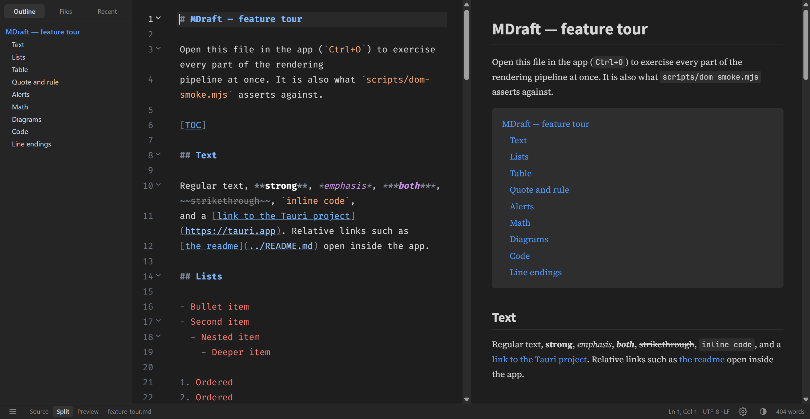
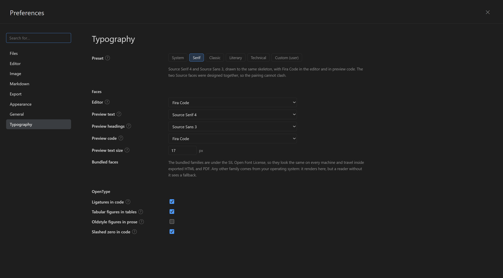

# MDraft

A small, fast editor for **Markdown and Typst**, in the spirit of [Typora](https://typora.io).

Live preview as you type, mathematics, diagrams, an outline sidebar, a native
menu, and PDFs typeset by [Typst](https://typst.app) — in an 11 MB download that
starts instantly, because there is no browser inside it.





## Why this exists

Typora is pleasant because of its *shape*: one pane that shows you the document
while you write it, not a source window with a preview bolted on. MDraft keeps
that shape and rebuilds it on a current, small runtime — the operating system's
own webview instead of a bundled Chromium, and Rust instead of a Node backend.

| Concern | Typora | MDraft |
| --- | --- | --- |
| Shell | Electron | Tauri 2.12 |
| Renderer engine | bundled Chromium | the OS's own webview |
| Backend | Node.js | Rust 1.91, compiled |
| Executable size | ~227 MB | 11 MB |
| Editor | a `contenteditable` surface | CodeMirror 6 |
| Math | MathJax | KaTeX 0.19, bundled |
| Diagrams | Mermaid | Mermaid 12.2 |
| Typst | — | compiler-driven preview and PDF |
| Licensing | paid, per seat | none, ever |

The size is the point of the stack, not a coincidence: there is no browser and no
JavaScript runtime to ship. About 2.3 MB of it is four typefaces compiled in, so
the typography does not depend on what the machine happens to have installed.

## Getting it

Download the installer for your platform from
[**Releases**](https://github.com/bgeneto/MDraft/releases). Windows gets an
`.msi`, a `-setup.exe`, and a **portable** build that is a single `.exe` — put it
in any folder, including one inside Dropbox or Nextcloud, and its settings are
written beside it. Linux gets a `.deb`, an AppImage and a plain binary.

PDF export needs [Typst](https://typst.app/open-source/#download), a single
executable with no dependencies. *Help › Install Typst* fetches and verifies it
for you; nothing is installed system-wide and no administrator rights are needed.

## What it does

- **Open / save / save as** with native dialogs, drag and drop onto the window,

  and `mdraft notes.md` on the command line.
- **Image paste, drop and download.** Paste a screenshot straight into either
  pane, paste an image URL, paste a path, or drop image files on the window.
  Where the bytes land is governed by Preferences › Image: a per-document
  `./name.assets` folder, a shared `./assets` folder, a custom folder, or keeping
  the original location. Filenames are sanitised, an existing file is never
  overwritten, and the bytes are content-sniffed rather than trusted.
- **Export** to HTML and PDF with nothing installed, and to DOCX, ODT,
  LibreOffice, LaTeX, reStructuredText, AsciiDoc, EPUB, RTF, Textile, MediaWiki
  and OPML through pandoc, each format configurable in Preferences. See
  [Export](#export).
- **Faithful saves**: the file's original line ending (`LF` / `CRLF`) and
  byte-order mark are preserved, and writes go through a temporary sibling +
  rename so an interrupted save cannot truncate your file.
- **Live preview** with debounced re-rendering and split / source / preview
  modes. Split view is the default and is always kept.
- **Markdown**: GitHub-flavoured tables, task lists, fenced code with
  `highlight.js` syntax colouring, blockquotes, rules.
- **KaTeX** for `$inline$`, `$$display$$`, `\(…\)` and `\[…\]` — math inside code
  spans and fences is left alone.
- **Mermaid** diagrams from ` ```mermaid ` fences, cached per theme.
- **Local images** resolve relative to the document being edited, through the
  Tauri asset protocol.
- **Outline sidebar** driven by document headings, plus a folder browser and a
  recent-files list persisted between runs.
- **Preferences panel** (`Ctrl+,`) laid out like Typora's: search box, vertical
  sections in the same order — Files, Editor, Image, Markdown, Export,
  Appearance, General — and rows whose controls write straight to
  `settings.json`.
- **Native menu bar** following Typora's structure (File, Edit, Paragraph,
  Format, View, Themes, Help) with working accelerators, including
  Increase/Decrease Heading Level, Math Block, Alert, Task Status and List
  Indentation submenus.
- **GitHub alerts** (`> [!NOTE]`, `[!TIP]`, `[!IMPORTANT]`, `[!WARNING]`,
  `[!CAUTION]`) rendered with per-kind colours, and `[TOC]` expanded into links
  to the document's headings.
- **Syntax highlighting in the source pane**, with eight selectable palettes.
  Markdown structure (headings, emphasis, links, list markers, quote bars, the
  `#`/`>`/backtick punctuation) and ordinary code inside fenced blocks are both
  coloured. Each palette owns the editor's background and text colour, so a
  light palette stays readable while the rest of the application is dark.
- **Focus mode** (dims every line but the current one) and **typewriter mode**
  (keeps the caret vertically centred).
- **Themes**: light, dark, or follow the system, with matching highlight.js and
  Mermaid themes.
- **External change detection**: reloads when the file changes on disk and the
  buffer is clean.
- **Auto save** (opt-in) writing in place every 20 seconds.
- **Export as HTML** with the rendered body, the active highlight theme and a
  KaTeX stylesheet link.
- **Unsaved-change guards** on close, open, new and reload.

## Comparison with Typora

What matches: the Preferences layout (search box, vertical sections with the
active one highlighted, `label → control` rows, `?` help affordances), the menu
bar's top-level structure, the Paragraph menu's grouping and shortcuts, the
status bar shape (mode toggles bottom-left, word count bottom-right), heading
rules, inline-code chips, link colour and the outline sidebar.

What does not match, by design:

- **The Paragraph menu is thinner.** Typora's has Table, Code Tools, Task Status
  and List Indentation submenus plus Link Reference, Footnotes and YAML Front
  Matter entries. This build implements Table as a single insert, and has no
  Code Tools (format/compress), Link Reference or Footnotes.
- **The document is not WYSIWYG.** Typora shows one pane where the markdown
  markers dissolve as you type; this build shows source and preview side by side
  (or either alone).
- **The Preferences sections are fewer.** Typora also has Image and Export
  sections with options that have no counterpart here, so they are omitted
  rather than shown as dead controls.
- **No `Themes` gallery.** Typora's Themes menu lists community CSS themes and
  opens a themes folder; this build offers Follow System / Light / Dark.
- **No licensing surface at all.** Typora has activation, device binding and a
  store; this build has none — see
  [No licensing, ever](#no-licensing-ever).
- **The status bar differs.** Typora shows a `</>` toggle plus an outline
  toggle; this build shows a sidebar toggle and an explicit
  Source / Split / Preview segmented control. An earlier version had both the
  `</>` toggle *and* the segmented control, which made two controls look
  selected at once in source mode; the toggle was removed because the segmented
  control states the current mode instead of hiding it behind a toggle.
- **Status-bar icons are inline SVG**, not characters. `⚙`, `◐` and `☰` render
  as thin shapes whose stroke weight does not match the surrounding 11.5px text,
  and the emoji presentation (`⚙️`) is a platform-specific colour bitmap that
  cannot follow the theme colour and differs between Segoe UI Emoji, Apple Color
  Emoji and Noto. Inline SVG in `currentColor` is crisp at an exact 16px,
  inherits hover and dark mode, and looks the same on all three platforms.
- **KaTeX, not MathJax.** Both draw TeX-quality math from Computer Modern-derived
  faces, so the visible result is equivalent. KaTeX is faster and smaller, but it
  implements a subset of LaTeX: no `\usepackage`, no numbered `align`, no
  `mhchem` or `siunitx`. MathJax 4 would cover more packages at roughly a
  megabyte more; switching is a deliberate change, not a drop-in.

## No licensing, ever

This is an open-source project, so **no licensing or payment machinery is
implemented, and none should be added**. Concretely, there is:

- no licence server, no HTTP client for one, and no network call at start-up;
- no licence key entry, activation, deactivation or renewal;
- no device fingerprinting or machine-code binding;
- no trial clock, feature gating, nag screen or "upgrade" prompt;
- no `My License` / `Deactivate` / `View License` menu items;
- no store, checkout or account UI;
- no telemetry reporting licence state.

The only `license` fields in the repository are the MIT metadata in
`package.json` and `Cargo.toml`, and the third-party licences of the
dependencies themselves.

The application also does nothing behind your back:

- it makes **no network request at start-up**, sends no telemetry, checks for no
  updates and contacts no licence server;
- the frontend contains no `fetch`, `XMLHttpRequest`, `WebSocket` or
  `sendBeacon` call;
- the capability set is limited to window, dialog, opener and window-state
  permissions;
- there is exactly **one** outbound code path in Rust: `images::download_image`.

There are two deliberate exceptions, and both require you to act first:

1. **Pasting or dropping an image URL downloads that image.** It is the only
   thing in the project that opens a socket. The command refuses any scheme other
   than `http`/`https`, caps the response at 32 MB with a 25-second timeout, and
   content-sniffs the result so an HTML error page is never saved as a `.png`.
   Turning off *Preferences › Image › Apply Above Rules to Online Images* removes
   the path entirely — the URL is then inserted as plain text and nothing is
   fetched.
2. **Export as HTML** writes a `<link>` to the KaTeX stylesheet on jsDelivr into
   the exported file, so that document renders its math when opened in a browser.
   That is a request the reader's browser makes, never the editor.

Unlike Typora, MDraft is open source and has no licence machinery at all. Typora
is a paid application and needs a licence to keep working past its trial, so it
naturally has a purchase and activation flow; MDraft has none by design, not
because a feature was removed.

That difference is the whole reason those two lists above are worth writing down.
They are a statement about what MDraft does, not a claim about how any other
program works inside.

## Syntax highlighting

The source pane is coloured by a palette chosen in *Preferences › Appearance ›
Editor Syntax Theme*:

| Palette | Character |
| --- | --- |
| Match the application theme | Follows the light/dark setting (default) |
| Paper / Ink | The application's own light and dark palettes |
| GitHub Light / GitHub Dark | The familiar Primer colours |
| One Dark | The Atom-era default |
| Solarized Light / Solarized Dark | Low-contrast, warm |
| Nord | Cool blue-grey |

The well-known palettes are close approximations of their namesakes, tuned for a
text editor rather than ported byte-for-byte from a colour scheme file.

A palette covers two families of tags, which is why fenced code inside the
editor is highlighted too:

- **markdown structure** — `heading1`…`heading6`, `strong`, `emphasis`,
  `strikethrough`, `link`, `url`, `monospace`, `quote`, `list`,
  `contentSeparator`, and `processingInstruction` for the syntax punctuation
  (`#`, `>`, `-`, backticks), which is dimmed so the prose stands out;
- **code tags** — keyword, string, number, comment, type, function and variable,
  which is what colours a ```rust or ```javascript fence.

Each palette also supplies the writing surface (background, text, caret,
selection, active line, gutter), so the editor is internally consistent. This is
why the old `oneDark` dependency is gone: a hard-coded dark chrome would fight a
light palette.

`scripts/syntax-theme-test.mjs` asserts that highlighting is real rather than
merely present — it reads the **computed colour** of every token span and
requires that a switch changes both the surface and the token colours:

```
auto    surface rgb(255,255,255)   9 distinct token colours
nord    surface rgb(46,52,64)      8 distinct token colours
7/7 checks passed
```

## Typography

Four faces are compiled into the application, so the type does not depend on what
is installed. Nothing is fetched at runtime, and the editor chrome keeps the
system UI font — a menu that reflows with the document's typeface is a worse
application, not a more flexible one.

| Role | Default | Why |
| --- | --- | --- |
| Preview text | Source Serif 4 | A screen-first serif with a real optical-size axis, true italics and moderate contrast |
| Preview headings | Source Sans 3 | Adobe drew it as Source Serif's companion: the two share a skeleton |
| Code, and the editor | JetBrains Mono | Drawn with programming ligatures as a headline feature |
| Alternative | Inter | More display presence, an unusually complete set of alternates |

*Preferences › Typography* sets each role independently — the source pane and the
preview's code are separate choices, because a markdown editor has one pane where
the text is not the document but the instructions for it. Each field takes any
CSS `font-family` stack, so `Georgia, "Iowan Old Style", serif` is understood, and
the bundled names are offered as suggestions rather than imposed. A specimen
under every field repaints as you type, in the face and with the OpenType
switches that will actually be used.

Five presets — **Default**, **Literary**, **Technical**, **Serif**,
**System only** — set all of it coherently, because the hard part of choosing type
is the pairing. Every preset is a starting point: the fields beneath it are there
to be taken apart.

### OpenType

The settings that a font name cannot express, and that people genuinely disagree
about:

| Setting | Default | What it does |
| --- | --- | --- |
| Ligatures in code | off | `->` and `=>` as single glyphs in faces that draw them |
| Tabular figures in tables | on | Equal-width digits, so columns of numbers line up |
| Oldstyle figures in prose | off | Figures with ascenders and descenders, sitting in running text |
| Slashed zero in code | off | Distinguishes `0` from capital `O` |

Kerning and the standard ligatures are stated explicitly rather than left to the
browser's defaults, and variable fonts are asked to interpolate their optical
size axis for the size in use.

### Exports carry the fonts

An exported HTML or PDF embeds the faces as data URLs, so it looks the same on a
machine that has never had them installed. This is not a refinement: a document
naming a family by name gets a silent fallback, and the PDF would stop matching
the preview precisely when a face had been chosen. Only the families that
actually win in a stack are embedded — a fallback can never render, and carrying
it added nearly a megabyte per export.

The cost is roughly 2 MB for the default set. Choosing *System only* embeds
nothing, because there is nothing to embed.

### Licences

All four families are under the SIL Open Font License 1.1, which permits bundling
inside an application provided the copyright notice and licence text travel with
it. Both do:

- Source Serif 4 — © 2014–2023 Adobe, [adobe-fonts/source-serif](https://github.com/adobe-fonts/source-serif)
- Source Sans 3 — © 2010–2022 Adobe, [adobe-fonts/source-sans](https://github.com/adobe-fonts/source-sans)
- Inter — © 2016 The Inter Project Authors, [rsms/inter](https://github.com/rsms/inter)
- JetBrains Mono — © 2020 The JetBrains Mono Project Authors, [JetBrains/JetBrainsMono](https://github.com/JetBrains/JetBrainsMono)

The licence texts are in [`src/assets/fonts/licenses/`](src/assets/fonts/licenses).
`src/assets/fonts/fonts.json` records every version, archive SHA-256 and file
SHA-256, and `scripts/fetch-fonts.ps1` reproduces the set, refusing to extract an
archive whose hash has changed.

## Math rendering

Inline `$…$` and display `$$…$$` math is rendered by KaTeX 0.19 with its own
stylesheet bundled, which brings the **Computer Modern** faces — the same design
family MathJax's TeX font reproduces, and what the original application shows.

| Face | Used for |
| --- | --- |
| `KaTeX_Main` Regular / Bold / Italic / BoldItalic | letters, digits, operators |
| `KaTeX_Math` Italic / BoldItalic | italic variables, `\boldsymbol` |
| `KaTeX_AMS` | `\mathbb`, `\mathfrak`, `\mathscr` |
| `KaTeX_Caligraphic` | `\mathcal` |
| `KaTeX_Fraktur` | `\mathfrak` (Fraktur) |
| `KaTeX_SansSerif`, `KaTeX_Script`, `KaTeX_Typewriter` | `\mathsf`, `\mathscr`, `\texttt` |
| `KaTeX_Size1`–`Size4` | **radicals, integrals, large delimiters** |

Two implementation details worth knowing:

- **Only woff2 is shipped.** KaTeX publishes every face three times (woff2, woff,
  ttf, ~1 MB together). Every webview this app targets has supported woff2 for
  years, so a small Vite plugin strips the other two formats before Vite resolves
  the URLs — 250 KB instead of 1 MB inside the executable.
- **One face is inlined.** Vite turns assets under 4 KB into data URIs, so
  `KaTeX_Size3` (3.5 KB) ends up base64 inside the CSS rather than as a file.
  That is why the build emits 19 font files, not 20; the twentieth is verified
  to be byte-identical to the source.

Wide display equations scroll horizontally instead of being clipped, and the
wrapper owns the vertical spacing because KaTeX's own `1em` margins would
otherwise double it.

### How this was verified

`scripts/math-render-check.mjs` forces every one of the 12 families to load
(`document.fonts.load`) and then measures the geometry that collapses when the
stylesheet is absent:

```
12/12 families declared and fetchable
radicals            6   without a tail box: 0    smallest 25.5 px wide
fractions          32   without a bar:      0    smallest bar 10.3 px
large delimiters   24
sample font-family  KaTeX_Main, math, "Times New Roman", serif
10/10 checks passed
```

The smoke test carries the same guards against `samples/feature-tour.md`, which
contains a fraction and a radical on purpose.

## Split view and position sync

Split view is the default view mode and is never removed. The two panes are
aligned by **content**, not by scroll ratio:

- every top-level preview block carries a `data-line` attribute pointing at the
  source line it was rendered from;
- **scrolling** either pane moves the other, so the two keep showing the same part
  of the document, unless **Synchronise Scroll** is turned off in Preferences;
- **clicking** never moves the other pane. A click in the source blinks the
  matching preview block — a 620 ms tint that fades and leaves nothing behind —
  and a click in the preview moves the source caret. Neither one scrolls;
- typing or arrowing keeps the caret's block in view, but only when it has
  actually left the pane.

Three details there are deliberate rather than incidental:

**The preview highlight is a blink, not a state.** A tint that persists looks
like markup applied to the document instead of a pointer, and in a preview that
is genuinely confusing. It also fires only on a click: the caret moves on every
keystroke and the panes scroll continuously, so blinking on those would strobe.

**A click never scrolls the other pane, and that is the point.** The rendered
preview is much taller than its markdown — roughly twice as tall for a document
with tables and diagrams — so a source line can be comfortably visible in the
left pane while its block is far below the fold on the right. Scrolling to it
would drag the preview somewhere else, and the panes would stop showing the same
part of the document: the source stays where it was, the preview jumps, and the
alignment the reader was relying on is gone. The caret still moves, the block
still blinks, and the scroll stays put. Two earlier attempts got this wrong in
both directions — first a click in the *preview* scrolled the preview, then a
click in the *source* scrolled the preview — which is why the rule is now simply
that only scrolling scrolls.

**Keyboard movement is treated differently, on purpose.** Arrowing past the fold
leaves the caret's block genuinely invisible, so the preview follows there. That
is the case where following helps rather than harms, and it is why the code
tracks whether the caret was placed by pointer or by keyboard.

Clicking a block in the preview leaves the preview exactly where it is, for the
same reason and by the same mechanism: the caret change is flagged as
preview-initiated, so it does not travel back through the cursor handler. Making
it scroll would also break drag-selection, since the text would slide out from
under the pointer mid-drag.

The mapping is exact rather than heuristic. The markdown is lexed a second time
from the *original* source, so each token's `raw` is a literal slice of what was
typed and its offset — and therefore its line — is known precisely. That token
list and the rendered element list are both in document order, and because the
render transformations neither add nor remove blocks they can be zipped index by
index. If the two counts ever disagree, the annotation is dropped for the whole
document and the panes fall back to independent scrolling rather than syncing to
the wrong place.

Programmatic scrolling is wrapped in a 150 ms suppression window in both
directions, because assigning `scrollTop` fires the same `scroll` event a user
gesture does; without it the two panes would chase each other.

## Tested against real documents

`docs/sample-files/` holds two documents that are much harsher than the built-in
sample, and `scripts/audit-document.mjs` reports what the renderer produced and —
more usefully — what it left behind.

```powershell
$env:WEBVIEW2_ADDITIONAL_BROWSER_ARGUMENTS = "--remote-debugging-port=9222"
.\src-tauri\target\release\MDraft.exe docs\sample-files\physrevb_70_035307.md
node scripts\audit-document.mjs 9222 "physics paper"
```

| | `README.md` (52 KB) | `physrevb_70_035307.md` (43 KB) |
| --- | --- | --- |
| Preview blocks | 151 | 149 |
| Inline math | 0 (none in the file) | **270** |
| Display math | 0 | **22** |
| KaTeX errors | 0 | **0** |
| Mermaid | 1 block → 1 SVG | none |
| Tables | 8 (66 rows) | none |
| Code fences | 14, all highlighted | none |
| Source pane tokens | 9 distinct colours | 10 distinct colours |
| `$` left in prose | **0** | **0** |
| `$` left inside code | 2 (correct — `$settings.webSearch`) | 0 |
| Line anchors | 151, monotonic, 1 → 663 | 149, monotonic, 3 → 333 |

Two real defects surfaced only on these files:

1. **Space-padded math was rejected.** The physics paper writes inline math as
   `$ ^{1} $`, `$ ^8 $`, `$ L $` — the style a PDF-to-markdown converter emits.
   The strict "no space inside the delimiters" rule recognised only 59 of 270
   spans and left 422 `$` characters in the prose.
2. **A rejected delimiter inverted the pairing.** The scanner emitted only the
   opening `$` and advanced one character, so its closing `$` opened a bogus
   span that swallowed the prose between them as a formula — producing
   `$ and mobility $`.

Both are fixed: a rejected candidate is now consumed whole, and a padded span is
accepted when its content holds a TeX character (`\ ^ _ { } = + < >`) or is a
single unspaced token such as `L`. Padded amounts stay literal, so `USD $50 and
$80` is never mistaken for a formula. After the fix both documents render with
**zero** stray `$` in prose and zero KaTeX errors.

A third defect was found on the same files: `<!-- Page 1 -->` markers produced
markdown tokens that DOMPurify strips, so the element count no longer matched the
token count and **no line anchors were assigned at all** (positional sync
silently fell back to independent scrolling). Comment tokens are now excluded
from the index zip.

## Export

*File › Export* offers two formats that need nothing installed, and any number of
pandoc formats above them.

| Entry | How it is produced | Needs |
| --- | --- | --- |
| **HTML** | MDraft renders it, from the same pipeline that draws the preview | nothing |
| **PDF (Print)** | MDraft writes the same rendered HTML and your browser prints it, so you choose “Save as PDF” | a browser |
| *any pandoc format* | pandoc converts the markdown | [pandoc](#installing-pandoc) |

Both native formats are rendered from the preview's own HTML, which is why they
match what is on screen down to the table of contents and the GitHub alert
callouts. The pandoc formats do not: `[TOC]` and `[!NOTE]` are this editor's own
extensions, and pandoc has no concept of either, so it prints them literally.
That is the price of a real word-processor file, and it is usually the right
trade.

### Installing pandoc

*Help › Install Pandoc* downloads the official build and unpacks it into the
application's own data directory. Nothing is installed system-wide, no
administrator rights are needed, and deleting that folder undoes it. The download
is checked against the SHA-256 GitHub publishes for the release asset, and a
mismatch is discarded rather than run.

If pandoc is already on your `PATH`, MDraft says so and offers nothing; a copy it
installed itself takes precedence over the one on `PATH`.

### PDF without LaTeX

PDF through pandoc needs a LaTeX engine — several hundred megabytes — so the
built-in **PDF (Print)** entry avoids pandoc entirely and prints the rendered
document through the browser's own print-to-PDF. Nothing is installed, and the
result is faithful to the preview, including mathematics, diagrams and syntax
colours.

The pandoc `PDF (via LaTeX)` entry remains in the list for anyone who already has
a TeX distribution and wants its typography. When no engine is present it fails
with an explanation rather than producing an empty file.

### Configuring the pandoc formats

*Preferences › Export* edits each format: its menu label, file extension, pandoc
arguments, extra arguments, a style reference, and up to three things to do after
a successful export. Four placeholders are substituted into the arguments:

| Placeholder | Expands to |
| --- | --- |
| `${inputPath}` | the document's path, empty for an untitled document |
| `${outputPath}` | the file you chose to save |
| `${styleReference}` | the reference or stylesheet file, empty when unset |
| `${pdfEngine}` | `--pdf-engine=<path>` when a LaTeX engine was found |

Arguments are passed to pandoc as a token list, never through a shell, so a path
with spaces needs no quoting — and a quote typed into the field would be taken
literally. **A token whose placeholder expanded to nothing is dropped entirely**,
which is what lets `--reference-doc=${styleReference}` simply disappear when no
style reference has been chosen.

## Image handling

Four ways an image gets into a document, all of them ending in the same place:

| You do this | What happens |
| --- | --- |
| Paste a screenshot or a copied image | The bitmap is written to the configured folder |
| Paste an image URL | Downloaded, then written (skipped when *Apply Above Rules to Online Images* is off) |
| Paste a path to a local file | Copied into the folder (skipped when *Apply Above Rules to Local Images* is off) |
| Drop image files on the window | Same as pasting a path; dropped non-images still open as documents |

The destination is the **When Insert…** rule in Preferences › Image:

| Rule | Folder |
| --- | --- |
| `Copy image to ./${filename}.assets` | `<document folder>/<document name>.assets/` |
| `Copy image to ./assets` | `<document folder>/assets/` |
| `Copy image to a custom folder` | Your path; a relative one resolves against the document |
| `Keep the original location` | Nothing is copied or fetched — the original path or URL is inserted |

Safety properties, each covered by a test in `src-tauri/src/images.rs`:

- **The markdown path is computed, not guessed.** A relative path is produced
  when the image shares a root with the document, otherwise an absolute one.
  `Add ./ for Relative Path` and `Auto Escape Image URL When Insert` control the
  spelling.
- **Filenames are sanitised.** Only the last path segment survives, leading dots
  are dropped, runs of dots collapse so no `..` component can exist, Windows
  reserved names are suffixed, and the stem is capped at 60 characters. A
  clipboard name of `../../etc/passwd` becomes `passwd`.
- **An existing file is never overwritten.** The target is `name.ext`,
  `name-1.ext`, `name-2.ext`, …
- **Importing a file that is already in the target folder is a no-op**, so
  re-importing cannot truncate the source.
- **Bytes decide the format**, by magic number, not the URL or the clipboard's
  claim. A URL returning HTML is rejected with an error rather than saved as a
  `.png`.
- **Non-HTTP schemes are refused**, and downloads are capped at 32 MB with a
  25-second timeout.

`scripts/image-paste-test.mjs` drives the three paste paths through the real UI
over CDP and needs a local fixture server:

```powershell
# serve a PNG on 127.0.0.1:8791, then:
node scripts\image-paste-test.mjs 9222 "http://127.0.0.1:8791/served.png" "C:\path\to\served.png"
```

## Deliberately out of scope for v1

- WYSIWYG editing. Typora edits the rendered document in place; this version
  edits markdown source with a live preview beside it instead.
- **A silent, in-app PDF.** PDF works — through the browser's print-to-PDF, or
  through pandoc if you have LaTeX — but neither writes the file without asking
  you something first. Doing that would need WebView2's `PrintToPdf`, which is
  Windows-only.
- **Pandoc formats that need a LaTeX engine.** The format is listed and will work
  once an engine is installed, but MDraft does not offer to install hundreds of
  megabytes of TeX for you.
- Uploading images to a remote host (S3, PicGo, Imgur and similar), and the
  YAML-driven "upload automatically" rule. Saving to disk and downloading a URL
  you paste *are* implemented.
- Auto-update, and Typora's community CSS theme format.
- A three-way "Save / Don't save / Cancel" prompt — the dialog plugin offers two
  buttons, so the prompt is Save / Discard.

## Requirements

- **Rust** 1.91+ with the `x86_64-pc-windows-msvc` (or platform equivalent) target
- **Node.js** 20+ and npm
- **Windows**: Visual Studio C++ build tools + Windows SDK, and the WebView2
  runtime (preinstalled on Windows 11)
- **macOS**: Xcode command line tools
- **Linux**: `webkit2gtk-4.1`, `libayatana-appindicator3`, `librsvg2`, `patchelf`

### Windows: build through `scripts\with-msvc.cmd`

Rust locates the MSVC toolchain and the Windows SDK through the registry. On
machines where that lookup does not resolve the SDK folders — for example when
the SDK registers `ProductVersion 10.0.26100` while the directory on disk is
`10.0.26100.0` — `cl.exe` fails with `C1083: cannot open include file
'windows.h'` and `link.exe` fails with `LNK1181`. Loading `vcvars64.bat` first
exports `INCLUDE`/`LIB`/`PATH` and fixes both.

```powershell
.\scripts\with-msvc.cmd npm install
.\scripts\with-msvc.cmd npm run tauri dev
.\scripts\with-msvc.cmd npm run tauri build
```

`scripts\cargo-vcvars.cmd` is the same wrapper for direct cargo use:

```powershell
.\scripts\cargo-vcvars.cmd check --manifest-path src-tauri\Cargo.toml
.\scripts\cargo-vcvars.cmd test  --manifest-path src-tauri\Cargo.toml
```

On macOS and Linux plain `npm run tauri build` is enough.

## Building installers

One command builds the application, produces every installer the host platform
supports, and stages them into a predictable folder:

```powershell
npm run dist
```

Tauri 2 needs no extra tooling for this. It drives the platform's own packagers,
and downloads what it does not find (WiX for MSI, NSIS for the setup executable).

### Downloads

Pushing a tag builds both platforms and publishes them as a GitHub release:

```bash
git tag -a v0.1.0 -m "MDraft 0.1.0"
git push origin master --follow-tags
```

The release carries the Windows MSI and NSIS setup, the Linux `.deb` and
AppImage, the bare executables, a Windows portable build, and a checksum file for
each platform. The tag is checked against the versions in `package.json` and
`src-tauri/tauri.conf.json` before anything is built, so a release can never be
labelled one version and contain another.

### Portable Windows build

`MDraft-portable.exe` is a single file. Put it anywhere — a USB stick, a Dropbox
or Nextcloud folder — run it, and it keeps its settings **beside itself** in an
`app-data` folder it creates next to the executable. Nothing is written to
`%APPDATA%`, nothing is installed, and no registry key is touched. Delete the
folder and every trace is gone.

```
D:\Dropbox\MDraft\MDraft-portable.exe
D:\Dropbox\MDraft\app-data\config\settings.json
D:\Dropbox\MDraft\app-data\config\.window-state.json
```

This is not a special build of the code. It is the ordinary build compiled with
one extra config file, `src-tauri/tauri.portable.conf.json`, which sets Tauri's
`appDirectoriesOverride`. Tauri then applies the redirect to its own path APIs and
to plugins, so the window position follows the executable just as the
preferences do.

Only the `config` directory moves. Deliberately not the `data` directory, and not
the webview's cache: those hold the pandoc download (a couple of hundred
megabytes) and the browser profile, and putting them in a synchronised folder
would push hundreds of megabytes through Dropbox on every run. If you would
rather have pandoc travel too, add `"data": "app-data/data"` to the override —
but do not do it in a folder that syncs.

Because the settings live in the folder, a synchronised folder means **two
machines editing the same `settings.json`**. That is the point for a USB stick and
a nuisance for two people sharing a Dropbox account; the file is small and
last-writer-wins.

On Windows that yields **two** installers plus the bare executable:

| File | What it is |
| --- | --- |
| `MDraft_0.1.0_x64-setup.exe` | NSIS installer, per-user, 4.4 MB |
| `MDraft_0.1.0_x64_en-US.msi` | WiX MSI for managed deployment, 5.3 MB |
| `MDraft.exe` | the application alone, for a portable copy |

They are collected into `bin/<os>/<arch>/` rather than left scattered under
`src-tauri/target/release/bundle/`, together with `SHA256SUMS.txt` (in
`sha256sum -c` format) and a `manifest.json`:

```
bin/windows/amd64/
  MDraft_0.1.0_x64_en-US.msi           5.29 MB
  MDraft_0.1.0_x64-setup.exe           4.45 MB
  MDraft.exe                           8.51 MB
  SHA256SUMS.txt
  manifest.json
```

Per-platform output, because a bundle target only exists on its own platform:

| Host | Bundles | Staged into |
| --- | --- | --- |
| Windows | `nsis`, `msi` | `bin/windows/amd64/` |
| macOS | `app`, `dmg` | `bin/macos/arm64/` |
| Linux | `deb`, `appimage` | `bin/linux/amd64/` |

`src-tauri/tauri.<platform>.conf.json` holds each list, so `tauri build` does the
right thing on every host without arguments.

Useful variations:

```bash
npm run dist -- --bundles nsis     # only the setup executable
npm run dist -- --no-bundle        # compile and stage, no installers
npm run stage                      # re-stage whatever is already built
npm run stage -- --dry-run         # show what would be copied
```

`npm run dist` forwards everything after `--` to `tauri build`, so any CLI flag
works. On Windows it routes the build through `scripts\with-msvc.cmd` for the
reason described above; `scripts/dist.mjs` is the entry point.

A macOS `.app` is a directory, so the staging step reports it and copies nothing:
distribute it with `ditto -c -k` or ship the `.dmg` beside it.

## Building for Linux

**You cannot cross-compile this from Windows.** Tauri's Linux build resolves
`webkit2gtk-4.1`, `javascriptcoregtk-4.1`, `libsoup-3.0` and `gtk+-3.0` through
`pkg-config`, and those are native libraries with no usable Windows sysroot. The
build has to happen where they live: WSL2, a container, a Linux machine, or a
Linux CI runner.

```bash
# One-time prerequisites (Debian/Ubuntu)
sudo apt update && sudo apt install -y \
  libwebkit2gtk-4.1-dev libjavascriptcoregtk-4.1-dev libsoup-3.0-dev \
  libgtk-3-dev librsvg2-dev patchelf

bash scripts/build-linux.sh                  # deb + AppImage
bash scripts/build-linux.sh --bundles deb    # just the package
```

From Windows with WSL2:

```powershell
wsl -e bash -lc 'cd /mnt/c/Users/bernh/Documents/GitHub/MDraft && bash scripts/build-linux.sh'
```

Results land in `bin/linux/amd64/` beside the Windows ones, with a
`SHA256SUMS.txt`:

```
MDraft_0.1.0_amd64.deb                6.0 MB   needs libwebkit2gtk-4.1-0, libgtk-3-0
MDraft_0.1.0_amd64.AppImage         107 MB   self-contained
mdraft                                 11 MB   the bare binary
```

The script exists because three things need handling that `npm run dist` does not:

- **Sources are rsynced to the Linux filesystem first.** Building on `/mnt/c` is
  roughly an order of magnitude slower and cargo's file locking over the 9p
  mount is not reliable. `MDRAFT_BUILD_DIR` overrides the cache location.
- **Node is optional.** `dist/` is plain HTML, CSS, JS and fonts — nothing
  platform-specific — so when Node is absent the already-built frontend is reused
  and Vite is skipped. With Node present it runs a real `npm ci && npm run build`.
- **Either CLI works**: `cargo-tauri` if you ran `cargo install tauri-cli`, else
  the version pinned in `package.json` through `npx`.

### Running it under WSL2

WSLg (Windows 11) provides a real display, so the app runs as an ordinary window
with a native GTK menu bar:

```bash
sudo apt install -y ./bin/linux/amd64/MDraft_0.1.0_amd64.deb
mdraft ~/notes.md
```

Verified on **Debian 13 (trixie)**, running the binary installed from the `.deb`:
the window opens with the GTK menu bar, the outline populates, syntax
highlighting, KaTeX math and Mermaid diagrams all render, and the SVG status-bar
icons appear correctly — which is the concrete reason those icons are SVG rather
than an emoji font Debian does not ship by default.

### The tests are platform-aware

`src-tauri/src/images.rs` splits its path tests into `#[cfg(windows)]` and
`#[cfg(unix)]` variants. Path semantics come from `std::path`, so a single test
written with `C:\` strings asserts nothing true about Linux while looking like
coverage — and it hid a real off-by-one in the relative-path expectations until
the suite was finally run on Linux. `cargo test` passes on both: 38 tests each.

## Application icon

The artwork in `src-tauri/icons/` comes from
`docs/ícones/markdown-editor-tauri-icons.zip` (a 1024×1024 master, PNG variants,
a multi-size Windows `.ico` and an Apple `.icns`).

| Installed as-is | Generated from the master |
| --- | --- |
| `icon.png` (1024), `512x512.png`, `256x256.png`, `128x128@2x.png`, `128x128.png`, `32x32.png` | `64x64.png` |
| `icon.ico`, `icon.icns` | `Square*Logo.png`, `StoreLogo.png` |

Everything except the Windows Store logos was already in the archive. Those were
produced with `tauri icon` from the same master so that no scaffold artwork from
a different brand is left in the tree:

```powershell
npx tauri icon docs/ícones/markdown-editor-tauri-icons.zip/icon.png -o <tmp>
```

`bundle.icon` therefore lists the full PNG range plus both platform files, and
`bundle.windows.nsis.installerIcon` points at `icons/icon.ico`.

### What was actually verified

Trusting the config is not evidence, so the icon Windows extracts from the built
binaries was compared pixel by pixel with the supplied `.ico`:

```
baseline (before the swap)        61877a5c…   (scaffold artwork)
provided icon.ico 32x32 frame     2cf8219a…
MDraft.exe            32x32       2cf8219a…   matches
nsis setup.exe        32x32       2cf8219a…   matches
```

The `.ico` itself was then parsed from its raw bytes, because .NET reports the
wrong frame for PNG-compressed entries:

| Frame | Payload | Equals |
| --- | --- | --- |
| 16×16 | 590 B, PNG | own artwork |
| 32×32 | 1 293 B, PNG | `32x32.png` |
| 48×48 | 2 153 B, PNG | own artwork |
| 64×64 | 3 089 B, PNG | own artwork |
| 128×128 | 10 882 B, PNG | `128x128.png` |
| 256×256 | 51 372 B, PNG | `256x256.png` |

`new System.Drawing.Icon(path, 256, 256)` silently returns the 128×128 frame, so
an icon check written with it reports a false mismatch for the 256 entry. Parse
the directory instead. `128x128@2x.png` and `256x256.png` are byte-identical,
which is expected — Tauri asks for the same artwork under two names.

## Verifying a build

`scripts/dom-smoke.mjs` attaches to a running window over the WebView2 DevTools
protocol and asserts that every rendering stage produced output. It needs no
extra packages — Node's built-in `WebSocket` speaks CDP directly.

```powershell
$env:WEBVIEW2_ADDITIONAL_BROWSER_ARGUMENTS = "--remote-debugging-port=9222"
.\src-tauri\target\release\MDraft.exe samples\feature-tour.md
node scripts\dom-smoke.mjs 9222
node scripts\syntax-theme-test.mjs 9222
node scripts\export-test.mjs 9222
```

The export suite runs the real thing: it converts the open document through
pandoc into DOCX, ODT, LaTeX, reStructuredText, AsciiDoc, EPUB, RTF and OPML,
then reads the bytes back to confirm each file is what it claims to be — a DOCX
that really is a zip containing `word/document.xml`, an RTF that starts with
`{\rtf`, LaTeX with `\documentclass`. It also checks that an export cannot
overwrite the document it is reading, that an unknown format is reported rather
than ignored, and that the PDF print document carries both stylesheets.

Last run against `samples/feature-tour.md` — **59/59 checks passed**:

| Stage | Observed |
| --- | --- |
| Editor (CodeMirror 6) | 31 rendered lines, virtualised from 121 |
| Preview | 37 block children, 10 headings |
| GFM table | 1 table, 5 rows |
| Task list | 2 checkboxes, 1 checked |
| Syntax highlighting | 4 highlighted blocks, 23 token spans |
| KaTeX | 3 inline + 2 display, 0 errors |
| Mermaid | 2 SVG diagrams, 0 errors |
| GitHub alerts | 3 alerts with titles |
| `[TOC]` | 1 table of contents, 10 links |
| Outline | 10 entries |
| Source pane | 9 distinct token colours, exactly one view mode active, no duplicate control |
| Status icons | 3 inline SVG at 16px, all inheriting the theme colour |
| Math | KaTeX_Main declared and available, fraction rules drawn, radical signs drawn, KaTeX font applied |
| Status bar | 404 words · UTF-8 · LF |
| Preferences | opens, 7 sections, 36 rows, search filters, a toggle rewrites the preview |
| Pane sync | 37 anchors, monotonic 1 → 126 |
| ↳ preview click | block at line 21 → caret lands on `Ln 21`, preview scroll unchanged |
| ↳ source scroll | preview top 845 → 1559 px, no blink left behind |
| ↳ source click | five clicks down the pane, preview scroll drift 0.15 px, panes stay aligned |
| Close | WM_CLOSE exits in 500 ms and writes `.window-state.json` |
| Console | no errors or warnings |

The sync rows are the interesting ones. They assert that the mapping is exact
rather than merely monotonic, and that the preview does not move when you click
inside it — the regression that made text selection impossible.

`scripts/test-close.ps1` is separate because it has to kill the application:
closing the window is not something the DOM test can survive.

```powershell
.\scripts\test-close.ps1
```

`scripts/screenshot.mjs` captures a PNG of the running window over the same CDP
session:

```powershell
node scripts\screenshot.mjs 9222 shot.png "document.getElementById('btn-prefs').click()"
```

The Rust side is covered separately:

```powershell
.\scripts\cargo-vcvars.cmd test --manifest-path src-tauri\Cargo.toml
```

Seven tests cover the settings defaults and forward compatibility, path
comparison, CRLF + BOM round-tripping, byte-exact saves without a trailing
newline, directory listing order, and opt-in hidden files.

Twenty-two tests in total, most of them on the image pipeline: format sniffing
(including refusing HTML), filename sanitising against traversal, unique-name
allocation, relative-path computation across drives, folder resolution for every
rule, plus end-to-end saves from the clipboard, imports of local files, and
refusals of non-HTTP download schemes — each asserted against real bytes on disk.

## Development

```bash
npm install
npm run tauri dev          # Windows: .\scripts\with-msvc.cmd npm run tauri dev

npm run build              # typecheck + bundle the frontend only
npm run dist               # build, then stage installers into bin/
npm run test:rust          # cargo test
```

Raw build artefacts land in `src-tauri/target/release/`; `npm run dist` rewrites
them into `bin/<os>/<arch>/` — see
[Building installers](#building-installers). Bundle target lists live in
`src-tauri/tauri.windows.conf.json`, `tauri.macos.conf.json` and
`tauri.linux.conf.json`.

See [AGENTS.md](AGENTS.md) for the full working guide: how to debug, test each
subsystem, and which traps cost time before.

## Layout

```
index.html                 application shell markup
docs/ícones/               source archive for the application icon
docs/sample-files/         real documents used as rendering fixtures
samples/feature-tour.md    showcase document / smoke-test fixture
src/
  main.ts                  document lifecycle, menu wiring, sidebar, status bar
  api.ts                   typed wrappers over the Rust commands
  editor.ts                CodeMirror 6 setup, focus/typewriter modes, formatting
  `markdown.ts`              markdown -> HTML, math, mermaid, alerts, TOC, images
  images.ts                paste, drop and download of images
  preferences.ts           the Preferences panel and its declarative rows
  sidebar.ts               outline extraction, folder browser, recent files
  highlight-theme.ts       runtime-swappable highlight.js themes
  content.ts               built-in welcome / reference / shortcuts documents
  styles.css               application chrome and preview theme
src-tauri/
  src/lib.rs               builder, plugins, menu, command registration
  src/menu.rs              native menu definition
  src/documents.rs         document and filesystem commands (+ tests)
  src/images.rs            image import, sanitising and download (+ tests)
  src/settings.rs          persisted settings and app state (+ tests)
  capabilities/default.json
scripts/with-msvc.cmd      MSVC environment wrapper
scripts/dom-smoke.mjs      CDP smoke test for a running window
scripts/audit-document.mjs CDP render audit for a real document
scripts/image-paste-test.mjs  CDP test of the image paste paths
scripts/math-render-check.mjs CDP test of math fonts and equation geometry
scripts/syntax-theme-test.mjs CDP test of source-pane highlighting
scripts/set-palette.mjs    drive the syntax palette from the shell
scripts/screenshot.mjs     CDP screenshot of a running window
```

## Keyboard shortcuts

| Action | Shortcut |
| --- | --- |
| New / Open / Save | `Ctrl+N` / `Ctrl+O` / `Ctrl+S` |
| Save as | `Ctrl+Shift+S` |
| Preferences | `Ctrl+,` |
| Strong / Emphasis / Strikethrough | `Ctrl+B` / `Ctrl+I` / `Alt+Shift+5` |
| Inline code | `Ctrl+Shift+\`` |
| Hyperlink / Image | `Ctrl+K` / `Ctrl+Shift+I` |
| Headings 1-6 / Paragraph | `Ctrl+1` … `Ctrl+6` / `Ctrl+0` |
| Increase / Decrease heading level | `Ctrl+=` / `Ctrl+-` |
| Quote / Code fences / Math block | `Ctrl+Shift+Q` / `Ctrl+Shift+K` / `Ctrl+Shift+M` |
| Table | `Ctrl+T` |
| Ordered / Unordered / Task list | `Ctrl+Shift+[` / `Ctrl+Shift+]` / `Ctrl+Shift+X` |
| Indent / Outdent | `Tab` / `Shift+Tab` |
| Find / Replace | `Ctrl+F` / `Ctrl+H` |
| Source code mode | `Ctrl+/` |
| Toggle sidebar | `Ctrl+Shift+L` |
| Outline / File list / Recent files | `Ctrl+Shift+1` / `Ctrl+Shift+2` / `Ctrl+Shift+3` |
| Focus / Typewriter mode | `F8` / `F9` |
| Zoom in / out / reset | `Ctrl+Shift+=` / `Ctrl+Shift+-` / `Ctrl+Shift+0` |

## Known limitations

- Preview rendering is debounced by 200 ms and re-renders the whole preview
  rather than diffing it.
- Sidebar width and the editor/preview split are not persisted between runs.
- The asset protocol scope is `**` and `csp` is `null` for v1. Both are
  permissive and should be tightened before shipping to third parties.
- macOS "open with" delivery is wired through `RunEvent::Opened`, but file
  associations are not declared in the bundle config yet.
- The preview is rendered from sanitised HTML in one pass; extremely large
  documents will re-render the whole preview on each keystroke pause.
- Save / Discard is the only choice offered for unsaved changes, because the
  dialog plugin does not expose a three-button prompt.
- The screenshots above are DevTools captures of the webview, so the native menu
  bar and window frame are not part of them.
- **PDF (Print) hands the document to your browser**, because WebView2 provides
  no print interface of its own: `window.print()` inside the application fires
  its events and then does nothing at all. The browser opens on the print
  preview, and you choose “Save as PDF”. A silent, in-app PDF would need
  `ICoreWebView2_7::PrintToPdf` — Windows only, and not implemented yet.
- **An exported document fetches one stylesheet.** KaTeX's layout rules and fonts
  come from jsDelivr in exported HTML and in the print document, because a
  standalone file has no bundle to resolve the local copies against. The editor
  itself still makes no request; this is one the reader's browser makes.
- **Pandoc exports print `[TOC]` and the alert markers literally.** They are this
  editor's extensions and pandoc has no equivalent. The native HTML and PDF
  exports render both correctly.
- **PDF through pandoc needs a LaTeX engine**, which is not bundled and is not
  offered for installation. Use PDF (Print), or install a TeX distribution and
  keep the `PDF (via LaTeX)` format.

## License

MIT — see [LICENSE](LICENSE). The project is open source, which is why it ships
without any of the activation machinery described under
[No licensing, ever](#no-licensing-ever).

"Typora" is a trademark of its owners. MDraft is an independent project that
takes inspiration from it and claims no affiliation with it.
