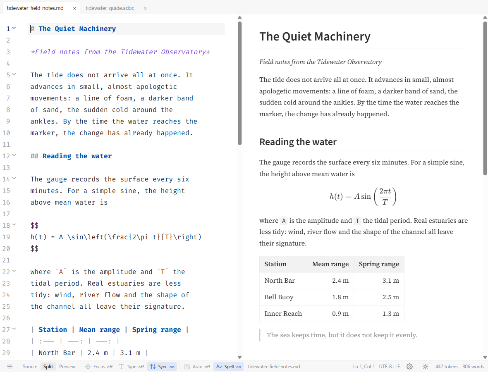
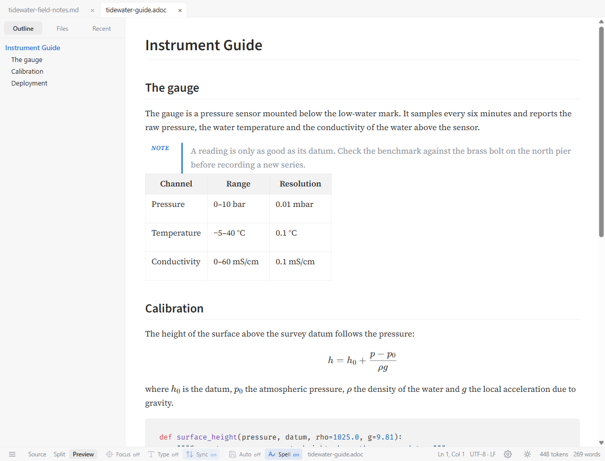

# MDraft

A cross-platform markup editor for **Markdown, AsciiDoc, Typst and HTML**, with
live preview and an eye for the finished document.

MDraft is for people who care about both the source they type and the page it
becomes. It keeps the rendered document beside the text, handles four markup
languages in one window, and exports to the formats other people ask for. It is
a native Tauri application: the system webview draws the preview. There is no
bundled browser, no account, and no telemetry.

**[Download MDraft 0.3.0 →](https://github.com/bgeneto/MDraft/releases/latest)**

Windows installers and a portable `.exe`; Linux `.deb`, AppImage and a bare
binary. Release notes and checksums are on the release page.



*Markdown source and preview in Split view, set in the Serif typography preset.*

## What it does well

- **Four languages, each with the right preview.** Markdown gets GFM tables,
  KaTeX, Mermaid, GitHub alerts and `[TOC]`. AsciiDoc gets Asciidoctor's
  admonitions, tables, listings, local includes and `latexmath`/`asciimath`. Typst, once
  its compiler is installed, gets a flowing document view and a PDF page view
  whose text can be selected and clicked. HTML keeps its own CSS, images and
  scripts, isolated in a sandbox.
- **A preview that follows the work.** Split, source-only and preview-only
  modes; scroll sync; clicking a source line blinks the matching block;
  selecting a word or a range in either pane paints it in the other, for
  Markdown, AsciiDoc and Typst, without moving the selection or scrolling; tabs
  keep each document's caret, undo and scroll position. A crowded strip scrolls
  with arrows, the wheel or drag reordering, and right-click offers the tab
  actions. The outline, file browser and recent list are one shortcut away, and
  **File › Open Recent** reaches the newest twenty entries of the persisted
  history without opening the sidebar.
- **Typing that closes itself.** `(`, `[`, `{`, quotes and backticks insert
  their pair, step over the closer and delete both on Backspace; HTML tags close
  in HTML, Markdown and AsciiDoc. Both behaviors have a switch under
  Preferences › Editor.
- **Typography that holds up.** Thirteen bundled typefaces, six presets,
  independent faces for editor, prose, headings and code, plus OpenType
  controls. Preview headings and emphasis use Semibold; mathematics has its own
  scale. Native HTML and PDF (Print) exports of Markdown and AsciiDoc embed the
  chosen faces.
- **Content moves both ways.** Paste formatted text from a browser or word
  processor and MDraft converts it into the destination's markup; copy from a
  text preview and the formatting goes with it. Images can be pasted, dropped,
  linked or downloaded into the document's assets folder.
- **Useful exports, stated plainly.** HTML needs no extra tools; PDF (Print)
  needs only a browser. DOCX, ODT, EPUB, LaTeX and the rest go through pandoc,
  which MDraft can install for you. A format whose converter is missing is
  disabled and says which tool it needs. Typst documents compile straight to
  PDF; PDF via Typst handles the other languages.
- **Quiet by design.** No accounts, activation, telemetry or update checks.
  MDraft makes no network request at start-up; it goes online only for an action
  you take, such as installing pandoc or Typst, fetching a pasted image URL, or
  opening an HTML document whose own markup references remote resources.



*The same window reading an AsciiDoc document: title, admonition, table and formula in Preview mode, with the outline alongside.*

## Getting started

1. Download the installer for your platform from
   [Releases](https://github.com/bgeneto/MDraft/releases/latest). On Windows,
   the portable `.exe` keeps its settings beside itself; the installers put
   them in the usual application data folder.
2. Open a document with **File › Open**, drop it on the window, or pass it on
   the command line:

   ```bash
   mdraft notes.md          # Linux, after installing the .deb
   MDraft.exe notes.md      # Windows
   ```

3. Split view is the default. Use the status-bar buttons for Source or
   Preview; `Ctrl+/` jumps to the source.
4. For `.typ` files, install the Typst compiler: **Help › Install Typst** on
   Windows; your package manager or the [Typst download
   page](https://typst.app/open-source/#download) on Linux, with `typst` on your
   `PATH`. For DOCX, ODT and the other pandoc formats, use **Help › Install
   Pandoc**. Neither is required to edit or preview Markdown, AsciiDoc or HTML.

## Requirements

- **Windows 10/11 (x64)** with the WebView2 runtime, which is preinstalled on
  Windows 11.
- **Linux (x64)** with WebKitGTK 4.1 and GTK 3. The `.deb` declares its
  dependencies.
- **macOS is not currently published.** The code includes macOS support, but
  the release page has Windows and Linux builds only.
- PDF (Print) hands the document to your browser's print dialog. It is not a
  silent in-app PDF.
- Pandoc and Typst are optional. **Help › Install Pandoc** installs pandoc
  into MDraft's own data folder on every published platform; **Help › Install
  Typst** does the same on Windows. On Linux, install Typst with your package
  manager or from its download page, and put `typst` on `PATH`. Administrator
  rights are not needed for the in-app installs.

## Documentation

- [User guide](docs/guide.md) — the four document types, previews, paste and
  images, shortcuts, limitations.
- [Export and conversion](docs/export.md) — formats, dependencies, PDF paths,
  pandoc configuration.
- [Typography](docs/typography.md) — bundled faces, presets, OpenType, export
  embedding and licences.
- [Contributing](CONTRIBUTING.md) — build, test and packaging instructions.
  [AGENTS.md](AGENTS.md) is the deeper working guide.
- [Issues](https://github.com/bgeneto/MDraft/issues) — bug reports and feature
  requests.

MDraft is open source under the [MIT License](LICENSE).
