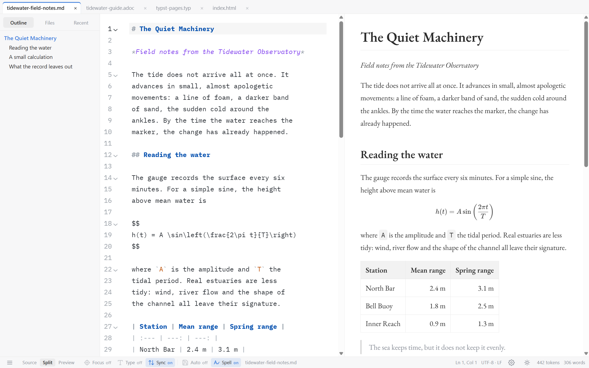
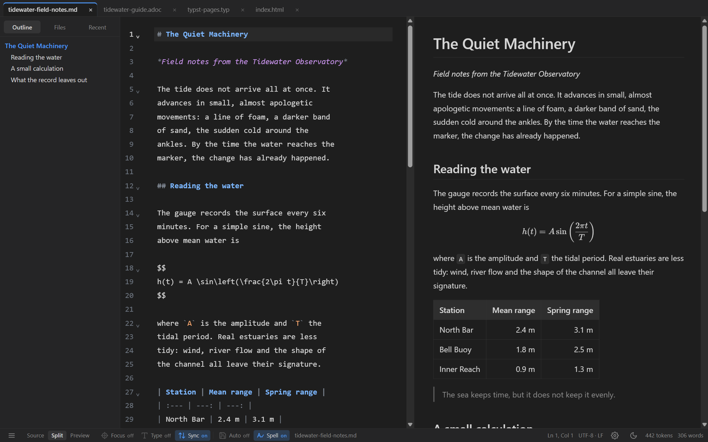

# MDraft

A cross-platform markup editor for **Markdown, AsciiDoc, Typst and HTML**, with
live preview and an eye for the finished document.

MDraft is for people who care about both the source they type and the page it
becomes. It keeps the rendered document beside the text, handles four markup
languages in one window, and exports to the formats other people ask for. It is
a native Tauri application: the system webview draws the preview. There is no
bundled browser, no account, and no telemetry.

[](https://github.com/bgeneto/MDraft/releases/latest)

**[Download the latest release →](https://github.com/bgeneto/MDraft/releases/latest)**

Windows installers and a portable `.exe`; Linux `.deb`, AppImage and a bare
binary. The release page always names the current version and carries its notes
and checksums.



*Light theme with the Renaissance preset: EB Garamond prose and headings, IBM
Plex Mono in the source.*



*Dark theme with the System preset: the platform's own faces, 
Markdown document active.*

## What it does well

- **Four languages, each with the right preview.** Markdown supports GFM tables,
  KaTeX, Mermaid, GitHub alerts and `[TOC]`. AsciiDoc supports Asciidoctor's
  admonitions, tables, listings, local includes and `latexmath`/`asciimath`. Typst, once
  its compiler is installed, gets a flowing document view and a PDF page view
  whose text can be selected and clicked; the Insert and Format menus write
  Typst syntax rather than Markdown. HTML keeps its own CSS, images and
  scripts, isolated in a sandbox.
- **A preview that follows the work.** Split, source-only and preview-only
  modes; scroll sync; clicking a source line blinks the matching block;
  selecting a word or a range in either pane paints it in the other, for
  Markdown, AsciiDoc, HTML and both Typst views. Pages uses verified prose
  context to identify repeated words across columns; unresolved or generated
  text stays unpainted. Selection stays in the pane you are using. The
  outline, favorites and recent list are one shortcut away, and
  **File › Open Recent** reaches the newest twenty entries of the persisted
  history without opening the sidebar.
- **Many documents, each with its own state.** Tabs keep every document's
  caret, undo and scroll position. A crowded strip scrolls with arrows, the
  wheel or drag reordering, and right-click offers the tab actions, including
  **Format Document** and **Add to Favorites**. **Reopen the last tabs** on launch
  restores the set that was open, in the same order and with the same one active.
- **Work that survives a crash.** Every dirty buffer, untitled included, is
  journaled beside the settings while you type; the next launch restores it as a
  dirty tab and says how many documents came back. A file that changed or was
  deleted on disk while its tab was dirty raises a notice with **Reload from
  disk**, **Keep my version** and **Save a copy…**, instead of being overwritten.
  The check compares the file's bytes, not only its timestamp and size, so a
  same-size rewrite is still caught.
- **Document changes stay with their tab.** Typing during Save or Save As stays
  dirty and recoverable; a delayed disk reload cannot replace newer edits.
  Closing offers **Save / Discard / Cancel**; Escape and dismissal cancel.
  Binary files and unsupported encodings are refused before editing, rather
  than decoded with replacement characters and later overwritten.
- **Typing that closes itself.** `(`, `[`, `{`, quotes and backticks insert
  their pair, step over the closer and delete both on Backspace; HTML tags close
  in HTML, Markdown and AsciiDoc. Both behaviors have a switch under
  Preferences › Editor.
- **Spelling in the language being written.** The operating system's own
  dictionary underlines prose as you type; code, URLs and mathematics are left
  alone. English and Portuguese are detected automatically, a language can be
  pinned under Preferences › Editor, and the status bar turns checking on and
  off. Right-click a marked word for suggestions or **Add to dictionary**.
  Nothing is downloaded, and HTML guests are not checked.
- **A right-click menu that acts on the source.** Cut, copy, paste and delete;
  select all; UPPERCASE, lowercase and Title Case; toggle a single-line comment;
  duplicate a line or move it up and down; undo and redo. **Format Document** is
  the last entry: Prettier aligns Markdown tables and tidies HTML, Typstyle
  reindents Typst. The same command is on a tab's context menu and formats that
  document even while another tab is on screen. One undo restores the exact
  original, the caret keeps its line, and the formatters are bundled rather than
  downloaded — nothing is loaded until the first format. AsciiDoc keeps the
  editing menu but has no formatter, and the item says so.
- **Typography that holds up.** Thirteen bundled typefaces, six presets,
  independent faces for editor, prose, headings and code, plus OpenType
  controls. The source pane's line height is **Compact**, **Normal** or
  **Wide** under Preferences › Editor. Preview headings and emphasis use
  Semibold; mathematics and code have their own scales, so a listing or a
  formula can be matched to the prose beside it. Native HTML, PDF and Print
  exports of Markdown and AsciiDoc embed the chosen faces.
- **Zoom the whole document.** `Ctrl+Shift+=` enlarges the source in Source-only,
  both panes in Split, and the rendered page in Preview-only — text, images,
  diagrams and Typst pages together. `Ctrl+Alt+0` resets the zoom without
  changing Content Width or the font-size preferences.
- **Content moves both ways.** Paste formatted text from a browser or word
  processor and MDraft converts it into the destination's markup; paste markup
  source and it is converted the same way, or kept in its original syntax when
  it already matches the destination. Formatted Markdown paste escapes currency
  dollars once. Copy from a text preview and the formatting
  goes with it. Images can be pasted, dropped, linked or downloaded into the
  document's assets folder.
- **Useful exports, stated plainly.** HTML, PDF and Print need no extra tools.
  Local images and links are resolved for the browser or the native writer, and
  the print document waits for its fonts and figures and owns its light theme.
  A static HTML document prints natively; scripted HTML keeps the browser route.
  DOCX, ODT, EPUB, LaTeX and the rest go through pandoc,
  which MDraft can install for you. A format whose converter is missing is
  disabled and says which tool it needs. Typst documents compile straight to
  PDF; PDF via Typst handles the other languages.
- **An opt-in writing assistant, without leaving the document.** Enable it under
  Preferences › AI Assistant and point it at any OpenAI-compatible
  `chat/completions` server (OpenAI, DeepSeek, Ollama, LM Studio, llama.cpp,
  vLLM, OpenRouter, your own gateway) or at Anthropic's Messages API. A single
  icon-only button sits in the source pane; drag it anywhere, and it starts at
  the same corner on every launch. The panel and History can be widened or
  heightened from the grip in their top-left corner; the button's corner and
  that size last for the session. Its searchable palette offers fourteen
  task-specific actions — Continue writing, Improve writing, Ask AI, Expand,
  Shorten, Simplify, Change tone, Translate, Summarize, Explain, Key points,
  Critique, Convert to table and Convert markup — and the answer streams into a
  non-modal panel before you apply it with **Replace selection**, **Insert
  below** or **Insert**. Answers are requested in the document's own markup —
  the saved extension, or the detected syntax of an unsaved buffer — and a final
  guard removes greetings, labels and change summaries before the answer reaches
  the panel. The finished answer renders as sanitized Markdown, with headings,
  lists, tables, code and emphasis, and the raw source stays one click
  away under **Source**; History uses the same rendering. One undo restores the
  exact original. The key is optional: a local inference server usually needs
  none, and when none is saved requests go out without an auth header. A saved
  key lives in the operating system's credential store, never in
  `settings.json`. The assistant is off by default: no request and no keychain
  read happens at start-up, and the store is read only when you open its
  Preferences section or use an action. Saving the key also fetches the
  endpoint's model list; the Model field's arrow opens a searchable list of it,
  and Fetch refreshes that list later. A model the endpoint no longer offers is
  cleared with a note, while an empty or failed list leaves a typed id alone.
  The ten most recent successful answers stay
  in an in-session **History**, reachable from the palette, where you can read,
  copy or insert them again; nothing in that history is written to disk.
- **Quiet by design.** No accounts, activation, telemetry or update checks.
  MDraft makes no network request at start-up; it goes online only for an action
  you take, such as installing pandoc or Typst, fetching a pasted image URL,
  asking the AI Assistant (only after you enable it and press Generate), or
  opening an HTML document whose own markup references remote resources.

## Getting started

Markdown keeps prices such as `R$50`, `R$ 15.200,75`, `US$5.00` and
`C$8,123.50` literal while supporting both `$x + y$` and `$ x + y $` equations.
Use `\$` for ambiguous literal dollars and `\(…\)` for explicit math. Tight
`$5$` is numeric math; `$ 5 $` is literal, `R$5$` is prefixed money, and a
dollar followed immediately by a digit cannot close math (`\(x\)2` replaces
`$x$2`). Code, URLs and existing escapes are preserved during paste;
`Ctrl+Shift+V` or rich paste off keeps the raw clipboard text. Native HTML, PDF
and Print use these rules; Pandoc retains its own Markdown reader.

1. Download the installer for your platform from
   [Releases](https://github.com/bgeneto/MDraft/releases/latest). On Windows,
   the portable `.exe` keeps its settings beside itself; the installers put
   them in the usual application data folder.
2. Open a document with **File › Open**, drop it on the window, or pass it on
   the command line:

   ```bash
   mdraft notes.md          # Linux, after installing the .deb
   MDraft.exe notes.md      # Windows
   ```

   Starting MDraft with a file while it is already open hands that path to the
   running window and opens it as a tab; it does not start a second window.
   Several paths on one command line all open, and an already open document is
   focused rather than duplicated.

3. Split view is the default. Use the status-bar buttons for Source or
   Preview; `Ctrl+/` jumps to the source.
4. For `.typ` files, install the Typst compiler: **Tools › Check or Install
   Typst…** on Windows and Linux; on macOS use your package manager or the
   [Typst download page](https://typst.app/open-source/#download), with `typst`
   on your `PATH`. For DOCX, ODT and the other pandoc formats, use **Tools ›
   Check or Install Pandoc…**. Neither is required to edit or preview Markdown,
   AsciiDoc or HTML.

## Requirements

- **Windows 10/11 (x64)** with the WebView2 runtime, which is preinstalled on
  Windows 11.
- **Linux (x64)** with WebKitGTK 4.1 and GTK 3. The `.deb` declares its
  dependencies.
- **macOS is not currently published.** The code includes macOS support, but
  the release page has Windows and Linux builds only.
- PDF and Print use the system webview: Windows writes through WebView2 and
  Linux through WebKitGTK, with selectable text, embedded fonts and a light
  diagram palette. The browser handoff remains for scripted HTML and for hosts
  without a print API.
- Pandoc and Typst are optional. **Tools › Check or Install Pandoc…** installs
  pandoc into MDraft's own data folder on every published platform; **Tools ›
  Check or Install Typst…** does the same on Windows and Linux. On macOS,
  install Typst with your package manager or from its download page, and put
  `typst` on `PATH`. Administrator rights are not needed for the in-app installs.

## Documentation

- [User guide](docs/guide.md) — the four document types, previews, paste and
  images, shortcuts, limitations.
- [Export and conversion](docs/export.md) — formats, dependencies, PDF paths,
  pandoc configuration.
- [Typography](docs/typography.md) — bundled faces, presets, OpenType, export
  embedding and licences.
- [Contributing](CONTRIBUTING.md) — build, test and packaging instructions.
  [AGENTS.md](AGENTS.md) is the deeper working guide.
- [Issues](https://github.com/bgeneto/MDraft/issues) — bug reports and feature
  requests.

MDraft is open source under the [MIT License](LICENSE).
