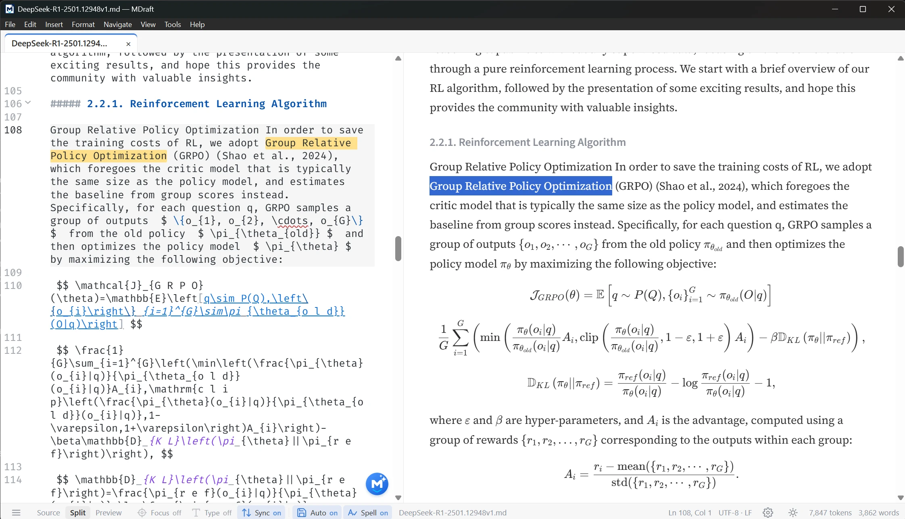
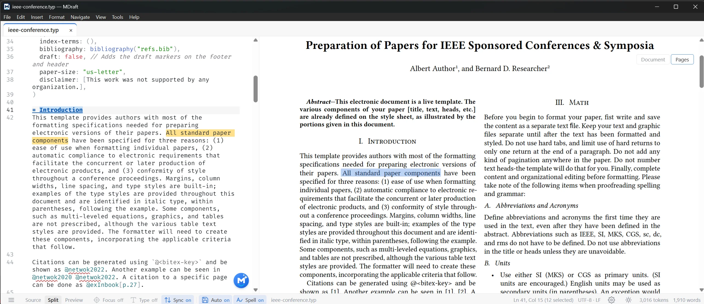
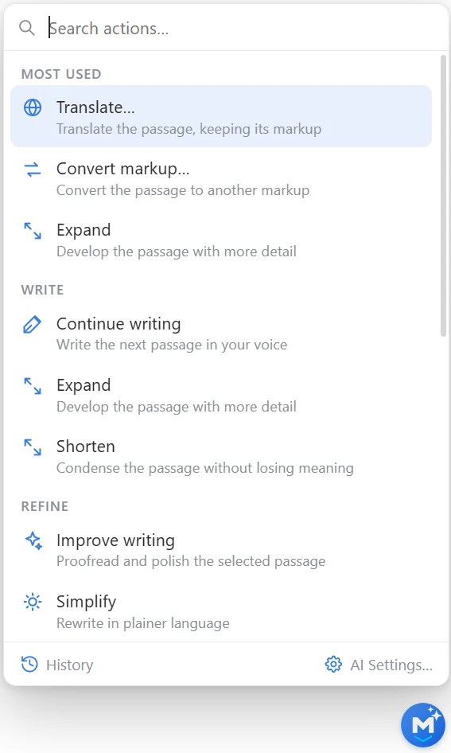
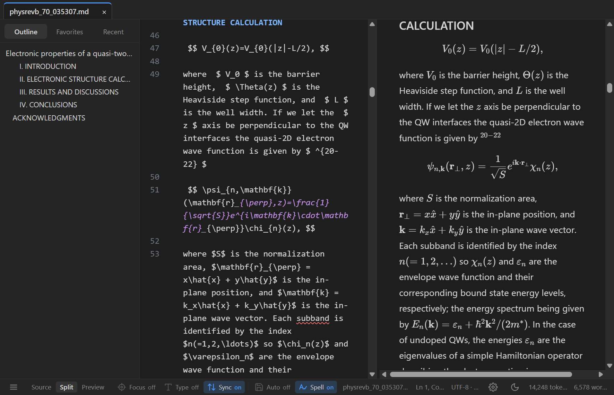

# MDraft

**Write in markup. See the page take shape.**

MDraft is a free, open-source desktop editor for **Markdown, AsciiDoc, Typst,
LaTeX and HTML**. Write notes, documentation or papers with your source and a
live preview side by side, then export a document ready to share.

**[Website](https://bgeneto.github.io/MDraft/) · [Download the latest release →](https://github.com/bgeneto/MDraft/releases/latest)**

*Select text in either pane to find its match in the other.*

## Stay oriented as you write

Scroll through the source or the preview and the other pane follows the same
part of the document. Select a word or passage in either pane to highlight the
matching text across the split. When a match cannot be identified confidently,
MDraft leaves it unmarked.

Use **Split** to see both views, or switch to **Source** or **Preview** when
you want more room. The outline, favorites and recent files keep longer
projects easy to navigate.

## Five formats, one editor

- **Markdown** — GitHub-flavored tables, task lists and alerts, plus math,
  Mermaid diagrams, syntax-highlighted code and a table of contents.
- **AsciiDoc** — admonitions, tables, listings, local includes and mathematics
  for manuals and technical documentation.
- **Typst** — a flowing Document view or a Pages view of the compiled PDF,
  with selectable text and source matching. Export directly to PDF with Typst.
  Typst and LaTeX share Compile/Cancel, Auto-compile, Save PDF and a Logs toggle;
  compiler messages stay separate from the rendered document.
- **LaTeX** — syntax colouring, `%` comments, an outline read from `\section`
  commands, and the compiled PDF in the preview. The bundled TeX distribution
  needs no separate installation; a TeX distribution already on the computer can be
  selected instead, as a separate program that may install its own packages.
- **HTML** — preview a page with its own CSS, images and scripts in a sandboxed
  view alongside its source. In HTML and CSS documents, Tab expands an Emmet
  abbreviation: `ul>li*3` becomes a list and `m10` becomes `margin: 10px;`,
  also inside `<style>` and `style="…"`. It is on by default, never acts in a
  tag, attribute, comment, script or selector, and can be turned off in
  *Preferences › HTML*.

*Typst Pages view shows the compiled page while you edit its source.*

Typst preview and PDF compilation require the Typst compiler. MDraft can
install it for you on Windows and Linux.

LaTeX is opt-in: enabling bundled TeX downloads about 20 MiB of verified
engine files, and the TeX packages a document needs are fetched on demand and
cached locally. Your own classes and packages can live in folders registered
once under *Preferences › LaTeX › Local packages* and are found by
every project, with either engine. *Preferences › LaTeX* can instead use a TeX
distribution already on the computer — including TeX Live inside a WSL
distribution on Windows — after MDraft has validated it; that engine runs with the
reader's permissions; it may use the network to install its own packages, while
shell escape remains disabled. MDraft itself makes no network request to run a
native compile. Nothing about your document leaves this device unless the
installed distribution downloads a package, and the same section reports the
bundled cache size and clears it.

## An AI assistant you can configure

MDraft's AI Assistant is **off by default**. If you enable it, you can use a
local server such as Ollama or LM Studio, an OpenAI-compatible endpoint, or
Anthropic. You choose the provider and model; provider charges may apply.

Choose from 14 actions to improve, continue, summarize, translate or convert
your writing, among other tasks. Review the streamed answer, then copy it,
replace a selection, insert it, or open it in a new tab. You can also edit the
prompts behind the actions.

  

Enable and configure it under **Preferences › AI Assistant**. Requests send
the relevant text to the endpoint you choose. Use a model running on your own
computer if you want local inference. The [AI Assistant guide](docs/guide.md#ai-assistant)
covers setup, prompts and privacy.

## Typography and themes

Choose a light or dark theme, then shape the document with six typography
presets or your own combination of fonts. MDraft includes 13 typefaces and lets
you choose installed fonts for the editor, body, headings and code. Math and
code can be scaled independently of the surrounding text.

*Dark theme, with mathematics rendered alongside the source.*

## Editing and organization

- **Keep your place.** Work across tabs that remember each document's caret,
  scroll position and undo history. Choose to reopen your last tabs on startup.
- **Protect unsaved work.** Unsaved changes, including untitled documents, are
  recorded for recovery after an unexpected close. If a file changes on disk
  while you have unsaved edits, MDraft asks how you want to proceed.
- **Bring content in.** Paste formatted text from a browser or word processor
  and convert it to your document's markup. Paste or drop images into your
  document.
- **Keep writing.** Use spellcheck, document statistics, focus and typewriter
  modes, and Read Aloud with your system's voices.

## Export and share

Export Markdown and AsciiDoc to HTML or PDF, or print them without installing
an extra converter. Static HTML can also be printed or saved as PDF; pages that
depend on scripts and systems without a print API use the browser route.

For **DOCX, ODT, EPUB, LaTeX** and other formats, MDraft uses Pandoc. Typst
documents use the Typst compiler for preview and direct PDF export. Both tools
are optional and can be installed from MDraft's **Tools** menu on Windows and
Linux. See the [export guide](docs/export.md) for formats and details.

## Get started

1. **[Download MDraft](https://github.com/bgeneto/MDraft/releases/latest)** for
   your computer:
   - **Windows 10/11, x64:** choose the setup `.exe` or `.msi`. The portable
     `.exe` keeps its settings beside the executable.
   - **Linux, x64:** choose the `.deb`, AppImage or standalone binary. Make an
     AppImage executable before opening it.
2. Install or open MDraft, then create a document or open one with **File ›
   Open**. You can also drop a file into the window.
3. Write in the source pane and watch the preview update. Try selecting a word
   in either pane, or use the status bar to switch views.

Windows needs the WebView2 runtime, included with Windows 11. Linux needs
WebKitGTK 4.1 and GTK 3; the `.deb` declares its dependencies. macOS builds
are not currently published.

To work with Typst files, choose **Tools › Check or Install Typst…**. For
Pandoc exports, choose **Tools › Check or Install Pandoc…**. Neither is needed
to edit or preview Markdown, AsciiDoc or HTML.

JavaScript (`.js`, `.mjs`, `.cjs`), CSS and JSON files can also be opened and
edited with syntax highlighting. These source files do not have a live preview;
open an HTML document to preview a page.

## Privacy

MDraft requires no account or activation. It has no telemetry, update checks
or network request at startup. You choose where to save your files.

Network access is used for actions you initiate, such as installing an
optional tool, downloading a pasted image, fetching AI models or generating
an AI response. If you enable AI filename suggestions, saving an untitled
document can also send text to your chosen endpoint. HTML documents may load
remote resources referenced by their own markup. An installed TeX distribution
you select is your own program: it may download its own packages, and MDraft
neither controls nor monitors that traffic.

The [LaTeX engine](docs/latex.md) downloads its files only after explicit
enablement and then retrieves missing TeX packages and fonts on demand. The
document and bibliography contents stay local. The first time you format a
`.tex` document, MDraft downloads the LaTeX formatter (about 1.7 MB, verified
against its pinned checksum and cached); later formats work offline.

## Learn more

- [User guide](docs/guide.md) — editing, previews, shortcuts and troubleshooting.
- [LaTeX](docs/latex.md) — the bundled TeX distribution, the project snapshot and PDF export.
- [Export and conversion](docs/export.md) — supported formats and dependencies.
- [Typography](docs/typography.md) — fonts, presets and OpenType options.
- [Contributing](CONTRIBUTING.md) — report a problem, build MDraft or contribute.
- [Issues](https://github.com/bgeneto/MDraft/issues) — bug reports and feature requests.

MDraft is open source under the [MIT License](LICENSE).
