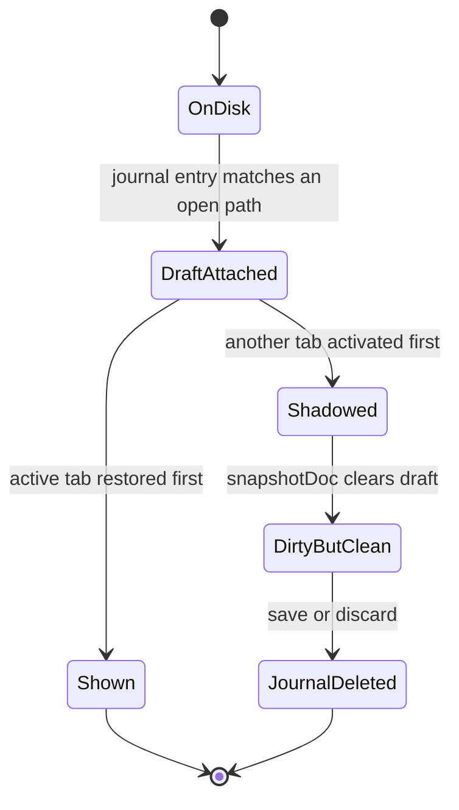
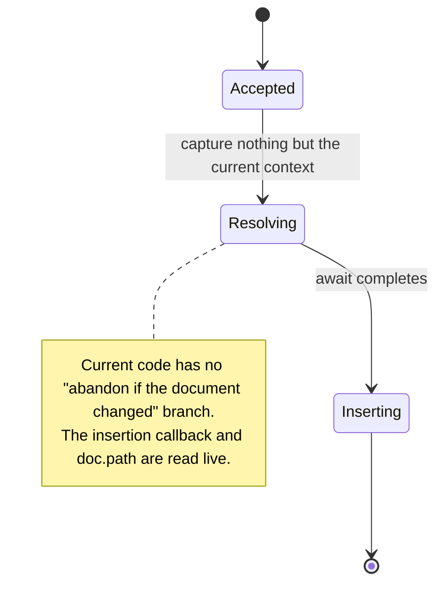
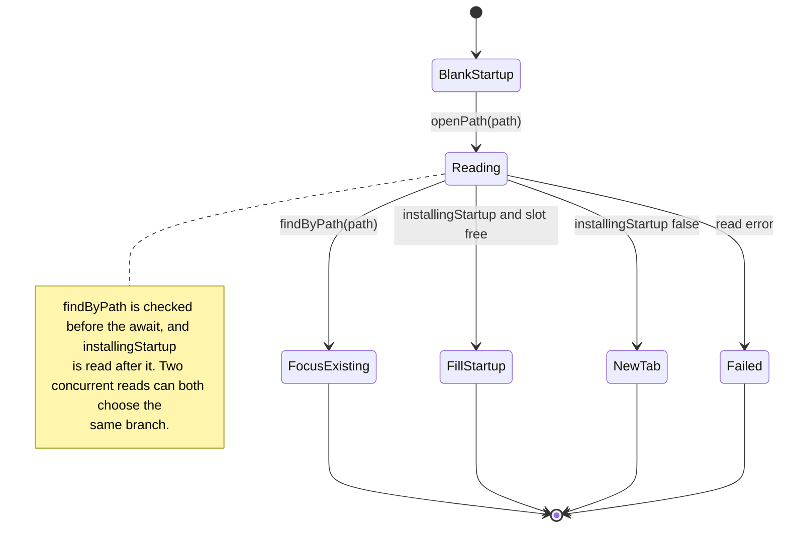
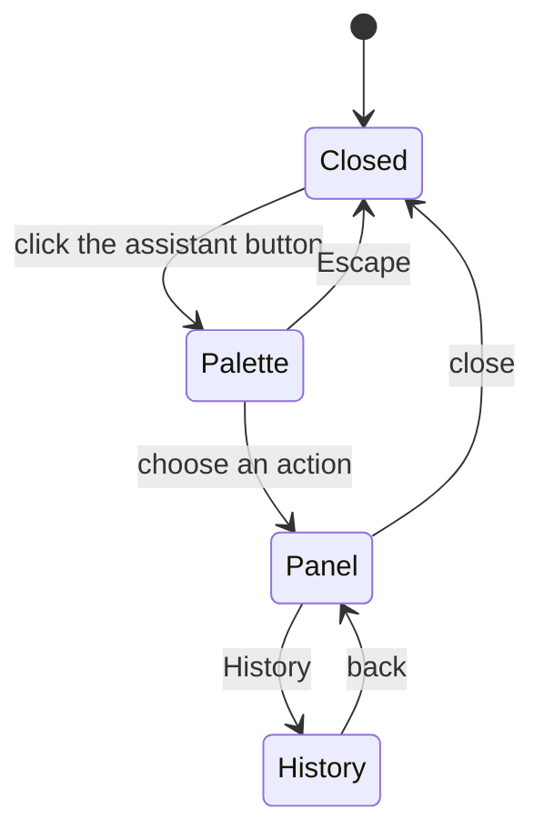
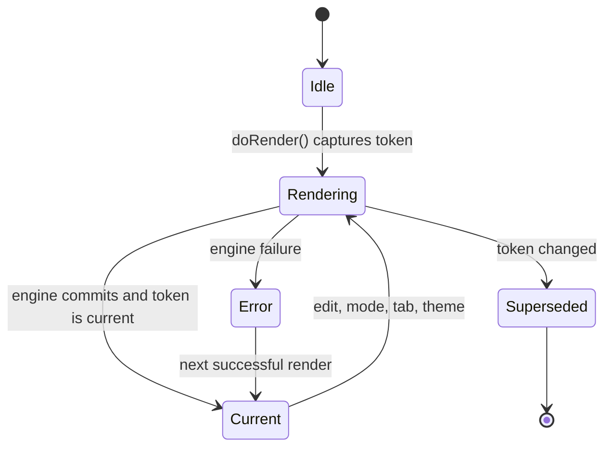

# Implicit State Machines: Audit and Architectural Recommendations

**Repository:** MDraft  
**Date:** 2026-11-08  
**Status:** Discovery and evaluation complete. Phase 3 has not started.  
**Constraint:** This audit is read-only. No source file, test, dependency, setting, or
public contract was changed. No build or test was executed during the audit; all
findings below come from reading the cited code paths and the existing tests.

## Why this report exists

MDraft has several asynchronous workflows whose correctness is enforced by
generation counters, snapshot comparisons, and "latest result wins" checks. Those
guards work, but the states they protect are often spread across booleans,
nullable fields, and module-level variables. That makes the valid combinations
hard to see and the invalid ones hard to test.

The goal is not to turn every conditional into a state machine. It is to find the
places where an explicit state, owner, or transition would prevent a real failure
or make the next change safer, and to leave the rest alone.

**Reading the confidence labels**

- **Verified by code path** — every branch named in the finding was read; the
  scenario follows from those branches. It was not executed.
- **Inferred** — one or more assumptions (for example, an OS file-lock behavior)
  were not established here.
- **Unverified** — the code suggests the outcome, but the relevant host or test
  was not exercised.

## Executive summary

Thirteen candidate areas were examined. Six warrant action (F1-F6), one is an
optional DX/AX improvement (F7), five are already explicit enough that changing
them would be churn (F8-F12), and one is UI/persistence-local and rejected (F13).

The highest-value findings are **ownership bugs**, not missing state libraries:

1. **A recovered draft can be shadowed and then deleted.** When several tabs have
   crash-recovery entries and the active tab is not the newest entry,
   `restoreRecovery` activates another tab first; `activateSession` snapshots the
   active tab and clears its `draft`, leaving the editor on disk text while the
   tab is marked dirty. Saving that tab then removes the journal. **Severity:
   high.**
2. **An image paste/drop can land in a different document.** Downloads can take
   seconds; the insertion callback targets the current editor, and the asset path
   is either captured from the paste or read live depending on the route.
   Switching tabs during the download can write the image into the wrong buffer,
   with the wrong language syntax, and save the asset under the wrong document
   folder. **Severity: high.**
3. **Concurrent opens can duplicate a tab or lose the startup document.** Every
   direct `openPath` caller bypasses the `openPaths` chain, and
   `installingStartup` is read after the awaited read. Two reads of the same path
   both miss `findByPath`; two startup reads can both fill the same blank tab.
   **Severity: medium-high.**
4. **The AI Assistant can keep streaming after its panel is gone.** Opening the
   palette or history while a request runs hides the panel without cancelling;
   choosing another action nulls the request id without `aiCancel`. A Stop before
   response headers is not observed by the Rust stream loop. **Severity:
   medium.**

The preview and export/print areas have real but narrower gaps: a failed HTML
preview can be declared current while the previous document's frame remains, and
export/install actions have no phase or re-entrancy guard. These are worth fixing
with small result checks or predicate functions, not with a new architecture.

No state-machine library is justified. The codebase has no parallel regions, no
persisted workflow states, and no need for visual editing. Plain TypeScript
discriminated unions, one small transition function per surface, and derived
selectors are sufficient.

## Inventory

| ID | Area | Primary evidence | Current encoding | Risk | Verdict |
| --- | --- | --- | --- | --- | --- |
| F1 | Crash-recovery draft ownership | `src/main.ts:8506-8591`, `:3157-3163`, `:3293-3304`; `src/document-lifecycle.ts:101-110` | `draft`, `dirty`, `editorState`, `recoveryId` | High: recovered text can be lost | Add draft ownership state/invariant |
| F2 | Image paste/drop async insertion | `src/images.ts:275-321`, `:351-457`; `src/main.ts:8147-8159`, `:8188-8231`, `:8274-8288` | No operation owner; current editor/current `doc` | High: wrong-document insertion | Add a small pending-operation owner |
| F3 | Document open and startup slot | `src/main.ts:3402-3470`, `:9057-9092` | `installingStartup`, `openPathChain`, pre-await `findByPath` | Medium-high: duplicate/lost open | Add per-path opening state and one queue |
| F4 | AI panel, surface, and request | `src/ai/assistant.ts:138`, `:367-398`, `:926-991`, `:1237-1281`, `:1889-2025`; `src-tauri/src/ai/mod.rs:435-510` | 5-value `PanelState` + 3 surface booleans + nullable satellites | Medium: orphaned stream, ineffective Stop | Discriminated union + `abort()` transition |
| F5 | Preview current/stale truth | `src/main.ts:1319-1340`, `:2673-2725`, `:1335-1340`, `:2365-2366`; `src/html-preview.ts:745-798` | Tokens + `previewStale` + `previewSyncReady` + per-engine flags | Medium-low: false "current" after HTML failure | Return commit result; derive flag |
| F6 | Export/print/install readiness | `src/main.ts:4403-4443`, `:4460-4490`, `:4762-4958`; `src-tauri/src/menu.rs:153-163`; `src-tauri/src/print.rs:36`, `:408-458` | Nullable caches; no export/print/install phase; one print mutex | Medium: enabled action that cannot run; invisible queue | Phase flags + predicates; backend lock |
| F7 | Session status derivation | `src/sessions.ts:11-58`; `src/document-lifecycle.ts:101-110` | Independent fields (`dirty`, `draft`, `conflict`, `lossy`, `readOnly`) | Medium DX/AX: cross-field disagreements | Derived `SessionStatus` + assertions |
| F8 | Format Document | `src/main.ts:413`, `:3315-3323`, `:3349`; `src/format/formatters.ts:315-328` | `formatBusy` + snapshot guard | None observed | Already explicit; no change |
| F9 | Spellcheck | `src/spellcheck.ts:454-556`, `:575-645` | Per-instance request generation + document identity | None observed | Already explicit; no change |
| F10 | Read aloud | `src/read-aloud.ts:250-319`, `:458-537` | Queue index + active flag, callback timestamps ignored | None observed | Already explicit; no change |
| F11 | HTML preview frames | `src/html-preview.ts:503-529`, `:731-798` | `generation`, `active`, `pending`, per-frame `ready`/`timer` | None observed | Already explicit; no change |
| F12 | Preview worker queue | `src/preview-worker-client.ts:27-154` | `broken`, `running`, `current`, `pending`, monotone id | None observed | Already explicit; no change |
| F13 | Settings and tab-strip UI state | `src/main.ts:1070-1082`; `src/tabs.ts:73-92` | Serialized settings queue; transient drag/menu state | Low | Rejected: no invalid operation or user-visible state |

Two related areas were considered and rejected as standalone state machines:

- **Settings persistence** already serializes writes in call order and deliberately
  treats a failed write as best-effort (`src/main.ts:1070-1082`). A visible
  "saving/error" state would add a new UI surface without changing any operation
  the reader can invalidate.
- **Tab drag/menu state** is transient pointer state with local guards
  (`src/tabs.ts:73-92`). It does not own document data and does not benefit from a
  document-level model.

## Detailed findings

### F1 — Recovered draft ownership

**States and transitions as implemented**

- `clean` — the session's `savedContent` equals the disk text.
- `recovered-unshown` — `draft` holds journal text; the editor may still show
  disk text (`src/sessions.ts:36-44`).
- `recovered-shown` — `draft` has been copied into the editor, then cleared
  (`src/main.ts:3213-3216`).
- `dirty` — the editor text differs from `savedContent`
  (`src/document-lifecycle.ts:101-110`).
- `journaled` / `clean` — `recoveryId` exists or has been forgotten
  (`src/recovery.ts:143-161`).

The intended sequence is: attach the draft, show it, clear the draft, and journal
later edits. The code has a path that skips `recovered-shown`.



**Evidence**

1. Entries are sorted newest-first (`src/main.ts:8515`). For every entry whose path
   is already open, the code attaches `draft`, sets `dirty = true`, and pushes the
   session into `recovered` (`:8526-8541`).
2. `recovered[0]` is made active (`:8584-8586`). If that is a different session,
   `activateSession` calls `snapshotDoc()` first (`:3293-3304`).
3. `snapshotDoc()` stores the current editor state and **clears `doc.draft`**
   (`:3157-3163`). It does not check whether the editor actually contains the
   draft.
4. `showInEditor` uses `doc.draft ?? doc.savedContent` (`:3213`), so a cleared
   draft is silently replaced by disk text. The session still has `dirty = true`
   from step 1.
5. A later save writes that disk text; `journal()` compares text with
   `savedContent` (`src/document-lifecycle.ts:101-110`), calls
   `recovery.forget`, and the unchanged journal file is removed
   (`:194-200`, `src/recovery.ts:143-161`).

**Invalid combinations representable today**

- `draft !== null` while the editor shows disk text.
- `dirty === true` while `textOf(session) === savedContent`.
- A live `recoveryId` for a session whose draft is no longer reachable in memory.
- `editorState === null` can mean "on screen" or "recovered, never shown"
  (`src/sessions.ts:52-55`), which is why Format refuses the latter
  (`src/main.ts:3319-3321`).

**Concurrency and lifecycle**

This is an ordering bug, not a race between two async operations. It is
deterministic once the newest journal entry belongs to a tab that is not the
restored active tab. A crash with two dirty tabs is enough; the tab the reader
last looked at need not be the one edited most recently.

**Existing safeguards and tests**

`p0-unit` exercises the recovery scheduler's per-session ordering and generation
guards (`scripts/p0-unit.mjs:70-223`), and `p0-lifecycle-test` covers save,
reload, close, and recovery removal. Neither drives the multi-journal restore
ordering above. `tabs-restore-test` covers remembered tabs, not recovered drafts.

**Would explicit modeling help?**

Not a full reducer. The useful explicit state is a **draft ownership invariant**:
`draft` may be non-null only while the editor does not hold that draft, and clearing
it must be a commit of the displayed text. A derived `SessionStatus` (F7) plus one
assertion catches the contradiction. The minimal fix is ordering: display the
active session's draft before activating another recovered tab, or process the
active tab first. Both are smaller than a state-machine rewrite and directly
testable.

**Proposed minimal change**

- In `restoreRecovery`, if `doc.draft !== null`, display that draft before
  `activateSession(first.id)`; alternatively put the active session first in
  `recovered` when it has a draft.
- Make `snapshotDoc()` refuse to clear a draft the editor has not shown
  (or require an explicit `displayedDraft` flag).
- Add a regression test with two journals whose newest entry is not the active
  tab; assert the active tab still shows its draft and a later save does not
  remove the other journal.
- Add the invariant to the lifecycle unit helper: `dirty === (textOf(s) !==
  savedContent)` unless a recovered-unshown draft is present.

**Expected impact**

- **UX:** recovered text is not silently replaced by disk text, and the dirty dot
  stops lying.
- **DX:** the draft lifecycle becomes a named precondition rather than an
  incidental field.
- **AX:** an agent can see that `draft` and `editorState` are not independent.

---

### F2 — Image paste/drop ownership

**States and transitions as implemented**

There is no state. A paste or drop is accepted, work is awaited, and the result is
inserted into whatever editor is active when the await settles.



**Evidence**

- `handleImagePaste` decides synchronously, then starts `saveClipboard`,
  `saveClipboardBase64`, `saveOnline`, or `saveLocal` without capturing a session
  (`src/images.ts:351-413`).
- `saveOnline` calls `api.downloadImage(url, ctx.documentPath, ...)` and then
  `ctx.insert(...)` (`:306-321`). `ctx` is built by `imageContext()`, whose
  `insert` is `(text) => editor.insertBlock(text)` and whose `documentPath` is
  `doc.path` at paste time (`src/main.ts:8147-8159`).
- Rich paste resolves every remote image before inserting; `resolveRichImage`
  reads `doc.path` and `doc.language` after each await (`:8188-8231`), and
  `applyRichPaste` inserts into the current editor (`:8274-8288`).
- `handleImageDrop` loops over files and inserts one joined block at the end
  (`src/images.ts:420-457`); a tab switch during the loop has the same effect.
- `editor.insertBlock` dispatches at the current selection; it has no session or
  revision parameter (`src/editor.ts:1643-1645`).
- The rich-paste plan explicitly says insertion follows the caret if the reader
  types while images arrive (`docs/plans/2026-10-17-rich-paste.md:444-448`). That
  behavior is intentional **within one document**; a tab switch is not covered by
  that decision.

**Invalid combinations representable today**

- Paste began in document A; document B is active at completion; markup is
  inserted into B.
- For a standalone image URL or bitmap, `ctx.documentPath` is A, so the asset is
  saved in A's folder while the markup is inserted into B (`src/images.ts:265-321`).
- For rich paste, `resolveRichImage` reads B's live `doc.path` after the await
  while it receives A's `language`, so the asset is saved under B's folder and the
  markup is generated for A's language (`src/main.ts:8188-8231`).
- A drop or paste that begins in an untitled tab can be resolved after the tab is
  saved as a different path, mixing the two folders.
- If the tab is closed during the download, the completion inserts into whichever
  tab is active, including a fresh Untitled.

**Concurrency and lifecycle**

Downloads are bounded (4 at a time, 8 s each, at most 8 remote images for rich
paste) but still up to roughly 20 seconds. That is ample time to switch tabs. The
code has no generation check, no `sessionId`, and no post-await `findByPath`.

**Existing safeguards and tests**

`image-rules-test`, `image-paste-test`, and `rich-paste-test` cover the import
rules, download success/failure, and per-destination syntax. They do not delay a
download across a tab switch. `image-rules-test` does check that opening the same
document again focuses its tab, but that is a different path.

**Would explicit modeling help?**

Yes, in a small form. A `PendingImageInsertion` value
`{ sessionId, documentPath, language, from, to }` captured at the event, with a
`commit()` that verifies `doc.id === owner.sessionId`, makes the invalid case
unrepresentable. A full state machine is unnecessary; this is one owner record
and one guard.

The revision should **not** be part of the guard by itself: the plan intentionally
lets insertion follow the caret if the reader types. Use `sessionId` (and a
captured path for asset placement) for the cross-document decision; keep the
current-caret insertion for the same document.

**Proposed minimal change**

- Extend `ImageContext` with `owner: { sessionId, documentPath, language }`.
- Capture the owner in `imageContext()` and in the rich-paste destination.
- Before `insert`, compare the owner's session id with the active session; if it
  differs, do not insert. Notify that the image was saved but the document
  changed, and leave the URL/reference available where possible.
- Use the owner's `documentPath` for `importImage`/`downloadImage`, not the live
  `doc.path`.
- Add a UI regression test: serve a delayed image, paste it, switch tabs before
  the response, and assert no markup appears in the second document and the asset
  landed under the first document's folder.

**Expected impact**

- **UX:** a download can no longer edit a document the reader did not paste into.
- **DX:** the paste path gains an explicit owner instead of relying on closure
  timing.
- **AX:** the contract "an async paste belongs to the session that started it" is
  visible in the type and test.

---

### F3 — Document open and the startup slot

**States and transitions as implemented**

- `blank-startup` — the initial session exists and `installingStartup` is true
  (`src/main.ts:411`).
- `reading(path)` — `openPath` awaits `api.readDocument` (`:3411`).
- `focus-existing` — a session with the same path is found (`:3404-3407`).
- `fill-startup` — `installingStartup` is still true, so the read replaces the
  initial session (`:3412-3414`).
- `new-tab` — a normal session is created and added (`:3415-3419`).
- `failed` — the read throws and a toast/dialog reports it (`:3447-3453`).



**Evidence**

- `openPath` checks `sessions.findByPath(path)` before awaiting
  (`src/main.ts:3404`), then reads (`:3411`), then branches on the global
  `installingStartup` (`:3412`) and adds a session (`:3418`). There is no
  post-await `findByPath` and no per-path in-flight map.
- `openPaths` has a serialization chain (`:3456-3470`), but direct callers bypass
  it: the sidebar/recent callbacks (`:2829`, `:2914`), the native Open Recent row
  (`:7491`), link navigation (`:7757-7782`), drag/drop (`:7828`), and startup
  (`:9072`, `:9080`) call `openPath` directly. Only `openPaths` and the
  `open-files` listener (`:9064`) use the chain.
- Startup installs the menu listener before the startup choice (`:9041` vs
  `:9067-9083`), so a menu open can arrive while the startup read is pending.
- The `installingStartup` flag is set false only after the first startup document
  is installed (`:9073`) or after the whole startup choice (`:9084`).

**Invalid combinations representable today**

- Two concurrent reads of the same path both see "not open" and create two
  sessions with the same path; the second becomes active, and both are journaled
  independently.
- Two concurrent startup reads both see `installingStartup === true`; each calls
  `describe(doc, payload)` on the same session. The later completion silently
  replaces the earlier document. If the reader typed in the blank tab before the
  read completed, that typing is replaced without a prompt.
- A menu Open or drop during boot can take the `fill-startup` branch and replace
  the document the startup sequence is about to install.
- Closing the last tab during boot can leave the session store empty while
  `loadUntitled` takes the fill branch and mutates the removed session
  (`src/main.ts:3480`, `:3663-3678`). The next `openPath` describes a `doc` that is
  no longer in the store; `lifecycle.run` refuses it silently
  (`src/document-lifecycle.ts:84-85`).

**Concurrency and lifecycle**

The Rust launch boundary deduplicates paths and queues them before emitting
(`src-tauri/src/launch.rs:103-141`). That protects the launch-to-frontend handoff,
but the frontend's own async gap is outside it. The `openPaths` chain protects
multi-path startup only; it does not protect direct opens.

**Existing safeguards and tests**

`single-instance-test.mjs` covers the queue/emit path and focus-not-duplicate for
an already-open tab. `tabs-restore-test.mjs` covers remembered tabs and Close All.
`document-tabs-test.mjs` covers `open-files` adding a tab. None of these holds two
reads of the same path or performs a direct open before the startup read
completes.

**Would explicit modeling help?**

Yes, but the smallest useful state is per path, not a global machine. Model
`OpenJob = { pathKey, promise, ownerSlot }`; every entry point goes through one
`openPath` queue, and the post-await decision re-checks the store and the captured
startup slot. That is one map and one chain, not a reducer.

**Proposed minimal change**

- Add `const opening = new Map<string, Promise<void>>()` keyed by `pathKey`.
  `openPath` returns the existing promise for the same key instead of starting a
  second read.
- Route every caller through the same queue (or make `openPath` itself append to
  `openPathChain`; keep `openPaths` for bulk error handling).
- Capture `const startupSlot = installingStartup` before the await; after the
  await, use that captured value and re-check `findByPath`.
- In `openPath`, after the await, if a session for the same path appeared while
  reading, focus it and discard the new payload instead of adding a duplicate.
- Make the startup fill branch reject or preserve a dirty/typed buffer; never
  replace typed text without a prompt.
- Add tests: two `openPath` calls with a delayed mock read; a direct open during
  the startup read; close during boot.

**Expected impact**

- **UX:** double-clicking a recent file cannot create two tabs; a startup read
  cannot silently discard a file or typed text.
- **DX:** one open path and one ownership rule replace the current caller
  matrix.
- **AX:** the startup slot and the in-flight read become explicit inputs that a
  test can control.

---

### F4 — AI Assistant surface and request

**States and transitions as implemented**

The panel has a five-value `PanelState` (`src/ai/assistant.ts:138`), but the
surface is three independent booleans (`paletteOpen`, `panelOpen`, `historyOpen`)
and the request has several satellites (`requestId`, `channel`, `startedInfo`,
`answerStopped`, `answerTruncated`, `entryId`, `usageCounted`).




**Evidence**

- `PanelState` is `"idle" | "parameter" | "running" | "done" | "error"`
  (`:138`); `state` is one mutable variable (`:367`). `requestId`, `channel`,
  `startedInfo`, `answerStopped`, `answerTruncated`, `entryId`, and
  `usageCounted` are separate (`:368-398`).
- `openPanel` sets `requestId = null` and resets the answer, but does not call
  `aiCancel` (`:1237-1265`). `choose()` reaches it through `closePalette()` (`:917-924`).
- `openPalette()` hides the panel (`panelOpen = false; panel.hidden = true`) and
  does not cancel (`:926-941`). `openHistory()` does the same (`:975-991`).
- `startRequest` sets `requestId` and `state = "running"` (`:1921-1923`), clears
  the answer fields, and subscribes with a closure that ignores events after the
  id changes (`:1938-1950`).
- `cancel()` only sends `api.aiCancel` and writes "Stopping…"; it does not move
  to a `stopping` state (`:2021-2025`).
- `onEvent("done")` sets `state = "done"`, records history and usage, and may
  reset to `parameter` if the sent parameter no longer matches (`:1964-1999`).
- `setParameter` clears `entryId` even when the value did not change (`:1422-1432`).
- `renderFooter` offers Copy in the `done` branch even when `answerStopped` and
  `answerText` is empty (`:1694-1723`); `copyAnswer` then returns silently
  (`:1820-1825`).
- Rust sends `Started` **before** registering the cancel sender
  (`src-tauri/src/ai/mod.rs:435-447`), and `provider::stream` awaits the response
  headers outside the cancellation `select!` (`src-tauri/src/ai/provider.rs:496-510`).
  The client has a 15 s connect timeout (`:17`, `:282-296`) but no deadline for
  response headers.

**Invalid combinations representable today**

- `state === "running"` while `panelOpen === false` and `requestId` is live
  (palette or history open).
- `state === "running"` while `requestId === null` (after `close()`), so `cancel()`
  no-ops even if the panel is somehow shown again.
- `state === "done"` with `requestId` still set; harmless only because `cancel()`
  checks state.
- `answerStopped && answerText === ""` with an enabled Copy button.
- `entryId === null` while an answer completes; history silently misses it.
- `startedInfo` can arrive on a request the reader has already abandoned if the
  id check is bypassed; normally the closure protects this.

**Concurrency and lifecycle**

- **Orphaned stream:** palette/history open during a run, then a new action sets
  `requestId = null`; the old Rust request continues to completion because no
  cancel was sent. The answer is discarded, the usage is not recorded, but the
  provider work and context transmission continue.
- **Stop lost before headers:** a server that accepts TCP and stalls before
  response headers keeps `post_chat` pending; the watch receiver is not polled
  until `stream` enters its loop. The panel can remain "Stopping…" until the
  server or the connect timeout gives up.
- **Cancel racing done:** Rust removes the request id before sending `Done`
  (`src-tauri/src/ai/mod.rs:475-477`); a `Done { stopped: false }` can overwrite
  "Stopping…" with "Answer ready". The UI has no `stopping` state to preserve the
  reader's intent.
- **History duplication:** choosing the already-selected Translate target nulls
  `entryId`; Regenerate then allocates a new id and adds a second history row for
  the same request (`:1425`, `:1917-1919`).

**Existing safeguards and tests**

`scripts/ai-assistant-test.mjs` covers Stop (status, server close, no late delta;
`:2382-2407`), tab-switch cancellation (`:2866-2885`), history cap, stopped
answers not recorded, Regenerate single row, and stale target disabled Replace.
`scripts/ai-unit.mjs` covers pure staleness/capture/history helpers. The suite
does **not** open the palette or history during a stream, close the panel while
running (only tab switch does), stall the provider before headers, or apply a
stale "Insert below".

**Would explicit modeling help?**

Yes. This is the one place where a discriminated union genuinely removes invalid
states:

```ts
type Surface = "closed" | "palette" | "panel" | "history";

type Request =
  | { phase: "idle" }
  | { phase: "parameter" }
  | { phase: "running"; id: string; started: StartedInfo | null; text: string }
  | { phase: "stopping"; id: string; text: string }
  | { phase: "done"; text: string; notes: string; stopped: boolean; truncated: boolean }
  | { phase: "error"; message: string; text: string };
```

Two invariants fall out: at most one surface is visible, and `requestId` exists
only in `running`/`stopping`. Every abandonment path (palette, history, new
action, close) then has to call one `abort()` that sends `aiCancel` and moves to
`stopping` or `idle`. No library is needed; a small `reduce` plus a `transition`
function is enough.

The backend needs a separate, smaller fix: wrap `post_chat` in the same
cancellation `select!` as `response.chunk()`, or give the request an overall
response-header deadline. That is not solved by the frontend state model.

**Proposed minimal change**

- Introduce `Surface` and one `showSurface(next)` transition; make
  `openPalette`/`openHistory`/`openPanel`/`close` use it.
- Add `abortActive()` and call it on every transition away from `panel` while a
  request is live; do not just null `requestId`.
- Add `stopping` to `PanelState`; keep Stop visible/disabled while stopping, and
  make `cancel()` idempotent.
- Only clear `entryId` when the parameter actually changed (`:1422-1432`).
- Disable Copy when `answerText.trim()` is empty.
- Backend: select on `cancel` around `post_chat` and set an overall headers
  deadline; add a stalled-server test.
- Tests: palette/history during a stream; second action during a stream; Stop
  before headers; stopped empty answer; duplicate Translate/Regenerate.

**Expected impact**

- **UX:** Stop always has an effect or visibly enters "Stopping"; the reader
  cannot hide a request and keep paying for it unknowingly.
- **DX:** request satellites become one value; the transition table is testable.
- **AX:** agents cannot add a new surface or abandonment path without stating
  what happens to the request.

---

### F5 — Preview current/stale truth

**States and transitions as implemented**

The preview has a monotone `renderToken` (`src/main.ts:1320`), two booleans
`previewStale`/`previewSyncReady` (`:1335-1340`), per-engine PDF fields, and a
`latexInFlight` flag. There is no explicit `rendering` phase.



**Evidence**

- `doRender` increments `renderToken` and dispatches by language
  (`:2691-2711`). Each engine checks `token !== renderToken` after its awaits
  (`:2720`, `:2740`, `:2463`, `:2552`, `:2688`, `:2255`, `:2292`).
- `renderHtmlPreview` awaits `htmlPreview.render` (`:2673-2689`), but
  `htmlPreview.render` catches build/IPC failures, calls `callbacks.onError`, and
  returns without creating a pending frame (`src/html-preview.ts:754-780`). The
  old active frame remains on screen.
- `doRender` then unconditionally sets `previewStale = false` and
  `previewSyncReady = true` (`:2723-2724`). A later Source→Split switch sees the
  pane as current and skips the rebuild (`:5700`).
- `preview.dataset.latexCurrent` is set after a successful compile
  (`:2300`), deleted on edit (`:8665`) and invalidate (`:3177`), but not deleted
  by `latexFailure` (`:1937-2035`) or the engine-none branch (`:2170-2182`).
- `showTypstFailure` sets `previewStale = false`, `previewSyncReady = true`
  (`:2365-2366`) before it may dispose the PDF; the fatal branch disposes at
  `:2380`. `syncReady` can therefore be true with nothing to sync.
- `scheduleRender`'s source-mode branch cancels LaTeX but not Typst workers,
  Typst preview, or the word map (`:1366-1375`), unlike `invalidatePreview`
  (`:3180-3184`).
- `latexInFlight` is cleared by `invalidatePreview` (`:3167`), `setViewMode`
  (`:5684`), and the edit handler (`:8668`). The early returns at `:2169` and
  `:2229` do not clear it themselves, and the source branch at `:1366-1375`
  leaves it alone. Every current token-changing transition that reaches those
  returns also clears the flag first, so no reachable path was proved that leaves
  it true without a compile. This is a latent invariant, not a demonstrated
  failure.

**Invalid combinations representable today**

- `previewStale === false` while the visible HTML frame belongs to the previous
  document (after a failed `setHtmlPreview`).
- `previewSyncReady === true` while `typstPdf === null` or the error pane has
  nothing syncable.
- `preview.dataset.latexCurrent` recording a token that `latexCurrent()` rejects.
- `latexInFlight === true` while no compile is running. A future caller could
  bump the token without clearing the flag; current callers do clear it, so this
  is a latent invariant rather than a reproduced bug.

Most of these are neutralized by token checks at the next commit. The HTML case
is different: the token check is never reached because `renderHtmlPreview`
returns after the error, and the stale frame is still on screen.

**Concurrency and lifecycle**

One staging slot (`stagedPdf`) serves all PDF renders. `stagedPdfHost()` disposes
the previous staged view (`:1448-1462`); a superseded render then takes its
`!latexCurrent` branch and disposes again (`:2292-2296`, `:2552-2556`). This is
safe only because `TypstPdfPreview.dispose()` is idempotent. A full explicit
preview record would make staging ownership visible, but the risk of rewriting
this timing-sensitive code is higher than the current payoff.

**Existing safeguards and tests**

`preview-worker-unit` covers supersede/fallback; `preview-dom-test` covers
canceled maps and stale yields; `typst-preview-test` covers cache hits, stale
selection, rebuilds, and correspondence; `latex-preview-test` covers manual mode,
Cancel, partial PDFs, and export freshness; `html-preview-test` covers leaving and
returning to the guest. No test injects an HTML render failure or asserts the two
preview booleans.

**Would explicit modeling help?**

Partially. A full `PreviewJob` record would replace five booleans, but the
proven failures do not justify the rewrite. The minimal improvement is to make
each render **return whether it committed**, and set `previewStale`/
`previewSyncReady` only on a committed result. If a later change needs more, fold
the token and PDF staging into one record then.

**Proposed minimal change**

- Have `renderHtmlPreview` return `boolean` (or a result), true only when
  `htmlPreview.render` actually created/promoted a frame; only then clear
  `previewStale` and set `previewSyncReady`.
- Delete `preview.dataset.latexCurrent` in `latexFailure` and the engine-none
  branch.
- Cancel Typst preview/workers and the word map in the source-mode branch, or
  route that branch through `invalidatePreview`'s helper.
- Reset `latexInFlight` on every early return after the token check, or make it a
  derived `latexPreview?.token === renderToken`.
- Add a test that rejects `setHtmlPreview` and asserts the old frame is not
  declared current; add a test for the dataset after a failed compile.

**Expected impact**

- **UX:** a failed HTML preview cannot masquerade as the current document.
- **DX:** "current" becomes a commit result rather than a flag set by the caller.
- **AX:** the preview token and its owner are easier to reason about without a
  full rewrite.

---

### F6 — Export, print, and tool-install readiness

**States and transitions as implemented**

Each external tool has `unknown → checking → ready | missing → installing →
ready | error`. The frontend stores only nullable caches (`pandocCache`,
`typstCache` at `src/main.ts:4403-4406`); there is no `installing` flag. Export,
print, and install have no phase variable at all.

**Evidence**

- Startup refreshes both statuses without awaiting them (`:9052-9053`); the
  Preferences panel reads the caches synchronously and refreshes on completion.
- `syncExportAvailability` returns early unless **both** caches are set
  (`:4436-4443`). A failed lookup leaves its cache null rather than marking the
  tool missing (`:4410-4416`, `:4419-4427`).
- The native menu defaults unknown availability to enabled
  (`src-tauri/src/menu.rs:161-162`); the Typst field uses
  `typstCache?.found !== false` (`src/main.ts:831`), so unknown also means
  available.
- `exportWithPandoc` refreshes a null cache, but if the refresh failed and the
  cache is still null, it proceeds to the save dialog (`:4470-4515`). The backend
  then fails after the reader chose a path.
- `pandocSetup`, `typstSetup`, and `latexSetup` (`:4822`, `:4891`, `:4762`) each
  begin with a status check and then call an install command; no flag prevents a
  second invocation. The Rust install commands
  (`src-tauri/src/export.rs:1980`, `src-tauri/src/typst.rs:369`,
  `src-tauri/src/latex.rs:354`) have no process-wide lock and write the same target.
- Native print serializes through `PRINT_JOB` (`src-tauri/src/print.rs:36`,
  `:414-441`). A visible print preview holds the lock until the reader closes it.
  A second Print or Export waits without a "queued" state and with only the
  "Preparing…" toast (`src/main.ts:4257-4325`).
- `print_compiled_pdf` writes a fixed `%TEMP%/mdraft-print/<stem>.pdf`
  (`src-tauri/src/latex.rs:1274-1282`) and `print_document` writes a fixed
  `<stem>.html` (`src-tauri/src/export.rs:1906-1923`). Two documents with the same
  stem share a path.
- `print_compiled_pdf` bypasses `PRINT_JOB` even though it writes into the shared
  print temp directory (`src-tauri/src/latex.rs:1260-1296`). `save_compiled_pdf`
  writes a reader-chosen destination, so it is not a print operation; it also
  sits outside any PDF-output queue.
- The native menu labels LaTeX PDF as "compiled by LuaLaTeX" even when the
  selected native engine is pdfLaTeX or XeLaTeX (`src-tauri/src/menu.rs:728`); the
  save dialog is truthful (`src/main.ts:4105`).

**Invalid combinations representable today**

- Export menu row enabled while the tool is unknown or its status lookup failed;
  the reader chooses a path before learning the tool is missing.
- Multiple exports or installs running at once; two installs can download and
  write the same target.
- A print preview holds the queue; a later export looks frozen rather than
  queued.
- Two documents named `notes.md` share one browser-print document.
- A compiled PDF remains exportable after the reader changes the native engine
  while LaTeX auto-compile is off (`src/main.ts:8895-8904`): freshness checks only
  token and revisions, and `scheduleRender` returns without bumping the token when
  auto-compile is disabled (`:1362-1365`).
- On macOS, `Export › PDF` is enabled for non-compiled languages while the native
  backend returns "not implemented" (`src-tauri/src/print.rs:785-790`); this is
  code-level and was not exercised on macOS.

**Existing safeguards and tests**

`export-test` covers relative-path refusal, failed PDF preservation, install
paths, and print-document contents. `menu-test` covers disabled rows and exact
labels. `pdf-native-test` drives two overlapping print calls and asserts they
finish in order. No test covers a failed status lookup, concurrent exports,
concurrent installs, queue timeout, engine change with a live preview, or two
same-stem print documents.

**Would explicit modeling help?**

Yes, but the frontend form is small: three phase literals and one predicate per
action, mirroring the existing `formatBusy`/`formatUnavailableReason` pattern
(`src/main.ts:413`, `:3315-3323`, `:3349`). The print queue's "queued" state is a
backend/UI contract; it is worth doing only if the reader-visible wait matters
more than the complexity. The fixed temp names and the missing install lock are
independent correctness fixes, not state-modeling work.

**Proposed minimal change**

- Add `type ToolPhase = "unknown" | "checking" | "ready" | "missing" | "installing" | "error"`
  for pandoc/Typst/LaTeX, with one `toolUnavailableReason()` per tool.
- Add `type ExportPhase = "idle" | "exporting" | "installing-tool"` and
  `PrintPhase = "idle" | "printing"`; check one predicate in the handler and
  publish it through `menuStateSnapshot()` (`:776-833`).
- Only send a definite availability to the native menu once both caches are
  known; treat unknown as disabled with a "Checking…" label, not enabled.
- Add a process-wide install guard in Rust (`AtomicBool` or `Mutex`) and return a
  clear "already installing" result.
- Use a unique suffix for the browser-print and compiled-PDF temp files; clean up
  owned files on failure.
- Add a queue/occupied state to `PrintOutcome` only if the UI needs it; otherwise
  keep the mutex and improve the waiting message.

**Expected impact**

- **UX:** rows are disabled with a reason instead of opening a save dialog that
  cannot succeed; a queued print is distinguishable from a hang.
- **DX:** one predicate per action replaces scattered cache checks.
- **AX:** tool readiness and operation phases become explicit inputs to the menu
  contract.

---

### F7 — Session status derivation (optional)

`Session` carries independent `dirty`, `draft`, `conflict`, `lossy`, `readOnly`,
and `editorState` fields (`src/sessions.ts:11-58`). The lifecycle derives `dirty`
inside `journal()` (`src/document-lifecycle.ts:101-110`), while other paths write
it directly. The recovered-draft bug in F1 is one symptom.

A full reducer that owns open/save/reload/poll/close would make illegal
transitions unrepresentable, but it touches `main.ts`, `document-lifecycle.ts`,
`recovery.ts`, and several test suites. The risk is high relative to the proven
defects. The minimal useful form is a pure selector:

```ts
type SessionStatus =
  | "untitled"
  | "clean"
  | "dirty"
  | "recovered-unshown"
  | "conflict-modified"
  | "conflict-deleted"
  | "lossy";
```

and one dev-only invariant check next to `journal()`:
`dirty === (textOf(s) !== savedContent)` unless `recovered-unshown` is set;
`!(draft && editorState)`; `!(conflict && !path)`.

This is a DX/AX improvement, not a UX feature. It is ranked below the concrete
fixes and should not be combined with them.

## Prioritized recommendations

| Priority | Recommendation | Prevented failure | Severity | Likelihood | Complexity | Regression risk | Confidence |
| --- | --- | --- | --- | --- | --- | --- | --- |
| P1.1 | Show the active recovered draft before activating another tab; add draft invariant/test (F1) | Recovered text silently replaced, then journal deleted | High | Medium | Low | Low-medium | Verified by code path |
| P1.2 | Capture a paste owner and refuse cross-session image insertion (F2) | Image markup in the wrong document/folder | High | Medium | Low-medium | Low | Verified by code path |
| P1.3 | Serialize every open and re-check path/startup slot after await (F3) | Duplicate tabs; dropped startup document; typed text replaced | Medium-high | Medium | Low | Low | Verified by code path |
| P1.4 | Model AI surface + request as a union; abort on abandonment; add header timeout (F4) | Hidden/orphaned stream; ineffective Stop; duplicate history | Medium | Medium | Medium | Medium | Verified by code path; stalled-header behavior inferred from `reqwest` API |
| P2.1 | Make preview renders return commit success; clear stale dataset (F5) | Previous HTML frame declared current; false "current" state | Medium | Low | Low | Medium | Verified by code path; failure injection not executed |
| P2.2 | Add tool/export/print phase predicates; install lock; unique temp names (F6) | Enabled action that cannot run; concurrent installs; temp collisions | Medium | Medium | Low-medium | Low | Verified by code path; Windows file-lock behavior inferred |
| P3.1 | Add a print queue/occupied state (F6) | Indistinguishable queue and hang | Low-medium | Low | Medium | Medium | Verified by code path |
| P3.2 | Add derived `SessionStatus` + invariant assertions (F7) | Cross-field drift like dirty-but-clean | Low | Medium | Low | Low | Verified by code path |

### Why these ranks

- **P1.1** is first because the failure is data loss, not a wrong display. The
  code path is deterministic once the journal order differs from the active tab.
- **P1.2** is second because it writes content into a document the reader did not
  act on. It is rare but silent, and the fix is a guard rather than a redesign.
- **P1.3** prevents duplicate tabs and startup loss. It is lower severity than
  P1.1/P1.2 but more likely in ordinary use (double-clicking a recent file).
- **P1.4** is a real resource/UX issue, but no document content is corrupted.
- **P2.1** is a truthfulness bug with a small fix; the trigger is an IPC failure
  that the UI already reports as a toast.
- **P2.2** is broad but mostly mechanical; the menu contract means a plan is
  required before the backend/menu part.
- **P3** items are optional and should not delay P1.

## What not to change

These areas are already explicit, tested, and appropriately scoped. Replacing
them with a state library or a reducer would add risk without a corresponding
failure:

- **`PreviewWorkerChannel`** (`src/preview-worker-client.ts:27-154`) has one
  active and one pending job, a monotone request id, and distinct
  `superseded`/`fallback` outcomes. `preview-worker-unit` covers the invalid
  replies and worker termination.
- **`HtmlPreviewHandle`** (`src/html-preview.ts:503-529`, `:731-798`) has a
  generation, a nonce, one active frame and one pending frame, a readiness timer,
  and explicit promotion. `html-preview-test` covers leave/return.
- **`formatSession`** uses `formatBusy`, one `formatUnavailableReason`, and a
  document snapshot guard (`src/main.ts:413`, `:3315-3323`, `:3349`;
  `src/format/formatters.ts:315-328`). This is the pattern F6 should copy.
- **Spellcheck** uses a per-instance request counter and a document identity
  check before applying suggestions (`src/spellcheck.ts:454-556`, `:575-645`).
- **Read aloud** deliberately models only its own sentence queue because the
  platform speech API is not a reliable state source
  (`src/read-aloud.ts:14-19`, `:250-319`).
- **`RecoveryScheduler`** already serializes per session, invalidates queued
  flushes with a generation, and reuses ids (`src/recovery.ts:82-193`).
- **`DocumentLifecycle`** already owns session/revision snapshots, save queues,
  and close decisions (`src/document-lifecycle.ts:34-348`); the findings above
  are gaps around it, not reasons to replace it.

A dedicated state-machine library is not recommended. The repository has no
parallel states, no persisted workflow state, no visual transition editor, and no
requirement for a runtime interpreter. TypeScript unions plus one pure transition
function per surface are easier to test in the existing Node suites, which import
`.ts` sources directly.

## Validation strategy

No validation was run for this audit because it is read-only. When a change is
approved, the following layers should be used, cheapest first.

### Per-recommendation tests

| Recommendation | New regression test | Existing layer to extend |
| --- | --- | --- |
| P1.1 | Two journals, newest entry not the active tab; active tab still displays its draft and saving it does not remove the other journal | `npm run p0:unit`, `npm run p0:lifecycle` |
| P1.2 | Delayed image response + tab switch; no markup in tab B, asset under tab A's folder | `npm run image:rules`, `npm run paste`, `npm run images` |
| P1.3 | Two concurrent reads of one path; direct open during startup read; close during boot | `npm run p0:unit`, `npm run tabs`, `npm run single:instance` |
| P1.4 | Palette/history during stream; second action during stream; Stop before headers; duplicate Translate/Regenerate | `npm run ai`, `npm run ai:unit`; Rust provider test |
| P2.1 | Reject `setHtmlPreview`; old frame is not declared current; dataset cleared on failed compile | `npm run html`, `npm run latex:preview` |
| P2.2 | Failed status lookup keeps export disabled; two installs; two same-stem print docs; engine change invalidates compiled PDF | `npm run export`, `npm run menu`, `npm run pdf:native` |
| P3.1 | Second print while a preview is open reports "queued" rather than hanging | `npm run pdf:native` |
| P3.2 | Invariant helper rejects dirty-but-clean and draft+editorState | `npm run p0:unit` |

### Quality gates

- `npm run build` — TypeScript and Vite bundle.
- `npm run lint` — ESLint.
- `npm run format:check` — Prettier.
- `npm run knip` — unused dependencies/exports.
- `npm run test:rust` — for any Rust change (`print.rs`, `latex.rs`,
  `export.rs`, `typst.rs`, or `ai/provider.rs`). On Windows run through
  `scripts\with-msvc.cmd` or `npm run test:rust` in the MSVC environment.
- Run the relevant UI suites with a fresh settings directory and remove
  `settings.json` and `ai-prompts.md` before each, as the repository guide
  requires.

### What "verified" will mean after implementation

A change is only behavior-preserving when the named regression test fails before
the change and passes after it, and the adjacent suite still passes. A successful
typecheck alone is not evidence for any of these findings: all of them are runtime
orderings across `await` boundaries.

## Risks and remaining unknowns

- **F1 ordering fix:** changing which recovered tab is activated first could
  change the remembered active tab. Preserve `lastActiveTab` and test both
  orders.
- **F2 owner guard:** do not over-guard by revision. The plan deliberately lets
  insertion follow the caret when the reader types in the same document. Guard
  the **session**, not every edit.
- **F3 queue:** serializing every open changes the order in which rapid,
  different-path opens complete. Keep the existing "last successful open is
  active" behavior and test multi-file drops.
- **F4 union:** the assistant has extensive focus/Escape/history behavior. A
  mechanical union migration can break focus restoration even if the request
  logic is correct; run the whole `ai` suite.
- **F5 flag changes:** `previewStale` and `previewSyncReady` feed menu state and
  Read Aloud decisions. Any change must update the menu assertions.
- **F6 menu contract:** adding fields to `MenuState`/`menu_state` is a public
  contract under `AGENTS.md`; the frontend-only guards can land first, but the
  menu change needs a plan and approval.
- **Print behavior:** Windows file locking and macOS native-print support were
  not exercised here. The same-stem collision is a code-level fact; whether a
  rename fails or replaces an open file is host-dependent.
- **AI stalled headers:** `reqwest`'s `connect_timeout` does not cover the
  response-header wait. The 90 s idle timeout applies only to `response.chunk()`.
  The finding is code-level; a deterministic mock server test is still needed.

## Approval and next step

Phase 3 has not been started. The smallest safe sequence is:

1. Approve and implement **P1.1** alone (recovery draft ownership + one test).
2. Approve **P1.2** alone (paste owner + one test).
3. Approve **P1.3** alone (open queue + one test).
4. Approve **P1.4** as two changes: frontend surface/request union, then the
   backend header timeout.
5. Treat **P2** as a plan-sized change because it touches the menu contract and
   the Rust print/install paths.
6. Leave **P3** optional until the P1/P2 tests are green.

Each change should preserve the existing public command names, settings schema,
recovery format, and menu event names. None of the proposed frontend changes
requires a new dependency.

---

## Appendix A — Candidate evidence index

| Candidate | Core code | Existing tests | ADRs / plans |
| --- | --- | --- | --- |
| F1 recovery draft | `src/main.ts:8506-8591`; `src/main.ts:3157-3163`; `src/document-lifecycle.ts:101-110` | `p0-unit`, `p0-lifecycle-test` | `docs/adr/2026-10-25-document-operation-ownership.md` |
| F2 image paste | `src/images.ts:275-457`; `src/main.ts:8147-8288` | `image-rules-test`, `image-paste-test`, `rich-paste-test` | `docs/plans/2026-10-17-rich-paste.md:421-448` |
| F3 open/startup | `src/main.ts:3402-3470`, `:9057-9092` | `single-instance-test`, `tabs-restore-test`, `document-tabs-test` | `docs/adr/2026-10-25-single-instance-boundary.md` |
| F4 AI panel | `src/ai/assistant.ts`; `src-tauri/src/ai/mod.rs`; `src-tauri/src/ai/provider.rs` | `ai-assistant-test`, `ai-unit` | `docs/adr/2026-10-28-ai-assistant-transport.md` |
| F5 preview | `src/main.ts:1319-2725`; `src/html-preview.ts` | `preview-worker-unit`, `preview-dom-test`, `typst-preview-test`, `latex-preview-test`, `html-preview-test` | `docs/adr/2026-11-05-preview-job-ownership.md` |
| F6 export/print | `src/main.ts:4403-4958`; `src-tauri/src/menu.rs`, `print.rs`, `latex.rs`, `export.rs` | `export-test`, `menu-test`, `pdf-native-test` | `docs/adr/2026-10-25-owned-print-operations.md`; `2026-11-07-latex-export-routes.md` |
| F7 session status | `src/sessions.ts`; `src/document-lifecycle.ts` | `sessions-test`, `p0-unit` | `docs/adr/2026-10-17-document-sessions.md` |

## Appendix B — Existing explicit machines worth copying

| Component | State vocabulary | Why it works |
| --- | --- | --- |
| `PreviewWorkerChannel` | `broken`, `running`, `current`, `pending`, `currentId` | One job per engine; superseded and failed are different outcomes; invalid replies fail all. |
| `HtmlPreviewHandle` | `generation`, `active`, `pending`, frame `ready`/`timer` | New frame is built beside the old one and promoted only on readiness. |
| `formatSession` | `formatBusy` + one reason predicate + snapshot guard | One gate is shared by the menu and the handler; a stale result is refused. |
| `Spellchecker` | per-instance `request` counter + document identity | A late suggestion cannot apply to a different document. |
| `ReadingQueue` | `active`, `index`, `chunks` | Stop is synchronous; callbacks from abandoned utterances are ignored. |
| `RecoveryScheduler` | per-session `pending`, `timers`, `chains`, `generations` | A slow write cannot land after a newer one; forget wins over an older flush. |
| `DocumentLifecycle` | session/revision snapshot, `busy`, `generations`, `closing`, `committing` | An operation owns the session and revision it started for, not the active tab. |
