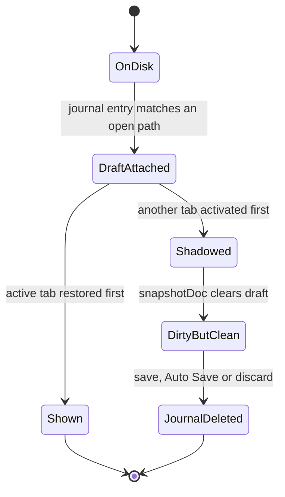
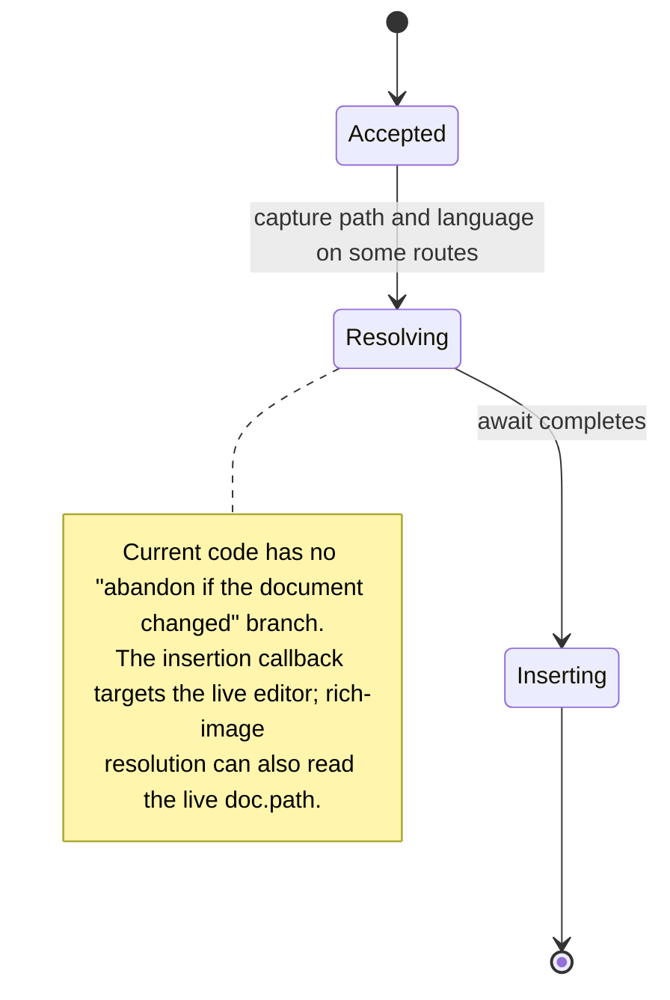
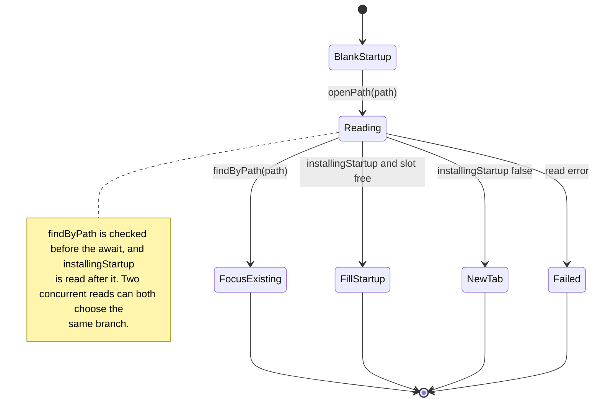
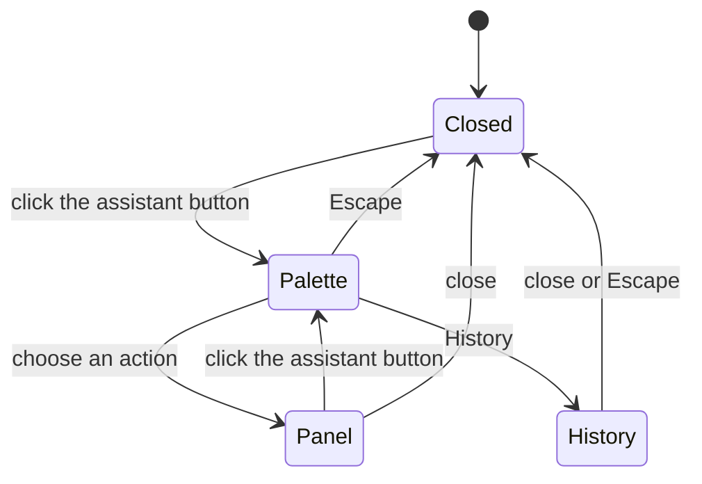
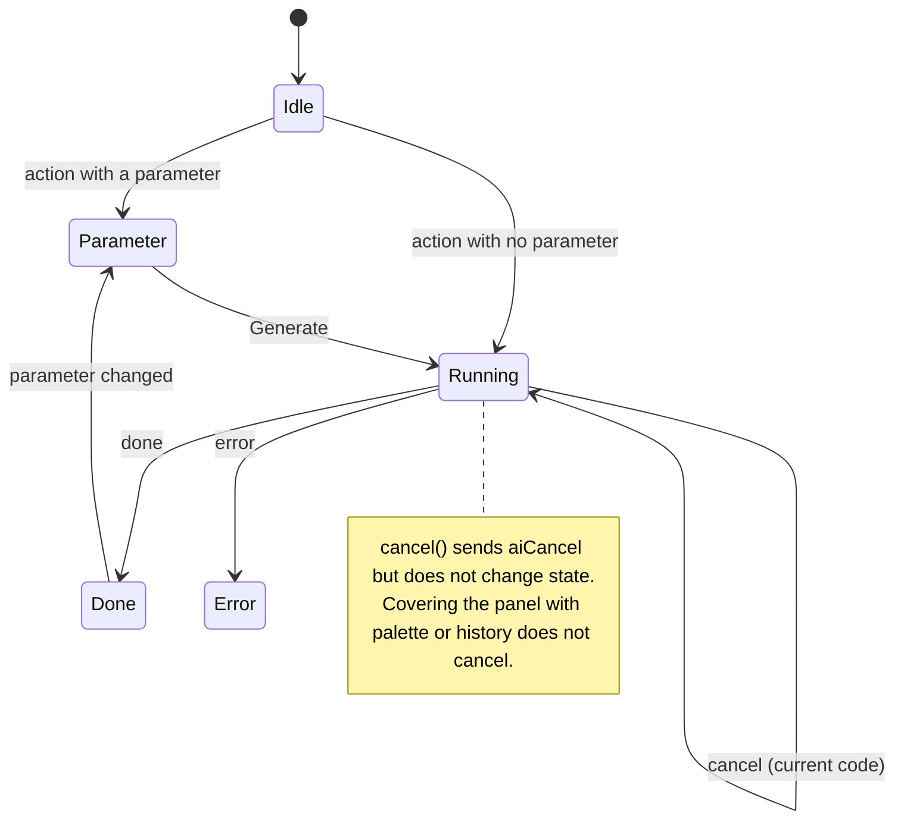
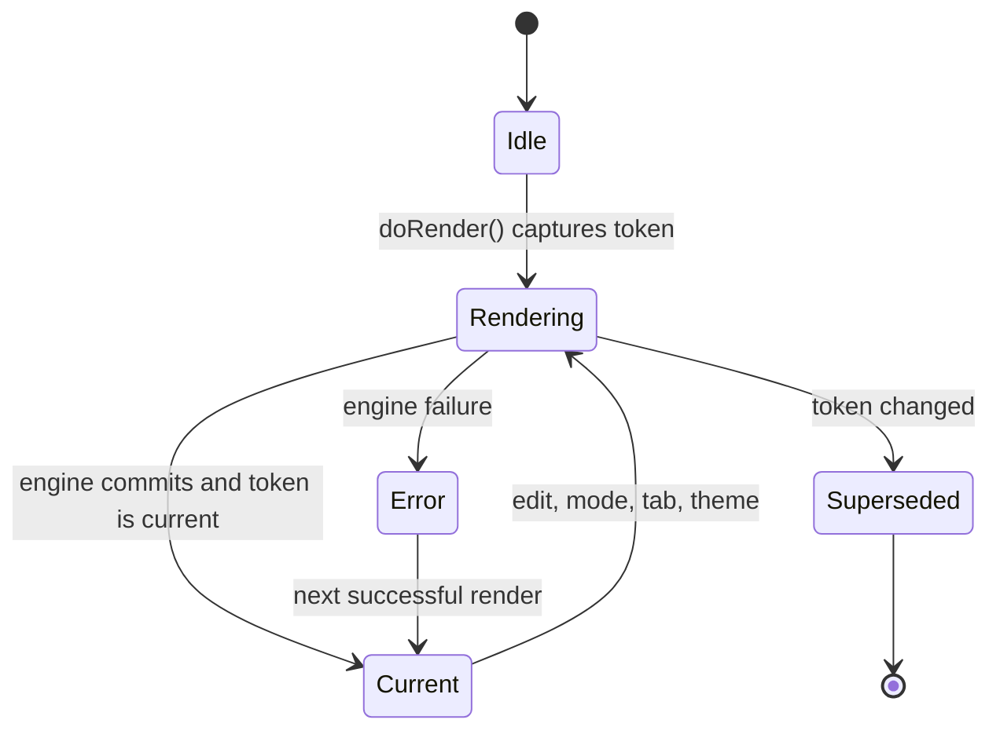
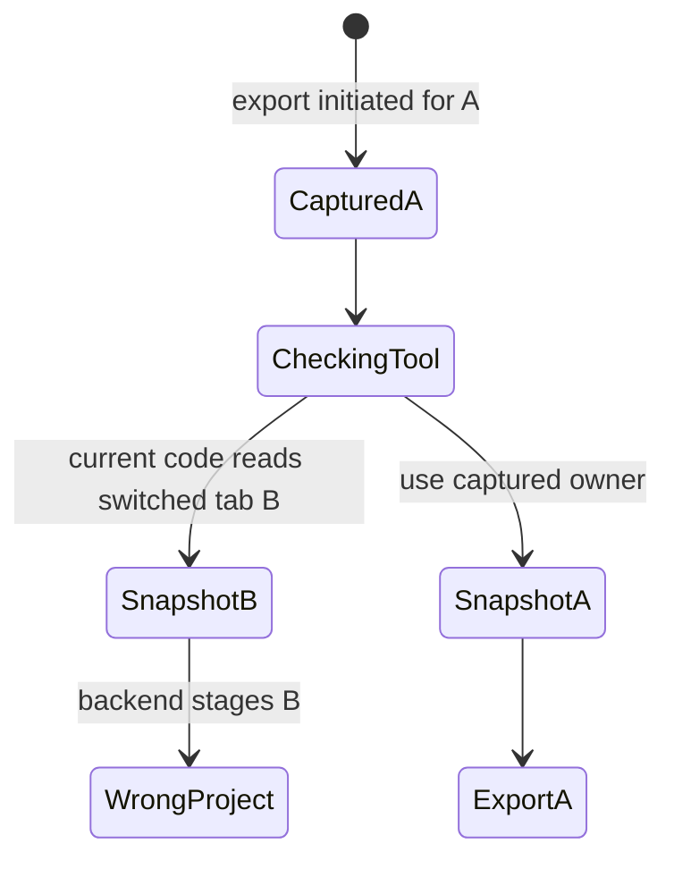
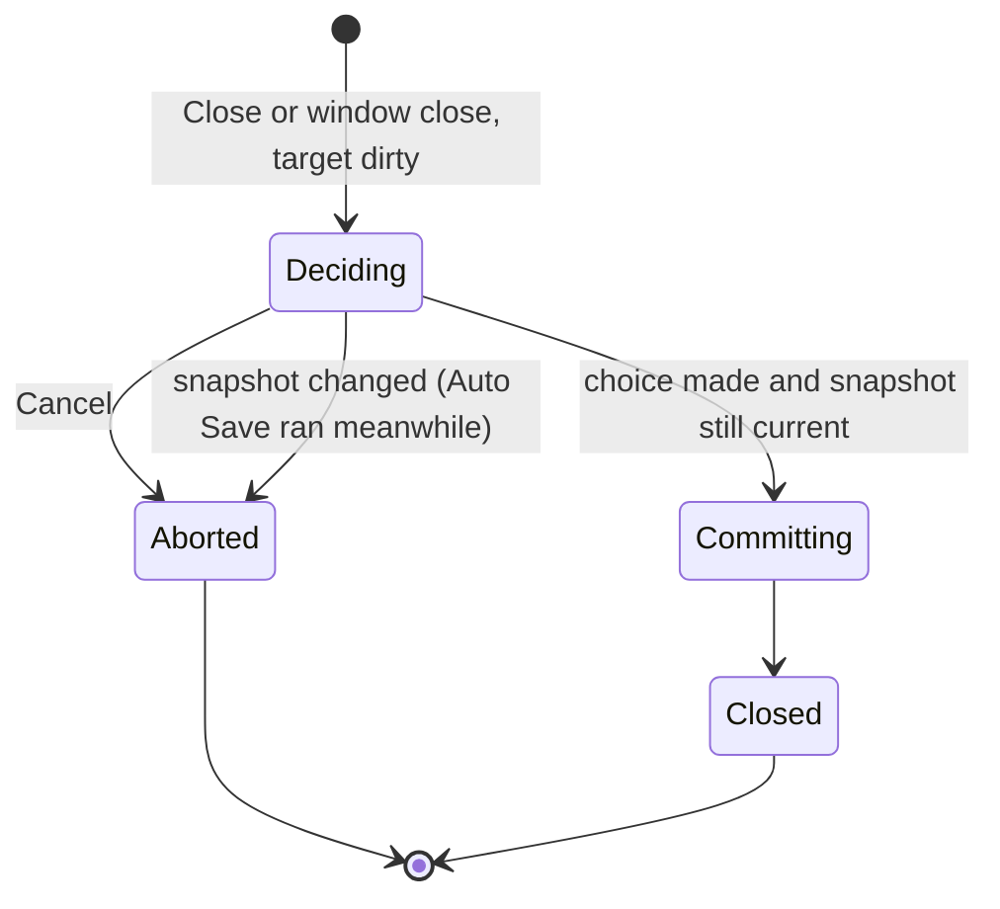

# Implicit State Machines: Audit and Architectural Recommendations

**Repository:** MDraft

**Date:** 2026-11-08

**Status:** Discovery and evaluation complete; revised after independent review
(2026-11-08) and re-verified against the code with a wider sweep (2026-11-10).
Phase 3 (implementation) ran on 2026-11-10 under the approved plan; its
execution record lists what landed, the tests added and what is still open.

**Reviewed revision:** `50866e9`; line references describe that revision. On
2026-11-10 the working tree differed from it only outside the cited
application paths (`src/main.ts`, `src/sessions.ts`, `src/document-lifecycle.ts`,
`src/images.ts`, `src/html-preview.ts` and `src/ai/` are unchanged; `latex.rs`
changed visibility only), so the references still hold. If a reference drifts,
search for the symbol named beside it rather than trusting the number.

**Constraint:** Discovery was read-only. The amendment and its draft plan change
documentation only; this audit work changed no application source, test,
dependency, setting, or public contract.
The original audit used code inspection only. The review additionally ran
app-free tests and in-memory reproductions with mocked boundaries; no real
application, provider, or user settings were exercised. See Validation strategy
for results and limitations.

### What the 2026-11-10 revision changed

- **Two new defects:** F16 (Auto Save during an open close decision silently
  discards the reader's Save/Discard choice) and F17 (a native LaTeX Cancel
  that reaches Rust before the job registers is lost).
- **Five areas added to the inventory** so the sweep is complete rather than
  sampled: F18–F20 below, plus the read-aloud start and AI file-name requests
  folded into F10 and F4. All of them were examined and need no change.
- **Sharper evidence:** F1 also breaks Next/Previous Tab and new-tab placement;
  F3 missed five direct `openPath` callers and loses the blank tab's journal
  entry, not only its text; F6's freshness gap includes `setNativeEnabled`, and
  repeated printing of the *same* document is the likelier temp-file collision;
  F14's trigger is narrower than stated; F15's own stale message steers the
  reader to the defective Insert below.
- **Reuse before invention:** each fix now names the in-repository primitive
  it should copy (Appendix B). In particular, `typst.rs` already solves
  cancel-before-registration with a watermark, and `DocumentLifecycle` already
  owns a per-path queue.
- **Two traps for whoever implements this:** `DocumentLifecycle`'s generation
  is the wrong paste-owner token (every Save and Auto Save bumps it), and
  `cancelTypstRender` passing the *current* token is correct, not a bug.
- **Harness facts corrected:** `image-paste-test.mjs` is not part of
  `scripts/test-all.mjs`; the opt-in harness ids are `image-path` and `export`.

## Why this report exists

MDraft has several asynchronous workflows whose correctness is enforced by
generation counters, snapshot comparisons, and "latest result wins" checks. Those
guards work, but the states they protect are often spread across booleans,
nullable fields, and module-level variables. That makes the valid combinations
hard to see and the invalid ones hard to test.

The goal is not to turn every conditional into a state machine. It is to find the
places where an explicit state, owner, or transition would prevent a real failure
or make the next change safer, and to leave the rest alone.

**Reading the confidence labels**

- **Verified by code path** — every branch named in the finding was read; the
  scenario follows from those branches. It was not executed.
- **Reproduced in memory** — actual function bodies were executed with mocked UI
  or I/O boundaries. This does not establish end-to-end behavior in Tauri.
- **Inferred** — one or more assumptions (for example, an OS file-lock behavior)
  were not established here.
- **Unverified** — the code suggests the outcome, but the relevant host or test
  was not exercised.

## Executive summary

Twenty candidate areas were examined. F1-F6 and F14-F17 contain concrete gaps;
F7 is an optional DX/AX improvement. F8-F10, F12 and F18 already have suitable
local guards; F11's frame controller has useful safeguards but its commit
notification needs attention in F5. F13, F19 and F20 are not worthwhile
standalone machines. A finding is not an approval to implement it.

Every module-level mutable variable in `src/main.ts` was enumerated and traced to
one of these rows, and every process-wide `static` registry in `src-tauri/src/`
was checked for an ownership or cancellation protocol. The inventory is
therefore a sweep, not a sample.

The highest-value findings are **ownership bugs**, not missing state libraries:

1. **Recovery can lose a draft or split active-session ownership.** When several tabs have
   crash-recovery entries and the active tab is not the newest entry,
   `restoreRecovery` activates another tab first; `activateSession` snapshots the
   active tab and clears its `draft`, leaving the editor on disk text while the
   tab is marked dirty. Saving or Auto Save can then remove the journal. A
   separate restore ordering can leave the displayed session different from the
   store's active session; closing it can leave the displayed `doc` outside the
   store, and until then Next/Previous Tab and new tabs are positioned relative
   to the wrong tab. **Severity: high.**
2. **A LaTeX export can combine two projects.** If the active tab changes during
   a tool lookup, the export can pair the initiating document with another
   project's snapshot, which the backend uses as its input (F14). The lookup
   only awaits while the Pandoc status cache is still empty, so the trigger is
   narrow, but the fix is a reordering. **Severity: high impact, narrow
   trigger.**
3. **An image paste/drop can land in a different document.** Downloads can take
   seconds; the insertion callback targets the current editor, and the asset path
   is either captured from the paste or read live depending on the route.
   Switching tabs during the download can write the image into the wrong buffer,
   with the wrong language syntax, and save the asset under the wrong document
   folder. Clipboard reads can also yield before the image handler captures a
   context. **Severity: high.**
4. **Concurrent opens can duplicate a tab or lose the startup document.** Every
   direct `openPath` caller bypasses the `openPaths` chain, and
   `installingStartup` is read after the awaited read. Two reads of the same path
   both miss `findByPath`; two startup reads can both fill the same blank tab,
   and filling a blank tab the reader typed in also forgets that text's
   recovery journal. **Severity: medium-high.**
5. **An AI insertion can use an obsolete position.** Insert and Insert below
   still use captured offsets after intervening edits, even though stale Replace
   is disabled — and the stale-Replace message tells the reader to "insert it
   below" (F15). **Severity: medium-high.**
6. **An abandoned AI request can continue.** A request intentionally continues
   while the palette or history covers the panel; choosing another action can
   lose the request id without cancelling. Stop also has registration and
   response-header races, and native LaTeX compiles have the same
   cancel-before-registration race (F4, F17). **Severity: medium.**
7. **Auto Save can void a close decision.** A background save during the
   unsaved-changes dialog invalidates the close's snapshot, so the reader's
   Save or Discard is silently ignored and the tab or window stays open (F16).
   No text is lost. **Severity: medium-low.**

The preview and export/print areas have narrower gaps: an old revision of an HTML
frame or an empty frame can be declared current after a failure, LaTeX freshness
omits engine configuration, and some install and print operations lack ownership
guards. Address these as independent changes, not as a new architecture.

Most fixes need no new mechanism: the repository already contains a working
example of each ownership pattern they need (Appendix B). The highest DX/AX
leverage is to reuse those primitives by name, so that the next asynchronous
path is written against a known pattern instead of a fresh flag.

No state-machine library is justified by the observed gaps. Some states are
orthogonal, such as request versus visible surface, or dirty versus conflict.
Small ownership records, discriminated unions where useful, transition functions,
and derived selectors fit the existing conventions without a runtime interpreter.

## Inventory

| ID | Area | Primary evidence | Current encoding | Risk | Verdict |
| --- | --- | --- | --- | --- | --- |
| F1 | Crash-recovery draft and active-session ownership | `src/main.ts:3157-3163`, `:3293-3304`, `:8530-8615`; `src/sessions.ts:174-225`; `src/document-lifecycle.ts:101-110` | `draft`, `dirty`, `editorState`, `recoveryId`, store active ID and `doc` | High: recovered or subsequent text can be lost | Enforce draft and active-session ownership |
| F2 | Clipboard, image paste and drop ownership | `src/context-menu.ts:167-183`; `src/images.ts:275-457`; `src/main.ts:5428`, `:8171-8312` | Async clipboard/image work targets the current editor or `doc` | High: wrong-document insertion or broken asset reference | Capture the operation owner before the first await |
| F3 | Document open and startup slot | `src/main.ts:3402-3470`, `:3125-3142`, `:8626-8668`, `:9091-9116` | `installingStartup`, `openPathChain`, pre-await `findByPath`, loop-index slot release | Medium-high: duplicate/lost open, lost typed text and journal | Per-path ownership and a single-consumer startup slot |
| F4 | AI panel, surface, and request | `src/ai/assistant.ts:138`, `:367-398`, `:926-991`, `:1237-1281`, `:1889-2025`; `src-tauri/src/ai/mod.rs:372-510` | 5-value `PanelState` + 3 surface booleans + nullable satellites | Medium: abandoned stream, ineffective Stop | Explicit request ownership and cancellation; preserve background completion |
| F5 | Preview current/stale truth | `src/main.ts:1319-1340`, `:2673-2725`, `:1335-1340`, `:2365-2366`; `src/html-preview.ts:745-798` | Tokens + `previewStale` + `previewSyncReady` + per-engine flags | Medium-low: false "current" after HTML failure | Return commit result; derive flag |
| F6 | Export/print/install readiness and engine freshness | `src/main.ts:1691-1701`, `:4415-4455`, `:4472-4502`, `:4786-4982`, `:8900-8929`; `src-tauri/src/print.rs:36`, `:408-458`; `export.rs:1835-1862`; `latex.rs:354-390` | Nullable caches; missing engine/configuration in freshness; one print mutex | Medium: stale PDF, failed action or collision | Separate freshness, readiness and resource-scoped guards |
| F7 | Session status derivation | `src/sessions.ts:11-58`; `src/document-lifecycle.ts:101-110` | Independent fields (`dirty`, `draft`, `conflict`, `lossy`, `readOnly`) | DX/AX: cross-field disagreements | Orthogonal derived selectors and justified assertions |
| F8 | Format Document | `src/main.ts:413`, `:3315-3323`, `:3349`; `src/format/formatters.ts:315-328` | `formatBusy` + snapshot guard | None observed | Already explicit; no change |
| F9 | Spellcheck | `src/spellcheck.ts:454-556`, `:575-645` | Per-instance request generation + document identity | None observed | Already explicit; no change |
| F10 | Read aloud | `src/read-aloud.ts:250-319`, `:458-537`; `src/main.ts:8079-8143` | Queue index + active flag, callback timestamps ignored; start guarded by request counter, document id and revision | None observed | Already explicit; no change |
| F11 | HTML preview frames | `src/html-preview.ts:503-570`, `:731-798` | `generation`, `active`, `pending`, per-frame `ready`/`timer` | Commit result is not reported to the shell (F5) | Keep frame controller; fix commit notification |
| F12 | Preview worker queue | `src/preview-worker-client.ts:27-154` | `broken`, `running`, `current`, `pending`, monotone id | None observed | Already explicit; no change |
| F13 | Settings and tab-strip UI state | `src/main.ts:1070-1082`; `src/tabs.ts:73-92` | Serialized settings queue; transient drag/menu state | Low | Rejected: no invalid operation or user-visible state |
| F14 | LaTeX project export ownership | `src/main.ts:3708-3767`, `:4472-4516`, `:4593-4606`; `src-tauri/src/export.rs:1170-1207` | Source captured before await; project snapshot uses live `doc` afterward | High: export may contain a different project | Capture one owner and overlay context before yielding |
| F15 | Stale AI insertion anchors | `src/ai/assistant.ts:1650-1656`, `:1708`, `:1827-1867`; `src/ai/context.ts:270-286` | Captured offsets reused after text changes | Medium-high: insertion can split unrelated text | Map the position or use a defined safe fallback |
| F16 | Auto Save during a pending close decision | `src/main.ts:463`, `:3663-3682`, `:7909-7941`, `:9125-9141`; `src/document-lifecycle.ts:84-93`, `:286-334` | `closing` is private; Auto Save's `run()` bumps the generation the close snapshot checks | Medium-low: Save/Discard silently ignored; no data loss | Skip Auto Save while a close is deciding; no overlapping ticks |
| F17 | Native LaTeX cancel before registration | `src/main.ts:1583-1588`, `:2245-2259`; `src-tauri/src/latex_native.rs:36-56`, `:275-293`, `:458-478` | Opaque job id; `latex_native_cancel` ignores an id not registered yet | Medium-low: TeX process tree keeps running; overlapping compiles | Record early cancels (tombstone), as `typst.rs` does with its watermark |
| F18 | Status, outline, native-menu and remembered-tab synchronization | `src/main.ts:774-919`, `:1189-1243`, `:7873-7907` | Request counters, generation, single-flight coalescer, signature compare | None observed | Already explicit; no change |
| F19 | Pane scroll and caret synchronization | `src/main.ts:5774-5781`, `:6011-6047`, `:6651-6655` | Time-window suppression (`suppress*Until`), drag booleans, word-map generation | None reproduced; hard to read | Rejected without a reproduced defect; see Additional areas |
| F20 | Preferences asynchronous actions | `src/preferences.ts:1304-1427`; `src/main.ts:8867-8929` | Endpoint-scoped reply guard; shared `ai.note`/`ai.loading` slots | Cosmetic: an older action can overwrite a newer note | Rejected: no wrong data is committed |

Two related areas were considered and rejected as standalone state machines:

- **Settings persistence** already serializes writes in call order and deliberately
  treats a failed write as best-effort (`src/main.ts:1070-1082`). A visible
  "saving/error" state would add a new UI surface without changing any operation
  the reader can invalidate.
- **Tab drag/menu state** is transient pointer state with local guards
  (`src/tabs.ts:73-92`). It does not own document data and does not benefit from a
  document-level model.

## Detailed findings

### F1 — Recovered draft and active-session ownership

**States and transitions as implemented**

- `clean` — the session's `savedContent` equals the disk text.
- `recovered-unshown` — `draft` holds journal text; the editor may still show
  disk text (`src/sessions.ts:36-44`).
- `recovered-shown` — `draft` has been copied into the editor, then cleared
  (`src/main.ts:3213-3216`).
- `dirty` — the editor text differs from `savedContent`
  (`src/document-lifecycle.ts:101-110`).
- `journaled` / `clean` — `recoveryId` exists or has been forgotten
  (`src/recovery.ts:143-161`).

The intended sequence is: attach the draft, show it, clear the draft, and journal
later edits. The code has a path that skips `recovered-shown`.

**Evidence**

1. Entries are sorted newest-first (`src/main.ts:8539`). For every entry whose path
   is already open, the code attaches `draft`, sets `dirty = true`, and pushes the
   session into `recovered` (`:8550-8565`).
2. `recovered[0]` is made active (`:8607-8610`). If that is a different session,
   `activateSession` calls `snapshotDoc()` first (`:3293-3304`).
3. `snapshotDoc()` stores the current editor state and **clears `doc.draft`**
   (`:3157-3163`). It does not check whether the editor actually contains the
   draft.
4. `displayDoc` restores `editorState` before considering `draft` (`:3252-3257`),
   so the captured disk text is shown when the session is revisited. The session
   still has `dirty = true` from step 1.
5. A later save writes that disk text; `journal()` compares text with
   `savedContent` (`src/document-lifecycle.ts:101-110`), calls
   `recovery.forget`, and the unchanged journal file is removed
   (`:194-200`, `src/recovery.ts:143-161`).

There is a second ownership failure. When the newest recovered entry belongs to
the displayed session A, and another entry creates session B, `sessions.add(B)`
changes the store's active ID (`src/sessions.ts:174-177`). `restoreRecovery` then
calls `displayDoc()` for A without resetting that ID (`src/main.ts:8599-8610`).
Closing A can remove it without returning a successor, because `removeMany`
believes B was active; `closeSessions` then leaves `doc` pointing at removed A
(`src/sessions.ts:209-225`, `src/main.ts:3663-3677`). Subsequent operations may
refuse or lose edits to the removed session.

The divergence is visible before any close. Next/Previous Tab are computed
from the store's active ID (`src/main.ts:5492-5493`, `src/sessions.ts:227-235`),
so Ctrl+Tab from A moves relative to B; `sessions.add` inserts after the store's
active ID (`:174-178`), so the next opened document lands beside B. These are
cheaper to assert in a test than the close path.

**Root cause.** "Which session is active" has two writers: the store's
`activeId`, which `sessions.add` also moves, and the shell's `doc`, which each
caller assigns separately. `openPath` and `loadUntitled` assign `doc` right
after `add` (`src/main.ts:3418-3419`, `:3488-3489`); `handoffLatexSelection`
assigns it through `setActive` in the same synchronous run (`:6340-6353`; the
recheck between them repeats conditions that were just checked, so its early
`return` is unreachable today, but it would leave the same divergence if one of
those conditions became independent); `restoreRecovery` adds inside a loop that
awaits and then decides from `doc`
(`:8579-8610`). The recovery path is the one caller where the two can disagree
across an await.

**Invalid combinations representable today**

- A hidden session with an unshown draft is valid. The dangerous case is an
  active session whose live editor still shows disk text while that session's
  unshown draft can be cleared, saved over, or ignored.
- After the draft is cleared, `dirty === true` while `textOf(session) ===
  savedContent`, and no in-memory representation holds the recovered text.
- A live `recoveryId` for a session whose draft is no longer reachable in memory.
- The store's active session differs from `doc`, or `doc` is no longer in the
  store after closing a tab.
- `editorState === null` can mean "on screen" or "recovered, never shown"
  (`src/sessions.ts:52-55`), which is why Format refuses the latter
  (`src/main.ts:3319-3321`).

**Concurrency and lifecycle**

The shadowing and active-ID examples follow deterministic orderings once their
preconditions hold. Recovery also awaits reads inside its loop; if the editor can
receive edits while an active draft is attached but unshown, the edit and journal
scheduler can observe disk text rather than the recovered text. This interaction
needs an application test. If Auto Save is enabled, it may save the shadowed
session and forget its journal without an explicit Save (`src/main.ts:9125-9140`).

**Existing safeguards and tests**

`p0-unit` exercises the recovery scheduler's per-session ordering and generation
guards (`scripts/p0-unit.mjs:70-223`), and `p0-lifecycle-test` covers save,
reload, close, and recovery removal. Neither drives the multi-journal restore
ordering above. `tabs-restore-test` covers remembered tabs, not recovered drafts.
The review executed the actual recovery/snapshot and recovery/close branches
with an in-memory session store and mocked editor or close lifecycle. Those
reproductions showed draft shadowing and store/display divergence; they did not
exercise real journal files, Auto Save, or a Tauri window.

**Would explicit modeling help?**

Not a full reducer. The useful invariants are: the displayed session equals the
store's active session; recovered text stays authoritative until it is installed
in its owner or deliberately discarded; and a journal is forgotten only after
the intended text is saved or discarded. A hidden session may legitimately hold
an unshown draft. Merely leaving `draft` set while also capturing disk text as an
`editorState` is insufficient: `displayDoc` prefers that state and clears the
draft. `textOf` also reads the live editor for `doc`, so every path that reads,
displays, snapshots, saves, or journals the active pending draft must agree on
the authority.

**Proposed minimal change**

- Ensure the active draft becomes authoritative before a snapshot, save, edit,
  or journal operation can observe the old editor text. The simplest form: a
  draft attached to the *displayed* session is installed into the editor in the
  same synchronous step, so `doc` never carries a pending draft; `draft` stays
  a pending field only for hidden sessions, where it is valid. Preserve the
  current choice of recovered tab unless a behavior change is explicitly
  approved.
- Keep `doc` and the store's active ID synchronized after every recovered session
  is inserted and when the selected session is closed: insert recovered sessions
  without moving the store's active ID (or restore it to `doc.id` before the
  next await), rather than adding a second reconciliation step afterwards.
- Test multiple journal orders, existing and new/untitled recovered tabs, close,
  save, Auto Save, and a delayed restore with an intervening edit. Assert both
  sessions' displayed text, written bytes, and journal contents/removal, rather
  than only checking that an unrelated journal survived.
- Add assertions only at stable boundaries where the ownership invariant is
  expected to hold; an unshown hidden draft is not itself an invalid state. The
  cheapest durable guard is a test helper that asserts
  `sessions.active() === doc && sessions.byId(doc.id) === doc` after each
  scripted operation, not a runtime throw in the shell.

**Expected impact**

- **UX:** recovered text is not silently replaced by disk text, the dirty dot
  stops lying, and tab navigation follows the tab on screen.
- **DX:** the draft lifecycle becomes a named precondition rather than an
  incidental field.
- **AX:** an agent can see that `draft` and `editorState` are not independent.

---

### F2 — Clipboard, image paste and drop ownership

**States and transitions as implemented**

There is no operation owner. A clipboard read, paste or drop is accepted, work is
awaited, and the result can target the editor or focused field active when the
await settles.

**Evidence**

- `handleImagePaste` decides synchronously, then starts `saveClipboard`,
  `saveClipboardBase64`, `saveOnline`, or `saveLocal` without capturing a session
  (`src/images.ts:351-413`).
- `saveOnline` calls `api.downloadImage(url, ctx.documentPath, ...)` and then
  `ctx.insert(...)` (`:306-321`). `ctx` is built by `imageContext()`, whose
  `insert` is `(text) => editor.insertBlock(text)` and whose `documentPath` is
  `doc.path` at paste time (`src/main.ts:8171-8183`).
- Rich paste can resolve multiple images before inserting; `resolveRichImage`
  takes the captured destination language but reads live `doc.path` at several
  points, including after awaits (`:8212-8283`), and `applyRichPaste` inserts
  into the current editor (`:8298-8312`). An already-started download receives
  the path passed at its call; a later image or validation may see a new path.
- `handleImageDrop` loops over files and inserts one joined block at the end
  (`src/images.ts:420-457`); a tab switch during the loop has the same effect.
- The context-menu Paste and menu Paste without Formatting await
  `readClipboardData()` before dispatching to the live editor or focused field
  (`src/context-menu.ts:167-183`, `src/main.ts:5428-5460`). Capturing ownership
  only in `imageContext()` is too late for those entry points.
- `editor.insertBlock` dispatches at the current selection; it has no session or
  revision parameter (`src/editor.ts:1643-1645`).
- The rich-paste plan explicitly says insertion follows the caret if the reader
  types while images arrive (`docs/plans/2026-10-17-rich-paste.md:444-448`). That
  behavior is intentional **within one document**; a tab switch is not covered by
  that decision.

**Invalid combinations representable today**

- Paste began in document A; document B is active at completion; markup is
  inserted into B.
- For a standalone image URL or bitmap, `ctx.documentPath` is A, so the asset is
  saved in A's folder while the markup is inserted into B (`src/images.ts:265-321`).
- For rich paste, an image resolution started after the switch can read B's live
  `doc.path` while receiving A's language, saving under B with A's markup. An
  image already being downloaded may instead have used A's path.
- A drop or paste that begins in an untitled tab can be resolved after the tab is
  saved as a different path, mixing the two folders.
- Save As can keep the same session ID but change its directory or language,
  making a reference relative to the captured old directory wrong for the new
  location. Reload or replacement can likewise retain a session ID while changing
  which document content an operation should affect.
- If the tab is closed during the download, the completion inserts into whichever
  tab is active, including a fresh Untitled.

**Concurrency and lifecycle**

Rich paste limits remote resolution to four at a time, eight remote images and an
8-second download timeout per request; the whole operation can still take many
seconds. That is ample time to switch tabs. The insertion has no owner or
post-await session/lifecycle check.

**Existing safeguards and tests**

`image-rules-test`, `image-paste-test`, and `rich-paste-test` cover the import
rules, download success/failure, and per-destination syntax. They do not delay a
download across a tab switch. `image-rules-test` does check that opening the same
document again focuses its tab, but that is a different path.

**Would explicit modeling help?**

Yes, in a small form: capture an owner at the initiating gesture, before the
first clipboard or image await. It must distinguish the owning session, its
document identity/replacement lifecycle and the relevant path and language.
Checking only `sessionId` does not handle Save As or replacement. A full state
machine is unnecessary, but the record needs a commit policy, not just a type.

Do not reject every changed text revision: the rich-paste plan intentionally
lets insertion follow the caret when the reader types in the same document. A
path change, document replacement, tab switch, and ordinary typing need distinct
policies. Do not invent new persisted state or discard a pasted payload silently.

Two existing tokens look suitable and are not. `Session.revision` changes on
every keystroke, so it would refuse intentional typing. `DocumentLifecycle`'s
per-session generation (`src/document-lifecycle.ts:86`) changes on every Save,
including Auto Save every 20 seconds, so a slow download would be refused for a
save that changed nothing the paste depends on. The owner needs the session
object, its path, its language, and an incarnation that only `describe` (the
startup fill) and lifecycle `replace` (reload) advance.

Nothing captured is lost by a refusal, which keeps the fallback small:

- A clipboard-read route has consumed nothing. The system clipboard still holds
  the data, so a target that changed during the read is a cancelled paste the
  reader can repeat.
- An image route has already written its asset, and `SavedImage` carries
  `absolutePath` as well as the relative reference (`src/api.ts:474-479`). A
  reference can be recomputed for a new directory, and a refused insertion can
  name the file that was saved.
- A hidden owner can still receive the insertion. `formatSession` already edits
  an inactive tab's stored `EditorState` in one undoable transaction and keeps
  revision, dirty state and the journal consistent (`src/main.ts:3366-3380`).
  That is the precedent for "the paste lands in the document it was made in".

**Proposed minimal change**

- Capture the destination before the first await in both clipboard menu routes,
  image paste/drop and rich paste. Include path/language and a replacement
  incarnation distinct from an ordinary typing revision and from the lifecycle
  generation.
- Resolve image paths against the captured destination. At commit:
  - owner on screen, same incarnation, path and language: insert at the live
    caret, as today;
  - owner hidden but otherwise unchanged: insert into its stored `EditorState`
    at its saved selection, following the `formatSession` precedent, and say so
    in a toast;
  - owner saved under a different directory: recompute the reference from
    `absolutePath`, or refuse;
  - owner closed, reloaded/replaced, or holding a never-shown recovered draft:
    insert nothing and name the saved asset in a toast.

  A clipboard-read route whose target changed during the read inserts nothing
  and says the paste can be repeated. No route inserts into an unrelated
  document or writes the system clipboard.
- Test delayed clipboard read and delayed images across tab switch, close,
  reload/replacement and Save As, including failed downloads. Verify the actual
  target text and asset path, and that typing in the same document still follows
  the existing caret policy.

**Expected impact**

- **UX:** a delayed paste cannot silently edit the wrong document or insert a
  reference relative to the wrong folder, and in the common tab-switch case it
  still lands where the reader pasted it.
- **DX:** the paste path gains an explicit owner instead of relying on closure
  timing, without a new retention surface or capacity accounting.
- **AX:** the contract "an async paste belongs to the session that started it" is
  visible in the type and test.

---

### F3 — Document open and the startup slot

**States and transitions as implemented**

- `blank-startup` — the initial session exists and `installingStartup` is true
  (`src/main.ts:411`).
- `reading(path)` — `openPath` awaits `api.readDocument` (`:3411`).
- `focus-existing` — a session with the same path is found (`:3404-3407`).
- `fill-startup` — `installingStartup` is still true, so the read replaces the
  initial session (`:3412-3414`).
- `new-tab` — a normal session is created and added (`:3415-3419`).
- `failed` — the read throws and a toast/dialog reports it (`:3447-3453`).

**Evidence**

- `openPath` checks `sessions.findByPath(path)` before awaiting
  (`src/main.ts:3404`), then reads (`:3411`), then branches on the global
  `installingStartup` (`:3412`) and adds a session (`:3418`). There is no
  post-await `findByPath` and no per-path in-flight map.
- `openPaths` has a serialization chain (`:3456-3470`), but direct callers bypass
  it: the sidebar/recent callbacks (`:2829`, `:2914`), File › Open (`:5482`),
  the native Open Recent row (`:7515`), preview link navigation (`:7343`) and
  editor link navigation (`:7781-7806`), drag/drop (`:7852`), LaTeX problem
  navigation (`:1884`), Open AI prompts (`:8935`), remembered-tab restore
  (`:8656`) and startup (`:9096`, `:9104`) call `openPath` directly. Only
  `openPaths` and the `open-files` listener (`:9088`) use the chain.
- Two callers act on the global `doc` after the open without knowing whether
  it succeeded. Preview link navigation scrolls whatever tab is active to the
  link's fragment (`:7343-7347`), including after a failed open or a tab switch.
  LaTeX problem navigation is the model to follow: it rechecks
  `pathKey(doc.path)` before acting (`:1889`).
- Startup installs the menu listener before the startup choice (`:9065` vs
  `:9091-9107`), so a menu open can arrive while the startup read is pending.
- The `installingStartup` flag is set false only after the first startup document
  is installed (`:9097`) or after the whole startup choice (`:9108`).
  `restoreLastTabs` releases it by loop index instead (`:8654-8656`): when the
  first remembered path fails to read, the second path still opens as a new tab
  and the blank startup tab is left behind.
- `describe()` resets content, dirty state, draft and conflict but keeps
  `recoveryId` (`:3125-3142`). `showInEditor` then calls `editor.setDoc`, which
  fires the ordinary change listener (`src/editor.ts:858-862`, `:1007-1027`);
  because the new text equals `savedContent`, that listener calls
  `recovery.forget(doc)` (`src/main.ts:8719-8721`). If the reader typed in the
  blank tab before a startup read completed, the typed text leaves the editor
  *and* its journal entry is removed.

**Invalid combinations representable today**

- Two concurrent reads of the same path both see "not open" and create two
  sessions with the same path; the second becomes active, and both can later be
  edited and journaled independently.
- Two concurrent startup reads both see `installingStartup === true`; each calls
  `describe(doc, payload)` on the same session. The later completion silently
  replaces the earlier document. If the reader typed in the blank tab before the
  read completed, that typing is replaced without a prompt and its recovery
  entry is forgotten.
- A Save As of another tab to path X while X is being opened: the open saw "not
  open" before its read, the save adopts X, and the open then adds a second
  session for X. `DocumentLifecycle` serializes Save As targets on a
  `path:<pathKey>` queue (`src/document-lifecycle.ts:130`), but opens do not use
  it.
- A menu Open or drop during boot can take the `fill-startup` branch and replace
  the document the startup sequence is about to install.
- Closing the last tab during boot can leave the session store empty while
  `loadUntitled` takes the fill branch and mutates the removed session
  (`src/main.ts:3480`, `:3663-3678`). The next `openPath` describes a `doc` that is
  no longer in the store; `lifecycle.run` refuses it silently
  (`src/document-lifecycle.ts:84-85`).

**Concurrency and lifecycle**

The Rust launch boundary deduplicates paths and queues them before emitting
(`src-tauri/src/launch.rs:103-141`). That protects the launch-to-frontend handoff,
but the frontend's own async gap is outside it. The `openPaths` chain protects
multi-path startup only; it does not protect direct opens.

**Existing safeguards and tests**

`single-instance-test.mjs` covers the queue/emit path and focus-not-duplicate for
an already-open tab. `tabs-restore-test.mjs` covers remembered tabs and Close All.
`document-tabs-test.mjs` covers `open-files` adding a tab. None of these holds two
reads of the same path or performs a direct open before the startup read
completes.

**Would explicit modeling help?**

Yes, but the smallest useful state is an in-flight path owner and a startup-slot
identity, not a global reducer. A captured boolean is not a slot: two jobs can
capture `true`, and another action can edit, replace, or close the initial session
while a read is pending. The commit needs to recheck path, session identity,
generation and whether the slot has already been consumed. A per-path map or a
carefully designed shared queue may coordinate opens; choose based on the tests
and preserve responsiveness for unrelated paths.

**Proposed minimal change**

- Coordinate same-path opens and recheck `findByPath` after a delayed read; focus
  an existing session instead of creating a duplicate. Prefer the existing
  `path:<pathKey>` key in `DocumentLifecycle` over a second per-path map: one
  key space then orders opens against Save As to the same target. The open
  holds it only for the read; no dialog runs inside it.
- Capture the startup session identity and relevant generation, consume the slot
  at most once, and recheck that it still exists and is safe to replace. Never
  overwrite typed text without an explicit decision. Release the slot when a
  document is installed, not by loop index, and treat a slot whose session has
  a journal entry or a changed revision as no longer blank.
- Callers that act on `doc` after an open should receive the opened session (or
  null) and act on it, as LaTeX problem navigation already rechecks.
- If routing callers through a queue, avoid a bulk-open task awaiting another
  task appended to its own chain; test error recovery and unrelated slow paths.
- Test duplicate opens, direct open during startup, typing or closing during a
  delayed read, Save As to a path being opened, a failed first remembered tab,
  multi-file order, and a failed read followed by a successful one. Assert the
  journal as well as the editor text after typing in the blank tab.

**Expected impact**

- **UX:** double-clicking a recent file cannot create two tabs; a startup read
  cannot silently discard a file or typed text.
- **DX:** explicit path and startup-slot ownership replace assumptions about
  which caller happened to enter the existing queue.
- **AX:** the startup slot and the in-flight read become explicit inputs that a
  test can control.

---

### F4 — AI Assistant surface and request

**States and transitions as implemented**

The panel has a five-value `PanelState` (`src/ai/assistant.ts:138`), but the
surface is three independent booleans (`paletteOpen`, `panelOpen`, `historyOpen`)
and the request has several satellites (`requestId`, `channel`, `startedInfo`,
`answerStopped`, `answerTruncated`, `entryId`, `usageCounted`).

**Evidence**

- `PanelState` is `"idle" | "parameter" | "running" | "done" | "error"`
  (`:138`); `state` is one mutable variable (`:367`). `requestId`, `channel`,
  `startedInfo`, `answerStopped`, `answerTruncated`, `entryId`, and
  `usageCounted` are separate (`:368-398`).
- `openPanel` sets `requestId = null` and resets the answer, but does not call
  `aiCancel` (`:1237-1265`). `choose()` reaches it through `closePalette()` (`:917-924`).
- `openPalette()` hides the panel (`panelOpen = false; panel.hidden = true`) and
  does not cancel (`:926-941`). `openHistory()` does the same (`:975-991`).
- `startRequest` sets `requestId` and `state = "running"` (`:1921-1923`), clears
  the answer fields, and subscribes with a closure that ignores events after the
  id changes (`:1938-1950`).
- `cancel()` only sends `api.aiCancel` and writes "Stopping…"; it does not move
  to a `stopping` state (`:2021-2025`).
- `onEvent("done")` sets `state = "done"`, records history and usage, and may
  reset to `parameter` if the sent parameter no longer matches (`:1964-1999`).
  Its comment explicitly preserves completion when palette or history covers
  the panel (`:1979-1981`).
- `setParameter` clears `entryId` even when the value did not change (`:1422-1432`).
- `renderFooter` offers Copy in the `done` branch even when `answerStopped` and
  `answerText` is empty (`:1694-1723`); `copyAnswer` then returns silently
  (`:1820-1825`).
- Rust sends `Started` **before** registering the cancel sender
  (`src-tauri/src/ai/mod.rs:435-447`), and `provider::stream` awaits the response
  headers outside the cancellation `select!` (`src-tauri/src/ai/provider.rs:496-510`).
  The client has a 15 s connect timeout (`:17`, `:282-296`) but no deadline for
  response headers. Before registration the command also locks settings and
  reads the prompt file from disk (`src-tauri/src/ai/mod.rs:399-418`), so the
  unregistered window is a file read wide, not a few instructions.
- A cancel that arrives during `post_chat` is not lost, only late: the watch
  receiver's version has advanced, so `cancel.changed()` resolves on the loop's
  first poll once headers arrive. The cancel that *is* lost is the one that
  reaches `ai_cancel` before `running.insert`.
- The Save As file-name suggestion (`src/main.ts:3073-3115`) is the one AI
  request that already bounds itself: it races the request against a timeout
  that also sends `aiCancel`, and caches by session and revision. It is not
  part of this finding.

**Invalid combinations representable today**

- `state === "running"` while `panelOpen === false` and `requestId` is live is
  an **intended** background state when palette or history covers the panel.
  It is not itself an invalid combination.
- `state === "running"` while `requestId === null` (after `close()`), so `cancel()`
  no-ops even if the panel is somehow shown again.
- `state === "done"` with `requestId` still set; harmless only because `cancel()`
  checks state.
- `answerStopped && answerText === ""` with an enabled Copy button.
- `entryId === null` while an answer completes; history silently misses it.
- `startedInfo` can arrive on a request the reader has already abandoned if the
  id check is bypassed; normally the closure protects this.

**Concurrency and lifecycle**

- **Orphaned stream:** palette/history open during a run, then a new action sets
  `requestId = null`; the old Rust request continues to completion because no
  cancel was sent. The answer is discarded, the usage is not recorded, but the
  provider work and context transmission continue.
- **Cancel before registration:** `ai_cancel` only consults registered senders
  (`src-tauri/src/ai/mod.rs:372-377`). Stop, close, or a window-close cancellation
  that reaches Rust before registration can be lost. Moving registration before
  Started reduces one window but does not by itself order independent commands.
- **Stop lost before headers:** a server that accepts TCP and stalls before
  response headers keeps `post_chat` pending; the watch receiver is not polled
  until `stream` enters its loop. The panel can remain "Stopping…" until the
  server responds or another external timeout ends the request; the connect
  timeout does not bound an already-connected server's header wait.
- **Cancel racing done:** Rust removes the request id before sending `Done`
  (`src-tauri/src/ai/mod.rs:475-477`); a `Done { stopped: false }` can overwrite
  "Stopping…" with "Answer ready". The UI has no `stopping` state to preserve the
  reader's intent.
- **History duplication:** choosing the already-selected Translate target nulls
  `entryId`; Regenerate then allocates a new id and adds a second history row for
  the same request (`:1425`, `:1917-1919`).

**Existing safeguards and tests**

`scripts/ai-assistant-test.mjs` covers Stop (status, server close, no late delta;
`:2382-2407`), tab-switch cancellation (`:2866-2885`), history cap, stopped
answers not recorded, Regenerate single row, and stale target disabled Replace.
`scripts/ai-unit.mjs` covers pure staleness/capture/history helpers. The suite
does **not** open the palette or history during a stream, close the panel while
running (only tab switch does), stall the provider before headers, or apply a
stale "Insert below".

**Would explicit modeling help?**

Some explicit modeling helps. Surface visibility and request lifecycle are
orthogonal: a request can legitimately run while History or the palette is
visible. A surface literal can prevent multiple visible surfaces, and a request
record can retain the ID and cancellation intent until the request terminates.
Neither type alone guarantees the side effect of cancellation; the transition
and backend registration protocol must enforce it. A reducer or wholesale union
migration is optional, not a prerequisite for fixing the ownership bug.

The backend needs cancellation both before registration and while awaiting
`post_chat`, including retries and error bodies. An overall response-header
deadline would add a new timeout behavior and needs explicit approval; it is not
required merely to make Stop cancellable. A completed request racing Stop must
report the actual outcome, not falsely claim that the provider stopped.

The repository already solves cancel-before-registration once. `typst.rs`
keeps a per-window `latest` watermark: a cancel advances it, and a compile that
registers with a token at or below the watermark starts cancelled
(`src-tauri/src/typst.rs:50-117`). AI request ids are opaque strings, so the
string-id analogue is a small tombstone set: `ai_cancel` for an unknown id
records it, `ai_complete` checks and clears it at registration, and the set is
bounded (oldest dropped) so a stray id cannot grow it. The same shape fixes
F17. Neither needs a payload change.

**Proposed minimal change**

- Preserve background completion and history while palette/history covers the
  panel. Cancel or otherwise retain ownership when a new action actually
  abandons an old request; do not simply null its ID.
- Make Stop and close cancellation idempotent, retain cancellation intent until
  registration or termination, and represent a pending stop without claiming
  remote computation or billing has stopped.
- Only clear `entryId` when the parameter actually changed (`:1422-1432`).
- Disable Copy when `answerText.trim()` is empty.
- Backend: record a cancel that arrives before registration (bounded tombstone,
  checked at `running.insert`) and select on cancellation around `post_chat`.
  Preserve command names and payloads.
- `close()` cancels and nulls `requestId` but leaves `state === "running"`
  (`src/ai/assistant.ts:2051-2063`); settle the state with the id so the next
  surface does not inherit a running request it cannot stop.
- Tests: background completion under palette/history; replacement by a second
  action; Stop/close before registration and before headers; completed-versus-
  cancelled races; stopped empty answer; duplicate Translate/Regenerate.

**Expected impact**

- **UX:** Stop has a reliable local effect, and the existing background History
  behavior is preserved. Remote provider work or charges cannot be guaranteed.
- **DX:** request ownership and cancellation intent have a testable contract.
- **AX:** new surface and abandonment paths must state what happens to a request.

---

### F5 — Preview current/stale truth

**States and transitions as implemented**

The preview has a monotone `renderToken` (`src/main.ts:1320`), two booleans
`previewStale`/`previewSyncReady` (`:1335-1340`), per-engine PDF fields, and a
`latexInFlight` flag. There is no explicit `rendering` phase.

**Evidence**

- `doRender` increments `renderToken` and dispatches by language
  (`:2691-2711`). Each engine checks `token !== renderToken` after its awaits
  (`:2720`, `:2740`, `:2463`, `:2552`, `:2688`, `:2255`, `:2292`).
- `renderHtmlPreview` awaits `htmlPreview.render` (`:2673-2689`), but
  `htmlPreview.render` catches build/IPC failures, calls `callbacks.onError`, and
  returns without creating a pending frame (`src/html-preview.ts:754-780`). The
  old active frame for the same document can remain on screen. A normal document
  switch calls `syncGuest`, which resets or disposes the guest and drops its
  frames (`src/main.ts:3118-3121`); after a reset, a failure may instead leave no
  frame. The previous-document claim is therefore not established for that path.
- `doRender` then unconditionally sets `previewStale = false` and
  `previewSyncReady = true` (`:2723-2724`). A later Source→Split switch sees the
  pane as current and skips the rebuild (`:5724`).
- Creating the pending frame is not a commit: `render` returns after installing
  it (`src/html-preview.ts:783-798`), while promotion occurs only after the
  matching bridge's ready message (`:547-570`). The 12-second timeout removes a
  frame that never becomes ready, but the shell has already marked it current.
- `preview.dataset.latexCurrent` is set after a successful compile
  (`:2300`), deleted on edit (`:8689`) and invalidate (`:3177`), but not deleted
  by `latexFailure` (`:1937-2035`) or the engine-none branch (`:2170-2182`).
- `showTypstFailure` sets `previewStale = false`, `previewSyncReady = true`
  (`:2365-2366`) before it may dispose the PDF; the fatal branch disposes at
  `:2380`. `syncReady` can therefore be true with nothing to sync.
- `scheduleRender`'s source-mode branch cancels LaTeX but not Typst workers,
  Typst preview, or the word map (`:1366-1375`), unlike `invalidatePreview`
  (`:3180-3184`).
- `latexInFlight` is cleared by `invalidatePreview` (`:3167`), `setViewMode`
  (`:5708`), and the edit handler (`:8692`). The early returns at `:2169` and
  `:2229` do not clear it themselves, and the source branch at `:1366-1375`
  leaves it alone. Every current token-changing transition that reaches those
  returns also clears the flag first, so no reachable path was proved that leaves
  it true without a compile. This is a latent invariant, not a demonstrated
  failure.
- Two mode flags change what `invalidatePreview`/the change listener do while
  they are set. `preservingLatexHandoff` is set and cleared around the
  synchronous prefix of `displayDoc(true)` (`:6356-6358`), which is correct only
  while `displayDoc` performs its `setDoc`/`restoreState` before its first
  `await`. `navigatingLatexProblem` is held across `activateSession`/`openPath`
  (`:1879-1888`), so any other tab switch that lands inside that window also
  skips the manual-mode preview disposal (`:3170`). Neither failure was
  reproduced; both are latent invariants to keep in mind when touching those
  functions.

**Invalid combinations representable today**

- `previewStale === false` while the visible HTML frame is an earlier revision,
  a replacement frame is still pending, or no frame survived a failed load.
- `previewSyncReady === true` while `typstPdf === null` or the error pane has
  nothing syncable.
- `preview.dataset.latexCurrent` recording a token that `latexCurrent()` rejects.
- `latexInFlight === true` while no compile is running. A future caller could
  bump the token without clearing the flag; current callers do clear it, so this
  is a latent invariant rather than a reproduced bug.

Most of these are neutralized by token checks at the next commit. In the HTML
case, the token can still match after a caught failure or pending-frame creation,
so the caller's token check does not prove a frame was promoted.

**Concurrency and lifecycle**

One staging slot (`stagedPdf`) serves all PDF renders. `stagedPdfHost()` disposes
the previous staged view (`:1448-1462`); a superseded render then takes its
`!latexCurrent` branch and disposes again (`:2292-2296`, `:2552-2556`). This is
safe only because `TypstPdfPreview.dispose()` is idempotent. A full explicit
preview record would make staging ownership visible, but the risk of rewriting
this timing-sensitive code is higher than the current payoff.

**Existing safeguards and tests**

`preview-worker-unit` covers supersede/fallback; `preview-dom-test` covers
canceled maps and stale yields; `typst-preview-test` covers cache hits, stale
selection, rebuilds, and correspondence; `latex-preview-test` covers manual mode,
Cancel, partial PDFs, and export freshness; `html-preview-test` covers leaving and
returning to the guest. No test injects an HTML render failure or asserts the two
preview booleans.

**Would explicit modeling help?**

Partially. The observed failures do not justify a full preview rewrite. The
minimal improvement is a matching promotion/commit result for the HTML frame, not
merely a successful IPC call or frame creation. Set `previewStale` and
`previewSyncReady` only once the matching frame is ready and promoted; distinguish
failure, timeout and supersession and settle all pending operations on reset or
dispose. Preserve the old readable frame when it belongs to the same document.

**Proposed minimal change**

- Report success only after the matching frame is promoted on readiness; a
  pending frame, timeout, failed build, failed IPC, supersession, or reset is not
  success. A callback or a settled result may carry the render's owner.
- Delete `preview.dataset.latexCurrent` in `latexFailure` and the engine-none
  branch.
- Treat source-mode cancellation and the latent `latexInFlight` invariant as
  separate investigations; a current PDF token does not indicate whether a new
  compile is running. Change them only with a demonstrated failing case.
- Test failed build/IPC, pending readiness, timeout, supersession, reset, and
  successful promotion. Assert old revision or empty output is not declared
  current; also test the dataset after a failed compile.

**Expected impact**

- **UX:** a failed HTML preview cannot masquerade as the current document.
- **DX:** "current" becomes a commit result rather than a flag set by the caller.
- **AX:** the preview token and its owner are easier to reason about without a
  full rewrite.

---

### F6 — Export, print, tool-install readiness and engine freshness

**States and transitions as implemented**

Each external tool has `unknown → checking → ready | missing → installing →
ready | error`. The frontend stores only nullable caches (`pandocCache`,
`typstCache` at `src/main.ts:4415-4418`); there is no `installing` flag. Export,
print, and install have no phase variable at all.

**Evidence**

- Startup refreshes both statuses without awaiting them (`:9076-9077`); the
  Preferences panel reads the caches synchronously and refreshes on completion.
- `syncExportAvailability` returns early unless **both** caches are set
  (`:4448-4455`). A failed lookup leaves a previously null cache null rather
  than marking the tool missing (`:4420-4439`).
- The native menu defaults unknown availability to enabled
  (`src-tauri/src/menu.rs:161-162`); the Typst field uses
  `typstCache?.found !== false` (`src/main.ts:831`), so unknown also means
  available.
- `exportWithPandoc` refreshes a null cache, but if the refresh failed and the
  cache is still null, it proceeds to the save dialog (`:4482-4527`). The backend
  then fails after the reader chose a path.
- `pandocSetup`, `typstSetup`, and `latexSetup` (`:4846`, `:4915`, `:4786`) each
  begin with a status check and then call an install command; no flag prevents a
  second invocation. The Rust install commands
  (`src-tauri/src/export.rs:1980`, `src-tauri/src/typst.rs:369`,
  `src-tauri/src/latex.rs:354`) have no process-wide lock for concurrent
  installations of the same tool and can write the same target.
- Native print serializes through `PRINT_JOB` (`src-tauri/src/print.rs:36`,
  `:414-441`). A visible print preview holds the lock until the reader closes it.
  A second Print or Export waits without a "queued" state and with only the
  "Preparing…" toast (`src/main.ts:4271-4350`).
- `print_compiled_pdf` writes a fixed `%TEMP%/mdraft-print/<stem>.pdf`
  (`src-tauri/src/latex.rs:1274-1282`) and `print_document` writes a fixed
  `<stem>.html` (`src-tauri/src/export.rs:1906-1923`). Two documents with the same
  stem share a path.
- `print_compiled_pdf` bypasses `PRINT_JOB` even though it writes into the shared
  print temp directory (`src-tauri/src/latex.rs:1260-1296`). `save_compiled_pdf`
  writes a reader-chosen destination, so it is not a print operation; it also
  sits outside any PDF-output queue.
- The native menu labels LaTeX PDF as "compiled by LuaLaTeX" even when the
  selected native engine is pdfLaTeX or XeLaTeX (`src-tauri/src/menu.rs:728`); the
  save dialog is truthful (`src/main.ts:4120`).
- The approved LaTeX plan requires backend or engine changes to invalidate the
  build owner immediately (`docs/plans/2026-11-08-latex-preview-and-native-distributions.md:210-218`).
  `latexCurrent` checks the token, active ID and source revisions, but not engine
  or configuration (`src/main.ts:1691-1701`). Both `setNativeEnabled` (bundled ↔
  installed backend) and `setNativeEngine` only call `scheduleRender(true)`
  (`:8900-8929`), which returns before bumping the token when auto-compile is
  off (`:1362-1365`).
- The Rust installers are not safe to run twice. Pandoc's `install` writes the
  executable in place with `std::fs::write` (`src-tauri/src/export.rs:1843`), so
  two concurrent installs can interleave writes to the same file before the
  version probe. `install_latex` removes an existing asset before its atomic
  write (`src-tauri/src/latex.rs:373-377`); a second install that already
  removed it makes the first fail on `remove_file`.

**Invalid combinations representable today**

- Export menu row enabled while the tool is unknown or its status lookup failed;
  the reader chooses a path before learning the tool is missing.
- Multiple exports or installs running at once; two installs can download and
  write the same target.
- A print preview holds the queue; a later export looks frozen rather than
  queued.
- Two documents named `notes.md` share one browser-print document. The likelier
  trigger is the *same* document printed twice, for example after fixing a
  typo: the second compiled-PDF print renames over `<stem>.pdf` while the first
  may still be open in a viewer that locks it on Windows (Inferred; viewer
  locking was not exercised).
- A compiled PDF remains exportable after the reader changes the native engine
  while LaTeX auto-compile is off (`src/main.ts:8919-8928`): freshness checks only
  token and revisions, and `scheduleRender` returns without bumping the token when
  auto-compile is disabled (`:1362-1365`).
- On macOS, `Export › PDF` is enabled for non-compiled languages while the native
  backend returns "not implemented" (`src-tauri/src/print.rs:785-790`); this is
  code-level and was not exercised on macOS.

**Existing safeguards and tests**

`export-test` covers relative-path refusal, failed PDF preservation, install
paths, and print-document contents. `menu-test` covers disabled rows and exact
labels. `pdf-native-test` drives two overlapping print calls and asserts they
finish in order. No test covers a failed status lookup, concurrent exports,
concurrent installs, queue timeout, engine change with a live preview, or two
same-stem print documents.

**Would explicit modeling help?**

Possibly, in independent pieces. Freshness needs the engine/configuration in the
owner or an immediate invalidation, as already specified by the approved LaTeX
plan. Repeated installs need a guard scoped to the tool or destination. The
fixed temp names are a separate correctness issue. A visible "checking" or
"queued" state changes UI behavior and potentially the menu or backend contract;
it needs its own justification and approval. A single global export/install
phase would unnecessarily block independent operations.

**Proposed minimal change**

- Invalidate the LaTeX build owner immediately on engine/backend changes
  (`setNativeEnabled` and `setNativeEngine`), including manual mode and in-flight
  builds; do not start a compile in manual mode. Check configuration again when
  saving or printing compiled bytes.
- Guard concurrent installations per tool or destination on the backend and
  return a clear result, without serializing unrelated installations.
- Give browser-print and compiled-PDF temp files unique ownership. Do not delete
  a file while the external viewer may still need it; preserve a completed file
  when an opener failure tells the reader to open it manually. Clean up only
  owned partial files under a tested policy.
- Investigate failed status lookup and print-queue messaging separately. Disable
  unknown tools or add menu/queue fields only after the user approves that
  observable or public-contract change.

**Expected impact**

- **UX:** old-engine PDFs are not presented as current, and concurrent jobs do
  not silently share a destination.
- **DX:** each resource has a focused owner or predicate instead of a global
  phase that blocks unrelated work.
- **AX:** freshness and resource ownership are named and testable without changing
  the menu contract by default.

---

### F7 — Session status derivation (optional)

`Session` carries independent `dirty`, `draft`, `conflict`, `lossy`, `readOnly`,
and `editorState` fields (`src/sessions.ts:11-58`). The lifecycle derives `dirty`
inside `journal()` (`src/document-lifecycle.ts:101-110`), while other paths write
it directly. The recovered-draft bug in F1 is one symptom.

A full reducer that owns open/save/reload/poll/close touches `main.ts`,
`document-lifecycle.ts`, `recovery.ts`, and several suites without guaranteeing
that asynchronous side effects respect its transitions. It is not justified by
the proven defects.

The fields are not one exclusive status. A document can be untitled and dirty,
or dirty and conflicted, and a recovered draft has an ownership dimension of its
own. If a consumer benefits, derive independent facts or small selectors, such
as content ownership, dirty/clean, disk conflict and read-only/lossy protection.
Do not encode them as one mutually exclusive union or impose assertions at
transitional boundaries without proving the invariant there. F1's testable
stable-boundary invariants are more valuable than a new general status model.

This is a DX/AX improvement, not a UX feature. It is ranked below the concrete
fixes and should not be combined with them.

---

### F14 — LaTeX project export ownership

**States and transitions as implemented**

- `captured-source(A)` — the export action captures text, path, name and language
  from document A (`src/main.ts:3708-3718`).
- `checking-tool` — a missing Pandoc cache causes an awaited status lookup
  (`:4472-4482` or `:4593-4600`).
- `captured-project(current doc)` — `latexExportSnapshot()` chooses its root and
  overlays from the then-current `doc` and session store (`:3735-3767`).
- `exporting` — the request can contain A's source and path but another project's
  snapshot. The backend stages the snapshot and uses its main file as Pandoc
  input rather than feeding the captured source (`src-tauri/src/export.rs:1170-1207`).

**Invalid combination and concurrency**

If the user switches from LaTeX A to LaTeX B during the lookup, the saved output
can contain B even though the export was initiated for A. A source edit during
the same delay can similarly make the captured source and later project overlays
describe different moments. Switching to a non-LaTeX tab instead fails the
export with "This document is not LaTeX." although it was started on a `.tex`
file. The direct HTML/Markdown LaTeX writer route has the same
source-before-lookup/project-after-lookup structure (`:4593-4606`). This is an
ownership problem, not a missing export phase.

The window exists only while `pandocCache` is null (`:4482`, `:4600`): the
startup lookup (`:9076`) has not finished, or it failed. Once the cache is
filled, `latexExportSnapshot()` runs before any await except its own IPC call,
and its root and overlays are captured synchronously before that call. The
trigger is therefore narrow; the consequence, a wrong project in the output,
is not.

**Existing safeguards and tests**

The project snapshot is bounded and staged away from the source project; the
backend checks destination collisions. `scripts/export-test.mjs` tests staged
LaTeX snapshots, and `scripts/p0-unit.mjs` tests delayed export ownership for
other formats. They do not exercise this LaTeX tab switch. The review executed
the real `exportWithPandoc` and `latexExportSnapshot` functions with a delayed
mock lookup and mocked I/O: the request retained A's path/text and contained B's
project snapshot. No real Pandoc or Tauri export was run.

**Minimal proposal and impact**

Capture one initiating owner, root and open-buffer overlays before yielding, and
pass that captured context into project snapshot creation across all LaTeX
conversion routes. Because `latexExportSnapshot()` already captures its inputs
synchronously, the smallest correct change is to call it before the Pandoc
lookup in `exportWithPandoc` and `exportLatexWithWriter`, as the chooser route
already does (`:4697`). The cost is one bounded snapshot read when Pandoc then
turns out to be missing. Preserve the existing snapshot-based export semantics across
a later tab switch; do not silently switch projects. Test A and B with distinct
root and chapter contents, delayed tool lookup, tab switch and edits, then assert
both the request and generated output. Specify what happens if a source closes or
changes before capture completes rather than assuming disk files are atomic.
**UX:** the exported project matches the action. **DX/AX:** one explicit owner
travels through lookup, snapshot and conversion.

---

### F15 — Stale AI insertion anchors

**States and transitions as implemented**

- `captured` — the request stores a session, revision, passage and numeric
  paragraph/caret offsets (`src/ai/assistant.ts:1237-1252`).
- `stale` — intervening edits make `targetIsCurrent` false; Replace is disabled.
- `insertable` — Insert/Insert below remain enabled for a complete answer, even
  when stale (`:1650-1656`, `:1703-1765`).
- `applied` — the insertion uses the original numeric offset clamped to the
  current document length (`:1827-1867`).

**Invalid combination and concurrency**

An offset can still be in range after an earlier edit while pointing into an
unrelated word or block. The review executed the actual `applyAnswer` body with
the real capture and block-insertion helpers and a mocked editor: a prefix added
before the original paragraph was split by Insert below. This is an in-memory
reproduction, not a UI test. Continue's Insert uses a captured caret or selection
end and needs the same analysis.

The interface makes this path the recommended one. When Replace is refused as
stale, both the footer hint and the status say "insert it below or into a new
tab" (`src/ai/assistant.ts:1708`, `:1838`), so a reader who edited above the
passage is steered to exactly the action that uses the obsolete offset.

The panel closes on every tab switch, reload or new document
(`src/main.ts:3205`, `:3244`), so the stale offset is always within the same
session; cross-document insertion is not possible through this path.

**Existing safeguards and tests**

Replace checks the captured target, and the existing UI suite intentionally
keeps Insert below enabled on a stale target
(`scripts/ai-assistant-test.mjs:2460-2485`). It checks availability, not the
resulting placement. New tab and
Copy offer safe alternatives when the target cannot be applied.

**Minimal proposal and impact**

Map a captured insertion position through the editor's intervening changes when
its meaning can be preserved; when it cannot, offer a defined safe fallback and
retain Copy/New tab. CodeMirror already provides the mechanism: a small state
field that maps the captured positions through every transaction with
`ChangeDesc.mapPos`, using `MapMode.TrackDel` to detect that the anchor's
surroundings were deleted. That keeps the anchor exact without diffing texts.
If the stale message stays, it should name only actions that remain safe. Preserve the existing enabled stale-insertion behavior where
the target can be mapped, and obtain approval for a different fallback policy if
it changes observable behavior. Test edits before, inside and after the passage,
selection/caret movement, ambiguous deletion, exact inserted text and undo.
**UX:** an answer does not silently split unrelated text. **DX/AX:** the anchor
contract states when a captured position is valid and how it becomes current.

---

### F16 — Auto Save during a pending close decision

**States and transitions as implemented**

`DocumentLifecycle.close` has three phases: *deciding* (`closing` true, one
unsaved-changes dialog per dirty target), *committing* (`committing` true, body
inert, journals forgotten) and *finalizing*. Only *committing* is visible to
other operations: `run()` refuses work while `committing`, not while `closing`
(`src/document-lifecycle.ts:84-85`).

**Evidence**

- Auto Save runs every 20 s (`src/main.ts:463`) and saves every dirty, saved,
  writable, unconflicted session (`:9125-9141`). It does not ask the lifecycle
  whether a close is deciding.
- `lifecycle.save` goes through `run()`, which increments the session's
  generation before queueing (`src/document-lifecycle.ts:84-93`).
- `close` snapshots each target before `decide`, then requires
  `current(before)` — which compares that generation, the baseline and the
  text — before honouring the choice (`:303-306`). After an Auto Save the
  snapshot is stale, so `close` returns `false`.
- Neither caller reports that result: `closeSessions` (`src/main.ts:3663-3682`)
  and the window close guard (`:7909-7941`) simply stop.
- The interval also has no in-flight guard: a tick whose saves are still queued
  queues more. That is redundant work on a slow volume, not a correctness
  defect.

**Invalid combination**

The reader pressed Save or Discard in a modal dialog, and neither happened: the
tab (or the window) stays open. The file was in fact saved by Auto Save, so no
text is lost, but the dialog's answer was ignored without a word — the
"fail safe, not silent" convention is met only in its first half.

**Would explicit modeling help?**

Only one fact needs to become visible: a close is deciding. Exposing it from the
lifecycle (as `committing` already is) and having Auto Save skip while it is set
is enough. A native menu Save during the dialog has the same effect; it is far
less likely and is out of this finding's minimal scope.

**Proposed minimal change and impact**

Expose a read-only `closing` (or "deciding") flag from `DocumentLifecycle` and
skip Auto Save ticks while it is set; skip a tick while the previous one is
still running. Test with the existing lifecycle harness: a deferred `decide`, an
automatic save in between, and each decision, asserting that the tab closes
(Discard), is saved then closed (Save), or stays (Cancel). **UX:** a close
decision is honoured. **DX/AX:** the lifecycle's phases are readable by the one
background writer that must respect them.

**Confidence:** Verified by code path; not executed.

---

### F17 — Native LaTeX cancel before registration

**States and transitions as implemented**

The frontend creates the job id and owns it in `latexJob` before calling
`latex_native_compile` (`src/main.ts:2245-2259`). Every edit, Cancel, tab switch
or source-mode switch calls `cancelLatex()`, which clears `latexJob` and sends
`latex_native_cancel(job)` (`:1583-1588`). The Rust command runs `compile` on a
blocking thread; `compile` snapshots settings, checks the TeX directory and only
then calls `register(job)` (`src-tauri/src/latex_native.rs:285-293`,
`:458-478`). `latex_native_cancel` sets the flag only for a job that is already
in the registry (`:275-283`).

**Invalid combination and consequence**

A cancel that arrives before `register` is dropped. The engine and bibliography
processes then run to completion or to their timeout. The result is discarded by
the render token, so nothing wrong is shown, but in auto-compile mode the next
edit starts another compile 800 ms later, and the two process trees overlap.
This is the native counterpart of F4's backend race.

**Existing safeguards**

The render token prevents a stale result from being displayed; each job has its
own directory, so overlapping jobs do not share files. The bundled engine
(`src/latex.ts:154-161`) and Typst previews (`src-tauri/src/typst.rs:50-117`)
do not have this race: the first is in-process with a generation counter, the
second has the watermark.

**Proposed minimal change and impact**

Record a cancel for an unknown job in a bounded tombstone set and have
`register` start the job cancelled when its id is there, mirroring the AI fix in
F4. Test it in Rust: cancel before register, cancel after register, unknown ids
and the bound. **UX:** Cancel and edits stop the TeX process they were meant to
stop. **DX/AX:** all three external-process registries answer "what if Cancel
comes first?" the same way.

**Confidence:** Verified by code path; process timing not exercised.

---

### Additional areas examined (F18–F20)

**F18 — Status, outline, native-menu and remembered-tab synchronization.**
Already explicit. The token count uses a request counter and resets on every
document change (`src/main.ts:1189-1243`); the outline is reset with the
document; native-menu state uses a generation for the fullscreen query and
computes its snapshot at send time (`:774-866`); Navigate › Open Tabs uses a
single-flight coalescer that always sends the newest list (`:868-919`); the
remembered-tab list compares a signature before persisting (`:7873-7907`).
Native-menu updates are not ordered at the receiver, but each one is computed
from current state when it is sent, so a reorder is cosmetic and momentary.

**F19 — Pane scroll and caret synchronization.** The most implicit state in
the shell: which pane leads is encoded in time windows (`suppressPreviewScrollUntil`,
`suppressEditorScrollUntil`), drag booleans (`syncDragging`,
`htmlScrollDragging`), pointer provenance (`caretByPointer`,
`caretCameFromPreview`) and a word-map generation. It is hard to read, but no
defect was reproduced in this review, and the `sync`, `word-sync`, `typewriter`
and `preview-dom` suites pin its behaviour. Rejected as a refactoring target:
naming a "sync driver" without a failing case would trade tested timing for
untested structure. Revisit only with a reproduced defect.

**F20 — Preferences asynchronous actions.** The AI model list is guarded by the
endpoint it was requested for (`src/preferences.ts:1304-1362`); TeX discovery,
enable and engine changes await one backend call each (`src/main.ts:8867-8929`).
The shared `ai.note` and `ai.loading` slots can show an older action's outcome
or clear "loading" while a second request is still running. That is cosmetic: no
reply is committed to the wrong endpoint. The engine changes' freshness gap is
F6, not F20.

## Prioritized recommendations

| Priority | Recommendation | Trigger and impact | Complexity / regression risk | Confidence |
| --- | --- | --- | --- | --- |
| P0.1 | Protect recovered drafts and synchronize displayed/store active sessions (F1) | Multiple recovered entries can shadow a draft or leave `doc` outside the store; later save/Auto Save can remove protection | Medium / medium | Reproduced in memory with mocked editor/lifecycle |
| P1.1 | Capture one LaTeX export owner and project snapshot (F14) | A tab switch or edit during a tool lookup can mix source and project | Low / low (reorder one call in two routes) | Reproduced in memory with mocked I/O |
| P1.2 | Capture clipboard, paste and image owners before their first await (F2) | Tab switch, Save As or replacement can redirect a paste or break an asset reference | Medium / medium | Verified by code path; no UI race test |
| P1.3 | Coordinate same-path opens and single-consumer startup ownership (F3) | Concurrent reads, Save As or startup interaction can duplicate tabs or replace content and its journal | Medium / medium | Verified by code path; startup interaction not exercised |
| P1.4 | Map stale AI insertion anchors or use a safe fallback (F15) | Edits before the captured offset can make an insertion split unrelated text; the stale message recommends that path | Medium / medium | Reproduced in memory with mocked editor |
| P2.1 | Retain and cancel abandoned AI requests; record cancels that precede registration, for AI and native LaTeX (F4, F17) | Replacing an action can orphan work; Stop or an edit may not stop the provider request or TeX process | Medium / medium | Verified by code path; deterministic server/process tests needed |
| P2.2 | Commit HTML preview on matching promotion; invalidate LaTeX owner on engine and backend changes (F5, F6) | Pending/failed HTML or an old-engine PDF can look current | Medium / medium | Verified by code path; failure injection not executed |
| P2.3 | Keep Auto Save out of a deciding close (F16) | Save/Discard in the close dialog is silently ignored | Low / low | Verified by code path |
| P2.4 | Guard installs per target and isolate print temp files (F6) | Concurrent installs or repeated/same-stem print jobs can share a resource | Medium / medium | Verified by code path; OS file/viewer behavior unverified |
| P3.1 | Consider a print queue/occupied state and unknown-tool UI (F6) | A queued print can look hung; tool availability can be uncertain | Medium / medium | UI/contract change requires separate approval |
| P3.2 | Consider orthogonal derived session selectors (F7) | Cross-field ownership is harder to inspect | Low / low | Optional DX/AX improvement |

### Why these ranks

- **P0.1** is first because recovery and subsequent edits can be lost; it has two
  distinct ownership invariants and needs a multi-entry regression matrix.
- **P1** protects the identity and placement of the reader's data across awaits.
  LaTeX export leads P1 although its trigger is the narrowest: the consequence
  is a wrong deliverable, the reproduction is direct, and the fix is a
  reordering, so it is the cheapest risk removed. The ordering is not a measured
  frequency claim.
- **P2** covers request cancellation, current-result truth, a background writer
  that ignores a decision, and resource collisions. Each item should be reviewed
  and tested independently; F4's backend part and F17 share one pattern and one
  test shape.
- **P3** adds UI or DX structure and is optional. Likelihood is not quantified:
  the table names the required triggers instead of inventing usage frequencies.

## What not to change

These areas are already explicit, tested, and appropriately scoped. Replacing
them with a state library or a reducer would add risk without a corresponding
failure:

- **`PreviewWorkerChannel`** (`src/preview-worker-client.ts:27-154`) has one
  active and one pending job, a monotone request id, and distinct
  `superseded`/`fallback` outcomes. `preview-worker-unit` covers the invalid
  replies and worker termination.
- **`HtmlPreviewHandle`** (`src/html-preview.ts:503-529`, `:731-798`) has a
  generation, a nonce, one active frame and one pending frame, a readiness timer,
  and explicit promotion. `html-preview-test` covers leave/return. Keep these
  safeguards while fixing the promotion notification in F5.
- **`formatSession`** uses `formatBusy`, one `formatUnavailableReason`, and a
  document snapshot guard (`src/main.ts:413`, `:3315-3323`, `:3349`;
  `src/format/formatters.ts:315-328`). This is the pattern F6 should copy.
- **Spellcheck** uses a per-instance request counter and a document identity
  check before applying suggestions (`src/spellcheck.ts:454-556`, `:575-645`).
- **Read aloud** deliberately models only its own sentence queue because the
  platform speech API is not a reliable state source
  (`src/read-aloud.ts:14-19`, `:250-319`); its start is owned by a request
  counter, document id and revision (`src/main.ts:8079-8143`).
- **Typst preview cancellation** (`src-tauri/src/typst.rs:50-117`) is a
  watermark. `cancelTypstRender` deliberately passes the *current*
  `renderToken`, not the in-flight token (`src/main.ts:1324-1330`): the backend
  cancels every compile at or below it and refuses any that registers later
  with a lower token. It looks like a bug and is not; do not "fix" it to pass
  `typstInFlight`.
- **The bundled LaTeX engine** cancels through a module generation and
  disposes the in-process compiler (`src/latex.ts:154-161`).
- **Status, outline, menu and remembered-tab synchronization** (F18) already use
  request counters, a generation and a single-flight coalescer.
- **`RecoveryScheduler`** already serializes per session, invalidates queued
  flushes with a generation, and reuses ids (`src/recovery.ts:82-193`).
- **`DocumentLifecycle`** already owns session/revision snapshots, save queues,
  and close decisions (`src/document-lifecycle.ts:34-348`); the findings above
  are gaps around it, not reasons to replace it.

A dedicated state-machine library is not recommended: the identified owners and
transitions do not justify its dependency or runtime cost. Request and surface,
or dirty and conflict, are examples of independent concurrent dimensions. Use
small records, unions, transition functions and selectors only where they clarify
an actual invariant; they remain testable in the existing Node suites.

## Validation strategy

The original discovery ran no tests. During the independent review at `50866e9`,
the following app-free checks were run without changing the repository or user
settings:

- `node scripts/sessions-test.mjs`: **60/60 passed**.
- `node scripts/ai-unit.mjs`: **184/184 passed**.
- `node scripts/preview-worker-unit.mjs`: **18/18 passed**.
- `node scripts/p0-unit.mjs`: **110/113 passed**. Its three delayed Pandoc
  ownership checks fail because the VM harness does not provide the newly added
  `toastReport` helper (`src/main.ts:4051`, `scripts/p0-unit.mjs:811-874`).
  Supplying a no-op helper only in memory produced **113/113**; that diagnostic
  does not fix the repository test or establish application behavior.
- In-memory reproductions executed the real recovery/snapshot/close functions,
  LaTeX export functions, and AI insertion function with mocked boundaries. They
  demonstrated the specific F1, F14 and F15 outcomes described above. They did
  not exercise a real Tauri window, disk journal, Pandoc, network provider, or OS
  viewer.

No build, Rust suite or UI suite was run during the review. The P0 baseline
failure should be resolved and the unmodified suite rerun before relying on it
as a green gate for implementation. When a change is approved, use the cheapest
applicable layers first.

On 2026-11-10 the same app-free checks were rerun against the working tree with
Node v24.22.0: `node scripts/p0-unit.mjs` still reports **110/113** with the same
three Pandoc checks failing, and `node scripts/sessions-test.mjs` **60/60**. The
P0 failure message names an ownership property although the cause is a missing
VM global; it is now recorded in
[`docs/agent-guide/traps/test-harness.md`](../agent-guide/traps/test-harness.md).
F16 and F17 were established by reading code paths only.

Harness facts that the test plan depends on:

- `scripts/image-paste-test.mjs` (`npm run images`) is **not** registered in
  `scripts/test-all.mjs`; it is a standalone script that needs a served image
  URL. The opt-in harness ids are `image-path` (`image-path-paste-test.mjs`)
  and `export` (which requires an installed Pandoc).
- The app-free `latex-native-unit`, `tabs-restore-unit` and
  `test-harness-ownership-unit` layers exist and are the cheapest homes for F17,
  F3 restore ordering and new deferred-ordering helpers respectively.

### Per-recommendation tests

| Recommendation | New regression test | Existing layer to extend |
| --- | --- | --- |
| P0.1 | Multiple journal orders and existing/new tabs; assert displayed/store active ID, both drafts, exact saved bytes and journal contents, close and Auto Save | `npm run test:sessions`, `npm run p0:unit`, isolated recovery/restart UI layer |
| P1.1 | Delay Pandoc lookup, switch/edit two LaTeX projects; assert initiating root and overlays in the request and produced output | `npm run p0:unit`, `npm run export`, relevant LaTeX project layer |
| P1.2 | Delay clipboard read and image response across switch, close, reload and Save As; check target text (including a hidden owner's stored state), asset path, refusal toast and same-document caret behavior | `npm run image:rules`, `npm run paste`, `npm run format:document`; `npm run images` only by hand, with a local image server |
| P1.3 | Delay duplicate reads and startup reads; type, close, fail and retry; Save As to a path being opened; failed first remembered tab; verify no duplicate, lost text or forgotten journal, and expected multi-file order | `npm run p0:unit`, `tabs-restore-unit`, `npm run tabs`, `npm run single:instance` |
| P1.4 | Edit before/inside/after captured AI passage, apply Insert/Insert below, and assert exact text and undo; test ambiguous deletion | `npm run ai:unit`, `npm run ai` |
| P2.1 | Complete under History/palette; replace action; cancel before registration/headers; race completion; verify cleanup, history and no late deltas. Native LaTeX: cancel before and after `register`, unknown ids, tombstone bound | `npm run ai:unit`, `npm run ai`; Rust tests in `ai/` and `latex_native.rs` |
| P2.2 | Reject HTML build/IPC, delay/timeout/supersede readiness, reset and promote; change LaTeX engine or backend during/after build in manual mode | `npm run html`, `npm run latex:preview`, relevant engine tests |
| P2.3 | Deferred close decision with an automatic save in between; each of Save, Discard, Cancel; overlapping Auto Save ticks | `npm run p0:unit` (lifecycle harness) |
| P2.4 | Two installs of one tool and independent tools; repeated and same-stem print jobs; opener failure and viewer lifetime | `npm run export` (where Pandoc is present), `npm run pdf:native`; focused Rust tests |
| P3.1 | If approved, test queued print and unknown-tool UI including menu state and recovery | `npm run menu`, `npm run pdf:native` |
| P3.2 | If adopted, test each selector on legitimate simultaneous states and stable-boundary invariants | `npm run p0:unit` |

### Quality gates

- `npm run build` — TypeScript and Vite bundle.
- `npm run lint` — ESLint.
- `npm run format:check` — Prettier.
- `npm run knip` — unused dependencies/exports.
- `npm run test:rust` — for any Rust change (`print.rs`, `latex.rs`,
  `export.rs`, `typst.rs`, or `ai/provider.rs`). On Windows run through
  `scripts\with-msvc.cmd` or `npm run test:rust` in the MSVC environment.
- Run UI suites through the repository harness and its isolated test profile,
  instance ownership checks and state restoration (`scripts/test-all.mjs`;
  `docs/agent-guide/testing.md`). Do not manually delete the reader's real
  settings, prompts, recovery journal, or credentials.

### What "verified" will mean after implementation

For each fix, demonstrate the targeted regression before and after where feasible,
then run adjacent behavior tests, including intentional behavior the fix must
retain. A failing-before/passing-after test is evidence for that scenario, not a
proof that every behavior is preserved. Report tests not run, platform limits and
any intentional behavior change. A typecheck alone cannot verify these runtime
orderings.

## Risks and remaining unknowns

- **F1:** preserve the intended selected recovered tab and both store/display
  authority; test save, Auto Save, close and recovery across process restarts.
- **F2:** retain the same-document current-caret policy while distinguishing
  session change, replacement and Save As. Avoid losing clipboard data or
  deleting assets on an abandoned insertion.
- **F3:** a global queue can change responsiveness and order for different
  paths; a queue that awaits work appended to itself can deadlock. Test ordering,
  failure recovery and the startup slot's identity.
- **F4/F15:** preserve background history completion and focus/Escape behavior;
  map stale anchors or explicitly define the safe fallback. Cancellation of a
  local request does not promise remote computation or billing has stopped.
- **F5 flag changes:** `previewStale` and `previewSyncReady` feed menu state and
  Read Aloud decisions. Settle pending renders on timeout, reset and supersession,
  and update the relevant menu and synchronization assertions.
- **F6 menu contract:** adding fields to `MenuState`/`menu_state` is a public
  contract under `AGENTS.md`; unknown-tool/queue UI and menu changes need explicit
  approval. Engine changes must invalidate in-flight as well as completed owners.
- **F14 snapshot:** a consistent captured project must include its initiating
  root and unsaved overlays; disk files can change independently during I/O.
- **Print behavior:** Windows file locking and macOS native-print support were
  not exercised here. The same-stem collision is a code-level fact; whether a
  rename fails or replaces an open file is host-dependent.
- **AI stalled headers:** `reqwest`'s `connect_timeout` does not cover the
  response-header wait. The 90 s idle timeout applies only to `response.chunk()`.
  The finding is code-level; a deterministic mock server test is still needed.
- **F16:** skipping Auto Save while a close decides delays at most one tick; a
  dirty session the reader then cancels the close on is saved at the next tick.
  Confirm that the close's own `save(s)` (which goes through `run()`) is not
  blocked by the new flag.
- **F17:** a tombstone for a job that already finished is harmless but must be
  bounded; the job id stays opaque to Rust, so do not parse the render token out
  of it.

## Approval and next step

The plan in `docs/plans/2026-11-08-state-ownership-hardening.md` was approved
on 2026-11-10 and implemented the same day; its "Execution record" is the
authoritative list of what changed, how each finding is now tested, and the
UI-level tests still open. The line references in this audit describe the code
*before* those changes. An approval of the plan is not permission to widen its
scope. Public
commands, wrappers, settings/recovery formats and menu contracts stay unchanged
unless a specific change is separately authorized. No new dependency is proposed.

---

## Appendix A — Candidate evidence index

| Candidate | Core code | Existing tests | ADRs / plans |
| --- | --- | --- | --- |
| F1 recovery draft | `src/main.ts:8530-8615`, `:3157-3163`; `src/sessions.ts:174-225`; `src/document-lifecycle.ts:101-110` | `p0-unit`, `p0-lifecycle-test` | `docs/adr/2026-10-25-document-operation-ownership.md` |
| F2 clipboard/image paste | `src/context-menu.ts:167-183`; `src/images.ts:275-457`; `src/main.ts:5428`, `:8171-8312` | `image-rules-test`, `image-paste-test`, `rich-paste-test` | `docs/plans/2026-10-17-rich-paste.md:421-448` |
| F3 open/startup | `src/main.ts:3402-3470`, `:9091-9116` | `single-instance-test`, `tabs-restore-test`, `document-tabs-test` | `docs/adr/2026-10-25-single-instance-boundary.md` |
| F4 AI panel | `src/ai/assistant.ts`; `src-tauri/src/ai/mod.rs`; `src-tauri/src/ai/provider.rs` | `ai-assistant-test`, `ai-unit` | `docs/adr/2026-10-28-ai-assistant-transport.md` |
| F5 preview | `src/main.ts:1319-2725`; `src/html-preview.ts` | `preview-worker-unit`, `preview-dom-test`, `typst-preview-test`, `latex-preview-test`, `html-preview-test` | `docs/adr/2026-11-05-preview-job-ownership.md` |
| F6 export/print | `src/main.ts:1691-1701`, `:4415-4982`, `:8919-8928`; `src-tauri/src/menu.rs`, `print.rs`, `latex.rs`, `export.rs` | `export-test`, `menu-test`, `pdf-native-test` | `docs/adr/2026-10-25-owned-print-operations.md`; `docs/adr/2026-11-07-latex-export-routes.md`; `docs/plans/2026-11-08-latex-preview-and-native-distributions.md` |
| F7 session status | `src/sessions.ts`; `src/document-lifecycle.ts` | `sessions-test`, `p0-unit` | `docs/adr/2026-10-17-document-sessions.md` |
| F14 LaTeX export owner | `src/main.ts:3708-3767`, `:4472-4516`, `:4593-4606`; `src-tauri/src/export.rs:1170-1207` | `p0-unit`, `export-test` | `docs/adr/2026-11-07-latex-export-routes.md` |
| F15 AI insertion anchors | `src/ai/assistant.ts:1650-1656`, `:1708`, `:1827-1867`; `src/ai/context.ts:270-286` | `ai-unit`, `ai-assistant-test` | `docs/adr/2026-10-28-ai-assistant-transport.md` |
| F16 Auto Save vs close decision | `src/main.ts:9125-9141`, `:3663-3682`, `:7909-7941`; `src/document-lifecycle.ts:84-93`, `:286-334` | `p0-unit`, `p0-lifecycle-test` | `docs/adr/2026-10-25-document-operation-ownership.md` |
| F17 Native LaTeX cancel | `src/main.ts:1583-1588`, `:2245-2259`; `src-tauri/src/latex_native.rs:36-56`, `:275-293`, `:458-478` | `latex-native-unit`, `latex-native` (CDP), Rust tests | `docs/plans/2026-11-08-latex-preview-and-native-distributions.md` |

## Appendix B — Existing explicit machines worth copying

Each fix in this audit should start from the row that names it. A new
mechanism is justified only when no row fits.

| Component | State vocabulary | Why it works | Reuse for |
| --- | --- | --- | --- |
| `PreviewWorkerChannel` | `broken`, `running`, `current`, `pending`, `currentId` | One job per engine; superseded and failed are different outcomes; invalid replies fail all. | F5: distinct failure, timeout and supersession outcomes |
| `HtmlPreviewHandle` | `generation`, `active`, `pending`, frame `ready`/`timer` | New frame is built beside the old one and promoted only on readiness. | F5: report the promotion it already performs |
| `formatSession` | `formatBusy` + one reason predicate + snapshot guard; edits an inactive tab's `EditorState` in place | One gate is shared by the menu and the handler; a stale result is refused; a background edit keeps undo, revision, dirty and journal consistent. | F2: inserting into a hidden owner; F6: one reason predicate per tool |
| `Spellchecker` | per-instance `request` counter + document identity | A late suggestion cannot apply to a different document. | F2/F15: identity check before commit |
| `ReadingQueue` / `startReadAloud` | `active`, `index`, `chunks`; request counter + document id + revision | Stop is synchronous; callbacks from abandoned utterances are ignored; a slow probe cannot speak late. | F4: settle state synchronously on close |
| `RecoveryScheduler` | per-session `pending`, `timers`, `chains`, `generations` | A slow write cannot land after a newer one; forget wins over an older flush. | F1: journal authority |
| `DocumentLifecycle` | session/revision snapshot, `busy`, `generations`, `closing`, `committing`; `session:` and `path:` queues | An operation owns the session and revision it started for, not the active tab. | F3: the `path:` queue for opens; F16: expose `closing` |
| Typst preview registry (`typst.rs`) | per-window `latest` watermark + active `(token, flag)` | A cancel that arrives before registration still wins; a late request cannot revive old work. | F4, F17: cancel-before-registration (as a bounded tombstone for string ids) |
| Navigate › Open Tabs sync | `openTabsPending`, `openTabsRunning`, signature key | Single flight; the newest pending value always wins; failure clears the key so the next change retries. | Any "latest state to the backend" sync |
| LaTeX problem navigation | rechecks `pathKey(doc.path)` after `openPath` | Acts only on the document the open actually produced. | F3: callers that act after an open |
