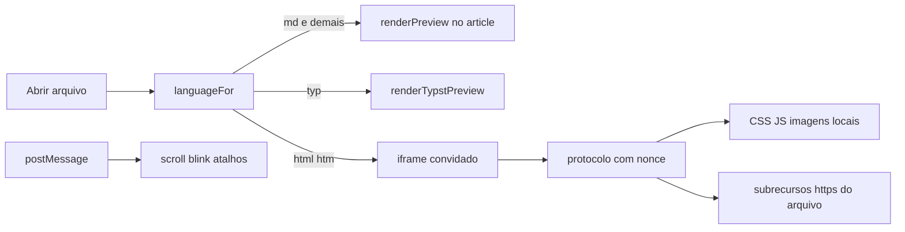

# HTML como terceiro formato, em documento convidado

Vale a pena, e dá para fazer sem alterar o comportamento de `.md` e `.typ`. Não é um caso simples de “já é um webview”. O webview atual é o editor: CSP desligada (`csp: null` em [src-tauri/tauri.conf.json](src-tauri/tauri.conf.json)), protocolo de assets com escopo `**`, e comandos como `read_document`, `write_document` e `run_after_export` invocáveis pela página. Colocar o HTML do usuário em `#preview` com `innerHTML`, como o Markdown faz hoje, aplicaria `.markdown-body` e, com `<script>`, entregaria o aplicativo ao arquivo.

O desenho é o de um documento convidado: o fonte continua no CodeMirror; a página é servida por um protocolo próprio e desenhada num iframe de origem separada. Matemática, Mermaid e o CSS do aplicativo ficam no caminho do Markdown. Um arquivo HTML que já traz KaTeX, MathJax, Bootstrap ou Tailwind usa exatamente isso, porque o preview é o browser a renderizar o arquivo.

## O que permanece intocado

- [src/main.ts](src/main.ts) `doRender`: o ramo `currentLanguage === "typst"` e o ramo `renderPreview` seguem como estão. O HTML entra num terceiro ramo, antes dos dois.
- `#preview.markdown-body` continua sendo o alvo do Markdown e do Typst. O iframe é um irmão, oculto nesses formatos. Os 82 checks de [scripts/dom-smoke.mjs](scripts/dom-smoke.mjs) leem `#preview` e não podem passar a entrar num frame.
- `setLanguage` hoje trata qualquer coisa que não seja `"markdown"` como Typst ([src/editor.ts](src/editor.ts) por volta da linha 467). O ramo HTML tem de ser explícito e anterior a esse fallback.
- Colar imagem em `.md` e `.typ` continua inserindo ``. Os comandos de parágrafo e formato continuam a escrever sintaxe Markdown nesses dois formatos, inclusive o Typst, que já recebe essa sintaxe hoje.
- `enableMath` e `enableMermaid` continuam só no pipeline de [src/markdown.ts](src/markdown.ts). Injetar KaTeX no HTML lutaria com o CSS e com o MathJax do arquivo, e transformaria `$` de preço em fórmula.

Classificar `.html` / `.htm` deixa de passá-los pelo `marked`. Hoje isso só acontece pelo filtro “All files”, porque [languageFor](src/main.ts) só distingue `.typ`. `.md` e `.typ` não mudam de classificador.

## Preview

Servir o buffer (edições não salvas inclusas) por um protocolo registrado em Rust, novo módulo `src-tauri/src/html_preview.rs`, montado em [src-tauri/src/lib.rs](src-tauri/src/lib.rs).

- Origem por documento: `http://<nonce>.mdraft-preview.localhost/…`. `*.localhost` é contexto seguro no WebView2, então módulos e `https://` de CDN carregam. Trocar de arquivo troca o nonce, e com ele `localStorage` e service workers.
- O HTML servido é o buffer. CSS, JS e imagens relativos são lidos do diretório do arquivo, com caminho canonicalizado e recusa de `..`. Documento sem pasta (não salvo) renderiza o que for inline; relativos locais falham como num browser sem base.
- Prefixo reservado `/__mdraft/` para a ponte. Nenhum arquivo do usuário é servido dali.
- Cabeçalho CSP em toda resposta desse protocolo: `'self'`, `https:`, `data:` e `blob:` para script, estilo, imagem e conexão; `worker-src 'none'`; `object-src 'none'`. Isso deixa Bootstrap e Tailwind passarem e bloqueia `http://asset.localhost`, que hoje lê qualquer arquivo do disco.
- Cada atualização do preview (o mesmo debounce de 200 ms) recarrega o frame. O estado de JS recomeça, como a compilação do Typst já recomeça o preview. A ponte restaura a linha visível depois do `load`.

No frontend, `src/html-preview.ts`:

- `parse5` com `sourceCodeLocationInfo` localiza as tags. Atributos `data-mdraft-line` são inseridos por emenda no texto original, nas tags de bloco (`p`, `h1`–`h6`, `li`, `pre`, `blockquote`, `tr`, `figure`, `section`, `article`, `div`, listas e tabelas), sem resserializar o documento. Resserializar quebraria `<script>`.
- O iframe leva `sandbox="allow-scripts allow-forms allow-modals"` e nunca `allow-same-origin`. Sem scripts quando a preferência estiver desligada, CSS e imagens continuam.
- O painel, só nesse formato, perde o padding e o scroll de `#preview-pane`; quem rola é o documento de dentro. Ao voltar para Markdown ou Typst a classe sai.

## Isolamento

Defesa em duas camadas, as duas testadas:

- O `sandbox` sem `allow-same-origin` impede o script do arquivo de ler o DOM do editor.
- Um initialization script registrado depois do IPC do Tauri 2.12 (`append_invoke_initialization_script`, ou o equivalente que o builder expuser) apaga e tranca `__TAURI_INTERNALS__` apenas quando `window.parent !== window`. O frame principal do editor não pode perder o IPC.

A ponte só aceita mensagens da origem do nonce corrente, e o pai só aceita mensagens daquele `contentWindow`. O pai nunca executa um caminho de arquivo, shell ou URL vinda da mensagem sem uma lista fechada. Teclas repassadas são só modificadores e teclas de função, para um campo de senha dentro do preview não ir parar no editor. Clique em link externo `http(s)` abre pelo opener já existente; `javascript:` é descartado; link para outro `.html` local pede ao editor para abrir esse arquivo, em vez de navegar o frame para fora do buffer.

## Sync, blink e o resto do editor

A mesma ideia de âncoras, com implementação separada para não passar pelo `rebuildAnchors` que lê `[data-line]` dentro de `#preview`:

- No load, a ponte mede `data-mdraft-line` e manda as posições. O pai interpola o scroll como `alignPreviewToScroll` / `alignEditorToScroll` já fazem.
- Clique no preview manda a linha; o pai chama `editor.revealLine` e pede o blink. Clique no fonte pede o blink dentro do frame. O realce é um `outline` temporário injetado pela ponte, para não depender do CSS do arquivo nem de `.markdown-body .sync-blink`.
- `caretByPointer` continua valendo: o rato não arrasta o outro painel.
- Outline: `extractHtmlHeadings` em [src/sidebar.ts](src/sidebar.ts), ao lado de `extractTypstHeadings`, lendo `h1`–`h6` do mesmo parse. O texto de vazio do Markdown e do Typst fica como está.
- Editor: `@codemirror/lang-html`, carregado só ao abrir HTML, no mesmo padrão de [src/typst-language.ts](src/typst-language.ts).
- Colar ou largar imagem em HTML insere ``, reutilizando `save_clipboard_image` / `import_image`.
- Parágrafo e formato, só quando `currentLanguage === "html"`, passam a envolver com tags (`<h1>`, `<strong>`, `<em>`, `<a>`, ``, `<code>`). Matemática do menu continua a ser sintaxe Markdown e só é oferecida em Markdown e Typst.
- Filtros de abrir/salvar ganham HTML. `defaultExtension` ganha `html`, sem mudar o padrão `md`.
- Preferência `htmlPreviewScripts` (padrão ligado), no fluxo de [AGENTS.md](AGENTS.md): [src-tauri/src/settings.rs](src-tauri/src/settings.rs), [src/api.ts](src/api.ts), [src/preferences.ts](src/preferences.ts), `applySettingsPatch`. Desligada, o sandbox omite `allow-scripts`.

## Exportação

Ramificar pela linguagem, deixando as funções atuais de Markdown no lugar:

- HTML de um buffer HTML grava o fonte. `exportHtml` deixa de passar esse buffer por `renderPreview`.
- PDF (Print) grava uma cópia em que `<link>` e `` locais são embutidos, com limite de tamanho, e os URLs `https://` permanecem. O browser do sistema não alcança o protocolo do preview. É o mesmo `print_document`.
- Pandoc, para docx e os demais, recebe `-f html`. Scripts e a maior parte do CSS não sobrevivem, a mesma classe de limite já documentada para `[TOC]` e alertas do Markdown. PDF via pandoc continua a ser o formato pandoc, não este print.

## Testes e texto

Suite nova `scripts/html-preview-test.mjs`, com porta em `argv[2]`, no formato das outras, mais uma entrada em [AGENTS.md](AGENTS.md) e em `scripts/test-all.mjs`. Fixture local, sem CDN, para o teste não depender de rede. Medir:

- o iframe não herda a fonte nem a largura de `.markdown-body`; a cor vem do CSS do arquivo
- um script inline altera o DOM e `__TAURI_INTERNALS__` no frame é inacessível; o pai continua capaz de invocar um comando
- imagem local aparece; `../` fora da pasta não carrega
- scroll e blink deslocam a linha correspondente
- abrir de novo `samples/feature-tour.md` na mesma instância volta ao `#preview` sem iframe visível

`npm run smoke` permanece o contrato de que Markdown não se moveu.

Uma frase no README registra a exceção de rede: um HTML aberto pode carregar os subrecursos que ele mesmo referencia, no mesmo gênero das imagens `https://` que o preview Markdown já pede. O aplicativo continua sem pedido próprio ao arrancar.