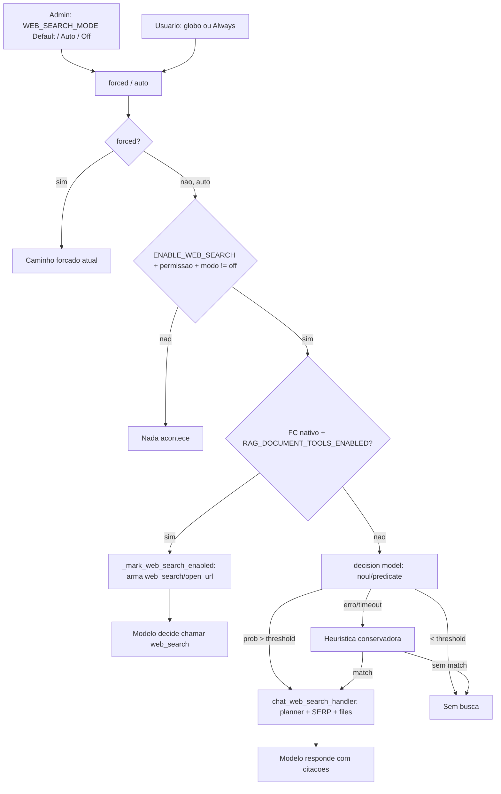

# Auto Web Search — busca decidida pelo modelo (SOTA)

**Data:** 2026-10-13 · **Base verificada:** árvore de trabalho atual (`chat-webui`) · **Status:** implementado (backend + frontend + testes; E2E manual pendente).

Este plano adiciona o modo **Auto** ao botão Web Search: o backend decide **por turno** se a pergunta precisa de informação atual, em vez de depender de o usuário lembrar de clicar no botão. A decisão usa duas camadas:

- **Tier A — function calling nativo (preferido, latência zero):** a tool `web_search` fica sempre armada no turno e **o próprio modelo decide** chamá-la — exatamente o desenho de OpenAI/Anthropic.
- **Tier B — decision model (modelos sem FC nativo):** uma pergunta binária (`noul`/`predicate`) a um decision model configurável (`DECISION_*`), com heurística local como último recurso, e então o pipeline de web search existente (`chat_web_search_handler`).
- **Forçado continua forçado:** clique no globo ou setting `Always` seguem com `features.web_search = true` e precedência absoluta; o modo Auto nunca interfere nesse caminho.

## 0. Decisões de produto (2026-10-13) e status da implementação

1. **Resolução `DECISION_PROTOCOL=auto` → `systemone`** quando há `DECISION_BASE_URL` + `DECISION_MODEL` (preset Clef quando `CLOUDFLARE_ACCOUNT_ID`/`CLOUDFLARE_AUTH_TOKEN` existem).
2. **O globo NÃO ganha ciclo de 3 estados.** O admin define o estado global em Admin → Settings → Web Search com o combobox **Default / Auto / Off** (`WEB_SEARCH_MODE`), aplicado a todos os usuários e modelos:
   - `default`: comportamento de hoje (manual; setting por usuário `Always` intacto);
   - `auto`: decisão automática em todo turno elegível (Tier A/B), mesmo que o cliente não mande flag;
   - `off`: kill switch — o botão é ocultado e `_web_search_capability_allowed` nega tudo.
   - `features.web_search_auto` continua aceito por requisição (útil para filtros), mas a UI não o envia.
   - O setting por usuário `Default/Always` (`Interface.svelte`) permanece **inalterado**; não há UI per-user de Auto.
3. **O status "Web search auto-enabled" persiste no histórico do chat** sem mudança extra: `socket/main.py:340-346` persiste todo evento `type == "status"`.

Arquivos entregues (ver §12) e verificação executada:

- `pytest -q backend/chat_webui/test --ignore=backend/chat_webui/test/apps` → **522 passed** (33 novos em `test_decision.py` + `test_web_search_auto.py`).
- Smoke de API via TestClient (admin + token): `/api/config` expõe `features.web_search_mode`; GET/POST `/api/v1/retrieval/config` refletem `WEB_SEARCH_MODE` e `DECISION_*`; `POST /api/v1/retrieval/config/decision/test` responde (`heuristic`).
- `CI=true npx vitest run --passWithNoTests` → **60 passed**; `svelte-check` sem novos erros estruturais além do passivo já existente (2531 erros pré-existentes no repo; `webSearch` foi adicionado ao tipo `Settings`).
- `black` aplicado aos arquivos Python alterados; `prettier`/`i18n:parse` aplicados no frontend (53 locales sincronizados pelo fluxo padrão do repo).

---

## 1. Objetivo e escopo

### 1.1 Objetivo

1. Fazer o chat buscar na web sozinho quando a pergunta depende de informação recente/volátil (eventos após o cutoff, preços, placares, notícias, "hoje/atual", pedido explícito de busca) sem o usuário precisar clicar no botão.
2. Nunca piorar o comportamento atual: sem configuração, nada muda; falha de decisão = sem busca (ou heurística conservadora); busca forçada e "Always" intocados.
3. Manter a decisão em uma camada plugável: LiteLLM `/v1/systemone`, LiteLLM `/v1/decisions`, Cloudflare Clef direto, TypeSafe/system-one.dev, Foundry, qualquer endpoint OpenAI-compatível (incluindo Ollama/LM Studio local) ou heurística offline.
4. Reusar integralmente o pipeline existente de query generation, SERP, loaders, citações e status.

### 1.2 Não-objetivos (v1)

- Provider-native server-side search (OpenAI `web_search`, Anthropic `web_search` server tool): o fork fala com providers por chat completions; isso é outro projeto.
- UI de "forçar desligado" por turno no globo (ciclo de 3 estados). O admin resolve isso com o modo global `Off`; a instrução de decisão também respeita "não pesquise" no texto.
- Overrides por modelo (ex.: "modelos pequenos sempre Auto") — desejável, mas depois.
- Cache de decisão (evitar re-decidir em regenerate/retry) — não implementado em v1; `DECISION_CACHE_TTL_SECONDS` fica reservado para v2.
- Mudanças no contrato das tools nativas e no feedback de fases: isso é o plano [improved-web-search](../improved-web-search/README.md), já concluído; esta feature se apoia nele.

---

## 2. SOTA: como os frontier labs resolvem

O padrão consistente é **web search como tool que o modelo decide chamar durante a geração**:

| Vendor    | Mecanismo                                                                                                                                  | Controles relevantes                                                                                                                                                |
| --------- | ------------------------------------------------------------------------------------------------------------------------------------------ | ------------------------------------------------------------------------------------------------------------------------------------------------------------------- |
| Anthropic | `web_search` server tool; "Claude determines when to search based on the prompt"; busca pode repetir no turno; resposta final com citações | `max_uses`, `allowed_domains`/`blocked_domains`, `user_location`; dynamic filtering (`web_search_20260209`, filtra resultados via code execution antes do contexto) |
| OpenAI    | `web_search` tool na Responses API; "the model can choose to search the web or not"                                                        | `tool_choice: "required"` para forçar; `search_context_size` (low/medium/high); `filters.allowed_domains`; `user_location`; `external_web_access`                   |

Critérios publicados pela Anthropic (usados como rubrica da nossa pergunta): buscar quando o pedido depende de **notícias/eventos recentes, preços/taxas/placares/estatísticas atuais, informações sobre pessoas/organizações/produtos que podem ter mudado, ou pedido explícito de consulta**; não buscar para **fatos estáveis, matemática, conceitos de programação, escrita criativa, análise do conteúdo já fornecido e conversa fiada**. Forçar ou proibir é sempre decisão do caller, não do modelo — daí o modo global do admin (`Default`/`Auto`/`Off`) e o toggle binário do globo.

O ecossistema de **decision models** (System One/TypeSafe Jev, Cloudflare Clef, OpenAI Decisions com `gpt-6-luna`, Perplexity, Foundry, etc.) operacionaliza esse "decisor externo" com probabilidades calibradas em vez de texto gerado, e o LiteLLM serve os dois formatos em duas rotas:

- `POST /v1/systemone` — `state` + `questions` **em mapa** (`noul`/`choice`/`score`), resposta `answers` por nome.
- `POST /v1/decisions` — `input` + `questions` **em lista** (`predicate`/`choice`/`score`), resposta `answers` em lista.

O LiteLLM traduz entre os formatos: qualquer rota alcança qualquer provider do `model_list` (OpenAI, TypeSafe, Fireworks, Perplexity, Cloudflare Clef, Databricks, Foundry, Strands, vLLM), e a resposta volta no formato da rota chamada. O envelope `{"result": ...}` do Cloudflare é desembrulhado pelo LiteLLM; chamadas diretas ao Workers AI continuam envelopadas (nosso parser tolera os dois).

---

## 3. Estado atual verificado (o que já existe)

### 3.1 Backend

| Peça                     | Onde                                                                                                                                                     | Observação                                                                                                                                                                                                                                     |
| ------------------------ | -------------------------------------------------------------------------------------------------------------------------------------------------------- | ---------------------------------------------------------------------------------------------------------------------------------------------------------------------------------------------------------------------------------------------- |
| Gate de features         | `backend/chat_webui/utils/middleware.py:2456-2469`                                                                                                       | `features = form_data.pop("features")`; `features.web_search` verdadeiro → nativo arma tool (`_mark_web_search_enabled`), não-nativo roda `chat_web_search_handler`. Roda **depois** dos filtros inlet (`:2446`).                              |
| Handler de busca forçada | `middleware.py:886-952`                                                                                                                                  | Planner gera `web_queries` → `execute_web_search_queries` → `form_data["files"]`; status "Generating search query"/"Searching …".                                                                                                              |
| Planner unificado        | `middleware.py:1075-1170` + `retrieval/planner.py`                                                                                                       | Usa o **modelo do chat** (não TASK_MODEL); template com `{{WEB_SEARCH_ENABLED}}`/`{{WEB_SEARCH_ALLOWED}}`.                                                                                                                                     |
| Tools nativas            | `middleware.py:2546-2597`, `retrieval/document_tools.py:2805-2858`                                                                                       | `document_tools_needed_for_turn()` (`middleware.py:743-755`) só anuncia tools se houver **corpus anexado ou `web_search_enabled`**. Com botão desligado e sem anexos, o modelo **nunca vê** a `web_search` — é exatamente o gap desta feature. |
| Descrição da tool        | `document_tools.py:2810-2818`                                                                                                                            | Orientada a documentos ("Use when attached documents do not contain enough evidence"); não menciona recência/cutoff.                                                                                                                           |
| Prompt nativo            | `middleware.py:2599-2629`                                                                                                                                | Só substitui `{{TOOLS}}`; `{{CURRENT_DATE}}` existe em `utils/task.py:38-54` mas não é aplicado aqui.                                                                                                                                          |
| Complementar em RAG      | `middleware.py:758-763`, `:1407-1438`                                                                                                                    | Auto-busca já existe **somente** quando há arquivos locais (refine); grava `metadata["web_search_auto"]`, lido em `:2695-2696` para formato de citação. **Não reusar essa chave.**                                                             |
| Capability               | `middleware.py:716-728`                                                                                                                                  | `ENABLE_WEB_SEARCH` + admin ou permissão `features.web_search`.                                                                                                                                                                                |
| Config                   | `backend/chat_webui/config.py:2305-2347`                                                                                                                 | `ENABLE_WEB_SEARCH`, `WEB_SEARCH_ENGINE`, result count, domínio, etc.                                                                                                                                                                          |
| Config endpoints         | `routers/retrieval.py:2800-2845` (GET), `:2851` (model), `:3237` (update); `main.py:1406-1447` (`/api/config`, `features.enable_web_search` em ~`:1431`) | Segredos ficam no config admin; `/api/config` só leva flags.                                                                                                                                                                                   |
| Filtros inlet            | `utils/filter.py`, `middleware.py:2446-2452`                                                                                                             | Um filtro pode reescrever `features` antes do gate — o modo Auto é compatível com filtros existentes.                                                                                                                                          |

### 3.2 Frontend

| Peça                | Onde                                                                                                             | Observação                                                                             |
| ------------------- | ---------------------------------------------------------------------------------------------------------------- | -------------------------------------------------------------------------------------- |
| Estado local        | `src/lib/components/chat/Chat.svelte:124` (+ reset `:151`, draft `:164/:423`, URL `?web-search=true` `:722-724`) | Binário `webSearchEnabled`.                                                            |
| Montagem do request | `Chat.svelte:1789-1805`                                                                                          | `features.web_search = config && permissão && (webSearchEnabled                        |     | $settings.webSearch === 'always')`. |
| Botão               | `src/lib/components/chat/MessageInput.svelte:1201-1219`                                                          | Globo; ativo quando toggle ou `webSearch === 'always'`.                                |
| Setting             | `src/lib/components/chat/Settings/Interface.svelte:62, 249-252, 308, 874-892`                                    | Hoje alterna `null` ↔ `'always'` ("Web Search in Chat").                               |
| Tipo                | `src/lib/stores/index.ts:65`                                                                                     | `webSearch` é usado mas **não está declarado** em `Settings` (`:134-160`).             |
| Renderização        | `ResponseMessage.svelte:776-846` + `WebSearchResults.svelte`; citações `:1028-1030` + `Citations.svelte`         | Status `action: "web_search"` com `urls/pages`; citações inalteradas para o modo Auto. |

### 3.3 Contratos já existentes que serão reusados

- `SearchForm`, `process_web_search` (`routers/retrieval.py:4763-4845`), `execute_web_search_queries` (`middleware.py:505-614`).
- Eventos: `status` `{action, description, urls, pages, done, query?, error?, extract_done?, extract_total?, loader?, index_count?}` (`middleware.py:426-453`).
- `metadata["web_search_enabled"]` arma tool nativa E é propagado (`middleware.py:766-772`, `:2508-2509`).
- `metadata["web_search_auto"]` = formato de citação do modo complementar — **reservado**.

---

## 4. Arquitetura

### 4.1 Modos e flags

**Modo global do admin (`WEB_SEARCH_MODE`, combobox Default/Auto/Off):**

| Modo      | Efeito                                                                                                                |
| --------- | --------------------------------------------------------------------------------------------------------------------- |
| `default` | Nada automático; globo e setting `Always` funcionam como hoje.                                                        |
| `auto`    | Todo turno elegível passa por Tier A/B (mesmo sem flag do cliente), exceto quando o turno é forçado pelo globo.       |
| `off`     | Kill switch: `_web_search_capability_allowed` retorna `False`, o globo é ocultado e `features.web_search` é ignorado. |

**Flags por requisição** (`_resolve_web_search_requests`, testável):

| Requisição                                          | Backend faz                                                       |
| --------------------------------------------------- | ----------------------------------------------------------------- |
| `features.web_search: true`                         | Forçado: nativo arma tool; senão SERP antes do modelo (como hoje) |
| `features.web_search_auto: true` (filtros/clientes) | Auto por requisição → Tier A/B                                    |
| nada + `WEB_SEARCH_MODE=auto`                       | Auto global → Tier A/B                                            |
| `features.web_search: true` + qualquer flag de auto | Forçado vence; auto ignorado                                      |

Gates: forçado e auto exigem `ENABLE_WEB_SEARCH` + permissão (`_web_search_capability_allowed`), que também nega quando `WEB_SEARCH_MODE=off`.

### 4.2 Fluxo



### 4.3 Precedência e composição

1. `features.web_search` (forçado) **sempre** vence; se ambos vierem, `web_search_auto` é ignorado.
2. Filtros inlet rodam antes e podem reescrever `features` — nada muda para eles.
3. Tier A não emite SERP pré-busca: só arma as tools (comportamento já existente para o forçado + nativo).
4. Tier B reusa `chat_web_search_handler`; a única diferença visível é um evento de status de transparência e a chave de metadata de telemetria.

---

## 5. Camada de decisão — `backend/chat_webui/utils/decision.py` (novo)

### 5.1 Modelo normalizado

```python
@dataclass(frozen=True)
class NoulQuestion:   name: str; instructions: str; criteria: dict[str, str] | None = None   # {"true": ..., "false": ...}
@dataclass(frozen=True)
class ChoiceQuestion: name: str; instructions: str; options: dict[str, str | None]            # ordem preservada
@dataclass(frozen=True)
class ScoreQuestion:  name: str; instructions: str; levels: list[str]                        # menor → maior

@dataclass(frozen=True)
class NoulAnswer:    probability: float
@dataclass(frozen=True)
class ChoiceAnswer:  choice: str; probabilities: dict[str, float]; confidence: float | None
@dataclass(frozen=True)
class ScoreAnswer:   score: float; probabilities: dict[str, float]; confidence: float | None; legend: dict[str, str]
@dataclass(frozen=True)
class RefusalAnswer: pass

@dataclass(frozen=True)
class DecisionResult:
    answers: dict[str, NoulAnswer | ChoiceAnswer | ScoreAnswer | RefusalAnswer]
    protocol: str
    model: str | None
    latency_ms: float
    usage: dict | None = None

class DecisionUnavailable(Exception): ...
```

### 5.2 API pública

```python
async def ask_decision(
    request,
    questions: list[NoulQuestion | ChoiceQuestion | ScoreQuestion],
    state,                                  # dict | str | list (JSON-serializável)
    *,
    protocol: str | None = None,            # None → resolve_decision_config(request)
    model: str | None = None,
    timeout: float | None = None,
) -> DecisionResult
```

- `protocol` efetivo: `systemone` | `decisions` | `openai` | `heuristic`.
- `heuristic` não faz HTTP (mas `ask_decision` não é usado para isso; o módulo de web search trata heurística direto — ver §6).
- Erros de rede/HTTP/parsing → `DecisionUnavailable` (o caller decide o fallback). Nunca levanta exceção genérica.

### 5.3 Payloads e parsers por protocolo

**`systemone`** (LiteLLM `/v1/systemone`, Cloudflare direto, TypeSafe, Foundry, NDI):

```jsonc
POST {base}/systemone
{
  "model": "decision",
  "state": { "today": "2026-10-13", "latest_user_request": "...", "recent_conversation": [...] },
  "questions": {
    "web_search": { "type": "noul", "instructions": "..." }
  }
}
// resposta
{ "model": "...", "answers": { "web_search": { "type": "noul", "noul": 0.87 } }, "usage": {...} }
```

- `choice` → `criteria` mapa (1..255); `score` → `criteria` lista (1..10).
- Parser: se `data["result"]` for dict, desembrulhar primeiro (Cloudflare direto); `answers` é mapa por nome; `type == "refusal"` → `RefusalAnswer`.

**`decisions`** (LiteLLM `/v1/decisions`, OpenAI Decisions beta):

```jsonc
POST {base}/decisions
{
  "model": "decision",
  "input": "<state serializado em string>",
  "questions": [
    { "type": "predicate", "name": "web_search", "instructions": "..." }
  ]
}
// resposta
{ "model": "...", "answers": [ { "type": "predicate", "name": "web_search", "probability": 0.87 } ], "usage": {...} }
```

- `choice` → `choices: [{value, description?}]`; `score` → `levels: [{label, description?}]`.
- Parser: `answers` é lista; casar por `name` quando presente, senão por posição; `predicate.probability`; `choice.probabilities` lista `[{value, probability}]`; `score.probabilities` com `{value, label, probability}`; `refusal` → `RefusalAnswer`.

**`openai`** (qualquer `/chat/completions`, incluindo LiteLLM, Ollama, LM Studio):

```jsonc
{
	"model": "...",
	"temperature": 0,
	"max_tokens": 64,
	"stream": false,
	"messages": [
		{
			"role": "system",
			"content": "You are a router. Reply with JSON only: {\"decision\": true|false, \"confidence\": 0..1}. No prose."
		},
		{ "role": "user", "content": "<state JSON + a pergunta e as opções>" }
	]
}
```

- Parser tolerante: primeiro objeto `{...}` do conteúdo; `decision` bool e `confidence` float opcional; sem JSON válido → `DecisionUnavailable`.
- Só suporta `NoulQuestion` (as demais primitivas não têm formato nativo; perguntas choice/score viram instruções e a resposta é mapeada apenas se uma string única coincidir com uma opção).

**`heuristic`**: sem HTTP; implementada no módulo de web search (§6.3) por ser específica do domínio.

### 5.4 HTTP, auth e URL

- `aiohttp.ClientSession(timeout=ClientTimeout(total=...))` por chamada (mesmo padrão do filtro `auto-tool-clef.py`); `trust_env` conforme config.
- Headers: `{ <API_KEY_HEADER>: "<PREFIX> <KEY>".strip() , "Content-Type": "application/json", **EXTRA_HEADERS }`.
- URL: `join(scheme+host, path)` sem duplicar caminho:
  - `DECISION_ENDPOINT_PATH` explícito (suporta `{model}`), senão defaults: `/systemone`, `/decisions`, `/chat/completions`.
  - Se a base já termina no caminho default (o admin colou o endpoint completo), não anexar de novo.
  - Preset Clef direto: base `https://api.cloudflare.com/client/v4/accounts/<acct>/ai/run` + path `/{model}` com `DECISION_MODEL=@cf/cloudflare/clef-flash` (model URL-encoded).
- Logs: `log = logging.getLogger(__name__)`, `log.setLevel(SRC_LOG_LEVELS["RAG"])`; nunca logar a API key (mascarar como no filtro: últimos 4 + length); logar protocolo, latência, HTTP status e corpo truncado em erro.

---

## 6. Decisão de web search — `backend/chat_webui/retrieval/web_search_decision.py` (novo)

### 6.1 Pergunta (rubrica SOTA)

```python
WEB_SEARCH_QUESTION_INSTRUCTIONS = (
    "Does answering the latest user request require current web information "
    "that a web search could provide — recent events or news, live prices, "
    "rates, scores or schedules, facts about people, organizations or products "
    "that may have changed after the assistant's knowledge cutoff, or an "
    "explicit request to look something up? Answer false for stable knowledge "
    "(established facts, mathematics, coding concepts), creative writing, "
    "analysis of the provided conversation or attached files, greetings, and "
    "chit-chat. If the latest user request says not to search the web, answer false."
)
```

- `WEB_SEARCH_AUTO_INSTRUCTIONS` (config, default vazio) pode sobrescrever a rubrica para domínios específicos.
- `noul`/`predicate`: `true` ⇒ precisa buscar; `noul > DECISION_THRESHOLD` (default 0.5) ⇒ busca.

### 6.2 State

```python
{
  "today": "2026-10-13",                       # data local do servidor
  "chat_model": "<body['model']>",
  "latest_user_request": "<última mensagem do usuário, ≤1500 chars>",
  "recent_conversation": [                     # últimas WEB_SEARCH_AUTO_HISTORY_MESSAGES (default 6)
      {"role": "user" | "assistant", "content": "…≤1500 chars"}
  ],
  "files_attached": bool,                      # metadado útil: não buscar o que já está anexado
}
```

- Exclui a própria última mensagem do histórico; ignora conteúdo não textual (`_content_to_text` do filtro serve de referência).
- Orçamento total do state: ~20k chars; truncar mantendo o fim da conversa.

### 6.3 Ordem de decisão e fallback

```python
async def decide_web_search(request, form_data, user) -> AutoSearchDecision:
    # 1) protocolo explícito/heurística por config
    cfg = resolve_decision_config(request)
    if cfg.protocol == "heuristic":
        return heuristic_decision(user_message)
    # 2) decision model
    try:
        result = await ask_decision(request, [NoulQuestion("web_search", instructions)], state)
        answer = result.answers.get("web_search")
        if isinstance(answer, NoulAnswer):
            return AutoSearchDecision(search=answer.probability > cfg.threshold,
                                      source="decision", probability=answer.probability,
                                      reason=f"{cfg.protocol}")
        return AutoSearchDecision(False, "decision", None, "unusable answer")   # refusal/choice inesperada
    except DecisionUnavailable as exc:
        log.warning(...)
        return heuristic_decision(user_message, fallback_reason=exc)           # 3) heurística
```

Heurística conservadora (sem rede) — nunca sobrescreve decisão do modelo, só cobre falha/ausência de decision model:

- **Negativo (veta):** `don't search|do not search|no need to search|sem busca|não pesquise|nao pesquise`.
- **Positivo (busca):**
  - pedido explícito: `search|look up|google|pesquise|pesquisar|busque|buscar na web`; ou
  - marcador de recência: `today|tonight|this week|latest|current|recent|right now|news|hoje|ontem|agora|atual|atuais|últimas|notícias|noticia|recente` **e** sujeito volátil: `price|quote|currency|cotação|dólar|euro|weather|previsão|tempo|score|placar|jogo|resultado|released|launched|lançamento|nova versão|who is the current`.
- **Default:** não buscar. (URL na mensagem não aciona busca; o caminho nativo já tem `open_url`.)
- Toda decisão heurística é logada com o motivo; `source="heuristic"`.

### 6.4 `AutoSearchDecision`

```python
@dataclass(frozen=True)
class AutoSearchDecision:
    search: bool
    source: str                 # "native" | "decision" | "heuristic" | "disabled"
    probability: float | None = None
    reason: str = ""
```

---

## 7. Integração no middleware

### 7.1 Ponto de inserção

Em `backend/chat_webui/utils/middleware.py`, o bloco de features foi substituído por (código implementado):

```python
features = form_data.pop("features", None) or {}

forced_web_search, auto_web_search = _resolve_web_search_requests(
    features, request.app.state.config
)

if forced_web_search:
    if _web_search_capability_allowed(request, user):
        if _native_document_tools_for_turn(request, metadata):
            _mark_web_search_enabled(form_data)
        else:
            form_data = await chat_web_search_handler(request, form_data, extra_params, user)
    else:
        log.info("Skipping forced web search; ENABLE_WEB_SEARCH or permission is off")
elif auto_web_search:
    form_data = await _auto_web_search_handler(
        request, form_data, extra_params, user, metadata
    )
```

e `_auto_web_search_handler` implementa os tiers (Tier A: arma tool sem SERP; Tier B: `decide_web_search` → `chat_web_search_handler`), como no pseudocódigo abaixo:

```python
if _native_document_tools_for_turn(request, metadata):
    _mark_web_search_enabled(form_data)
    metadata["web_search_auto_enabled"] = True
    await _emit_auto_search_status(extra_params, source="native")
else:
    decision = await decide_web_search(request, form_data, user)
    if decision.search:
        form_data = await chat_web_search_handler(request, form_data, extra_params, user)
        metadata["web_search_auto_enabled"] = True
        await _emit_auto_search_status(extra_params, source=decision.source)
```

Regras:

- `metadata["web_search_auto_enabled"]` é a chave nova (telemetria/status/log). **Não usar** `metadata["web_search_auto"]` — reservada para o formato de citação do complementar (`:2695-2696`).
- `isProject` de sempre: `_mark_web_search_enabled` seta `form_data["web_search_enabled"]` **e** `metadata["web_search_enabled"]`; com isso `document_tools_needed_for_turn()` (`:743-755`) vira `True` e `build_document_tools(..., enable_web_search=_web_search_capability_allowed(...))` (`:2578`) anuncia `web_search` + `open_url`. Nenhuma outra mudança no bloco nativo é necessária.
- No Tier B, o `chat_web_search_handler` já grava `metadata["web_search_progress"]` e os files `type == "web_search"`; o formato de citação permanece o mesmo do caminho forçado.
- Status de transparência (novo helper em `middleware.py`, ao lado de `emit_web_search_status`):

```python
async def _emit_auto_search_status(extra_params, source: str) -> None:
    emitter = extra_params.get("__event_emitter__")
    if emitter is None:
        return
    await emitter({"type": "status", "data": {
        "action": "web_search",
        "description": "Web search auto-enabled",
        "done": False,
        "auto": True,
        "source": source,
    }})
```

O evento aparece antes do "Generating search query" do handler; sem `urls/pages`, a UI mostra a descrição genérica de status (compatível com `ResponseMessage.svelte:776-846`).

### 7.2 Cuidados verificados

- Filtros inlet continuam antes do gate: um filtro existente pode adicionar/remover `web_search_auto`.
- `skip_stuffed_context` (`:2642-2645`, `should_skip_stuffed_rag_context` `:2269-2279`) é `True` quando `document_tools_intended`; Tier A não roda o files handler — correto (as tools nativas já são o caminho).
- Regenerate/retry re-executa a decisão (aceitável; cache é v2). O custo é ~1 chamada barata por turno.

---

## 8. Qualidade do Tier A (nativo)

### 8.1 Descrição da tool `web_search`

Em `backend/chat_webui/retrieval/document_tools.py:2810-2818`, trocar a descrição document-centric por:

> Search the web and return citable excerpts. Use when the answer depends on current or live information: recent events or news, prices, rates, scores or schedules, facts that may have changed after your knowledge cutoff, or when the user explicitly asks to look something up. Do not use it for stable knowledge, math, coding concepts, creative writing, or chit-chat. Pass one short keyword query, or up to 3 queries together. Use the language of the pages you expect to find. Call open_url only if an excerpt is missing or truncated. Copy the URL exactly; do not invent or rewrite a path.

### 8.2 Data atual no prompt nativo

Quando as tools de documento/web estão armadas (`document_tools_intended` em `middleware.py:2558`), injetar `Today's date is YYYY-MM-DD.` uma única vez:

- Opção escolhida: junto de `_inject_system_or_ollama_message(form_data, model, NATIVE_DOCUMENT_TOOLS_GROUNDING_HINT)` (`:2672-2675`), concatenando a linha de data ao hint quando `metadata.get("web_search_enabled")`.
- Alternativa (mais invasiva): aplicar `prompt_template()` (`utils/task.py:38-54`) na composição do `TOOLS_FUNCTION_CALLING_NATIVE_PROMPT_TEMPLATE` (`:2609-2615`) para que `{{CURRENT_DATE}}` funcione em templates customizados. Fica como melhoria opcional.
- Ecoar a data apenas quando web search está armado evita custo/ruído em turnos puramente documentais.

### 8.3 Orientação para "não busque"

Adicionar uma linha ao hint de grounding quando a tool web estiver armada via Auto: `If the latest user request says not to search the web, do not call web_search.` (Tier B já cobre isso na própria pergunta.)

---

## 9. Configuração

### 9.1 Chaves novas

Todas em `backend/chat_webui/config.py` perto de `:2305-2347` (busca) e seguindo `PersistentConfig(<chave pontuada>, default, type=<tipo>)`; defaults via `os.environ.get(...)` onde indicado. Depois do primeiro save no admin, o valor do banco vence o env (comportamento padrão do fork).

| Atributo                           | Chave persistida                       | Env default                     | Default         | Uso                                                        |
| ---------------------------------- | -------------------------------------- | ------------------------------- | --------------- | ---------------------------------------------------------- |
| `WEB_SEARCH_MODE`                  | `rag.web.search.mode`                  | `WEB_SEARCH_MODE`               | `"default"`     | modo global: `default`/`auto`/`off`                        |
| `WEB_SEARCH_AUTO_HISTORY_MESSAGES` | `rag.web.search.auto.history_messages` | —                               | `6`             | histórico enviado ao decisor                               |
| `WEB_SEARCH_AUTO_INSTRUCTIONS`     | `rag.web.search.auto.instructions`     | `WEB_SEARCH_AUTO_INSTRUCTIONS`  | `""`            | rubrica custom (vazio = default)                           |
| `DECISION_PROTOCOL`                | `decision.protocol`                    | `DECISION_PROTOCOL`             | `"auto"`        | `auto`/`systemone`/`decisions`/`openai`/`heuristic`        |
| `DECISION_BASE_URL`                | `decision.base_url`                    | `DECISION_BASE_URL`             | `""`            | base do endpoint                                           |
| `DECISION_ENDPOINT_PATH`           | `decision.endpoint_path`               | `DECISION_ENDPOINT_PATH`        | `""`            | override; suporta `{model}`                                |
| `DECISION_MODEL`                   | `decision.model`                       | `DECISION_MODEL`                | `""`            | nome do modelo no proxy/provider                           |
| `DECISION_API_KEY`                 | `decision.api_key`                     | `DECISION_API_KEY`              | `""`            | segredo (fallback: `LLM_API_KEY`, `CLOUDFLARE_AUTH_TOKEN`) |
| `DECISION_API_KEY_HEADER`          | `decision.api_key_header`              | `DECISION_API_KEY_HEADER`       | `Authorization` | ex. Azure `api-key`                                        |
| `DECISION_API_KEY_PREFIX`          | `decision.api_key_prefix`              | `DECISION_API_KEY_PREFIX`       | `Bearer`        | vazio para Azure                                           |
| `DECISION_EXTRA_HEADERS`           | `decision.extra_headers`               | `DECISION_EXTRA_HEADERS` (JSON) | `{}`            | gateways/proxies                                           |
| `DECISION_THRESHOLD`               | `decision.threshold`                   | `DECISION_THRESHOLD`            | `0.5`           | corte da probabilidade                                     |
| `DECISION_TIMEOUT_SECONDS`         | `decision.timeout`                     | `DECISION_TIMEOUT_SECONDS`      | `3`             | orçamento de latência                                      |
| `DECISION_TRUST_ENV`               | `decision.trust_env`                   | `DECISION_TRUST_ENV`            | `False`         | `HTTP(S)_PROXY`                                            |
| `DECISION_TEMPERATURE`             | `decision.temperature`                 | `DECISION_TEMPERATURE`          | `0`             | protocolo openai                                           |
| `DECISION_MAX_TOKENS`              | `decision.max_tokens`                  | `DECISION_MAX_TOKENS`           | `64`            | protocolo openai                                           |

> `DECISION_CACHE_TTL_SECONDS` não foi implementado (reservado para v2).

### 9.2 Resolução (`DECISION_PROTOCOL=auto`)

1. `CLOUDFLARE_ACCOUNT_ID` + `CLOUDFLARE_AUTH_TOKEN` presentes (config ou env) → preset Clef: `systemone`, base `https://api.cloudflare.com/client/v4/accounts/<acct>/ai/run`, path `/{model}`, model default `@cf/cloudflare/clef-flash`, key `CLOUDFLARE_AUTH_TOKEN`, header `Authorization`/`Bearer`.
2. senão `DECISION_BASE_URL` + `DECISION_MODEL` presentes → `systemone` (formato majoritário; admin troca para `decisions` explicitamente se preferir).
3. senão → `heuristic`.

Fallback de API key: `DECISION_API_KEY` → `LLM_API_KEY` → (preset Clef) `CLOUDFLARE_AUTH_TOKEN`.

Exemplo para o host LiteLLM local (`llm.sistema.pro.br`):

```bash
WEB_SEARCH_MODE=auto
DECISION_PROTOCOL=systemone
DECISION_BASE_URL=https://llm.sistema.pro.br/v1
DECISION_MODEL=decision
DECISION_API_KEY=<LLM_API_KEY>
DECISION_THRESHOLD=0.5
DECISION_TIMEOUT_SECONDS=3
```

(ou tudo pelo admin, que grava as mesmas chaves via `POST /api/v1/retrieval/config/update`.)

### 9.3 Superfícies de API e admin

- `routers/retrieval.py` (implementado): GET de config, Pydantic `WebConfig` e update ganharam `WEB_SEARCH_MODE`, `WEB_SEARCH_AUTO_*` e `DECISION_*`; segredos seguem no GET admin como os demais providers.
- `main.py` `/api/config` (implementado): expõe **apenas** `features.web_search_mode` (nada de URL/key).
- Admin UI (`src/lib/components/admin/Settings/WebSearch.svelte`, implementado): combobox "Web Search Mode" (Default/Auto/Off) e, quando `auto`, o bloco "Decision model" com Protocol, Base URL, Model, API Key, Threshold, Timeout, History messages e "Advanced" (endpoint path, header/prefix da key, extra headers JSON, trust env).
- **Teste do decisor (implementado):** botão "Test decision endpoint" → `POST /api/v1/retrieval/config/decision/test` (admin-only) chama `ask_decision` com uma pergunta fixa e devolve protocolo, modelo, latência e respostas; em `heuristic` informa que nenhum endpoint é chamado.
- Frontend API: `src/lib/apis/retrieval/index.ts` ganhou `testRAGConfigDecision`.

---

## 10. Frontend (implementado)

### 10.1 Admin — Admin Settings → Web Search

- Combobox **Web Search Mode** (`default`/`auto`/`off`) ligado a `webConfig.WEB_SEARCH_MODE`.
- Quando `auto`, bloco **Decision model**: Protocol (select `auto`/`systemone`/`decisions`/`openai`/`heuristic`), Base URL, Model, API Key (`SensitiveInput`), Threshold, Timeout (s), History messages; "Advanced" com Endpoint path, API Key header, API Key prefix, Extra headers (JSON) e Trust environment proxies.
- Botão **Test decision endpoint** chama `POST /api/v1/retrieval/config/decision/test` e mostra o JSON (ou o erro) num `<pre>`.
- `DECISION_EXTRA_HEADERS` é editado como string JSON: `onMount` faz stringify do dict e `submitHandler` faz parse com validação (toast + abort em JSON inválido).

### 10.2 Chat

- `src/lib/components/chat/Settings/Interface.svelte` **não mudou**: o setting por usuário continua `Default`/`Always` (o Auto é global do admin).
- `src/lib/components/chat/MessageInput.svelte`: o globo é ocultado quando `$config?.features?.web_search_mode === 'off'`; no modo `auto` (e sem forçar/Always) ele aparece com destaque azul suave e tooltip "Web Search (Auto) - click to force for this message". O clique continua binário (força no turno).
- `src/lib/stores/index.ts`: `web_search_mode?: 'default' | 'auto' | 'off'` no tipo `Config` e `webSearch?: 'auto' | 'always' | null` no tipo `Settings` (o campo já era usado, mas não declarado).
- `Chat.svelte` **não mudou**: sem setting per-user de Auto, a montagem de `features.web_search` permanece a atual; o backend aplica o modo global.
- i18n: novas strings extraídas com `npm run i18n:parse` (sincroniza todos os locales; valores novos ficam vazios para tradução).

---

## 11. Testes

### 11.1 Backend — `backend/chat_webui/test/utils/test_decision.py` (implementado, sem rede)

Cobre builders/parsers (`systemone` mapa e envelope `result`, `decisions` lista com match por nome e por posição, `refusal`, `openai`), URL com `{model}` e sem duplicação, resolução `auto` (preset Clef com `CLOUDFLARE_*`, base+model → `systemone`, sem nada → `heuristic`), header/prefixo vazio (Azure), heurística parametrizada, `build_decision_state` (última mensagem fora do histórico, limite e data) e `decide_web_search` (acima/abaixo do threshold, instruções custom, fallback heurístico em `DecisionUnavailable`).

### 11.2 Backend — `backend/chat_webui/test/retrieval/test_web_search_auto.py` (implementado)

| #   | Cenário                                                              | Esperado                                                                                                                             |
| --- | -------------------------------------------------------------------- | ------------------------------------------------------------------------------------------------------------------------------------ |
| A1  | `_resolve_web_search_requests` forçado + auto                        | `(True, False)` — forçado vence                                                                                                      |
| A2  | nada + `WEB_SEARCH_MODE=auto`                                        | `(False, True)`                                                                                                                      |
| A3  | `features.web_search_auto` + modo default                            | `(False, True)`                                                                                                                      |
| A4  | qualquer flag + modo `off`                                           | `(False, False)`                                                                                                                     |
| A5  | `_web_search_capability_allowed` com modo `off` / sem permissão      | `False`                                                                                                                              |
| A6  | auto + nativo (`function_calling=native`, `RAG_DOCUMENT_TOOLS=true`) | `_mark_web_search_enabled`; sem decisor; `metadata["web_search_auto_enabled"]`; status `source=native`                               |
| A7  | auto + não-nativo + decisão `search=True`                            | `chat_web_search_handler` chamado; files `type=web_search`; status `Web search auto-enabled`; `metadata["web_search_auto"]` intocado |
| A8  | auto + não-nativo + decisão `search=False`                           | nada; sem flag de metadata; sem status                                                                                               |

### 11.3 Frontend

- `CI=true npx vitest run --passWithNoTests` → 60 testes passando (a matriz de flags ficou no backend, em `_resolve_web_search_requests`).
- `svelte-check`: sem novos erros estruturais; o repo já possui 2531 erros pré-existentes (baseline) e `webSearch` agora está declarado no tipo `Settings`.

### 11.4 Suítes reexecutadas

```bash
PYTHONPATH=backend pytest -q backend/chat_webui/test --ignore=backend/chat_webui/test/apps   # 522 passed
CI=true npx vitest run --passWithNoTests                                                      # 60 passed
# smoke de API (TestClient): /api/config, retrieval config GET/POST, decision/test — OK
```

### 11.5 Roteiro E2E manual

1. Modelo local Ollama (não-nativo) + admin em modo `auto` + decisor (`systemone` no host LiteLLM): "Qual a cotação do dólar hoje?" → status "Web search auto-enabled" + busca + resposta com fontes; "Escreva um haiku sobre o mar" → sem busca.
2. Modelo OpenAI-compatível nativo (`RAG_DOCUMENT_TOOLS_ENABLED=true`): pergunta de recência → modelo chama `web_search` sozinho; pergunta de matemática → responde direto.
3. Globo clicado (forçado) em modo `auto` → SERP pré-busca como hoje (não-nativo) / tool armada (nativo).
4. Setting por usuário `Always` → comportamento de hoje em todos os modelos.
5. Admin muda para `off` → globo some; `features.web_search`/`web_search_auto` ignorados (log); `/api/config` reflete `web_search_mode=off`.
6. Decisor derrubado (URL inválida) → turno não quebra; heurística decide; aviso no log.
7. Decisor `heuristic` (sem endpoint) → sem HTTP; decisão por heurística.
8. Mensagem "não pesquise, responda do seu conhecimento" em Auto → sem busca (decisão e/ou heurística).
9. Admin "Test decision endpoint" → mostra protocolo/modelo/latência (ou mensagem de heuristic/erro).
10. Filtro inlet existente continua podendo reescrever `features` antes do gate.

---

## 12. Arquivos afetados (implementado)

**Novos**

- `backend/chat_webui/utils/decision.py`
- `backend/chat_webui/retrieval/web_search_decision.py`
- `backend/chat_webui/test/utils/test_decision.py`
- `backend/chat_webui/test/retrieval/test_web_search_auto.py`

**Modificados**

- `backend/chat_webui/utils/middleware.py` — `_resolve_web_search_requests`, `_auto_web_search_handler`, `_emit_auto_search_status`, gate de features e `_web_search_capability_allowed` (modo off), data + hint "não busque" no prompt nativo
- `backend/chat_webui/retrieval/document_tools.py` — descrição da tool `web_search` orientada a recência/cutoff
- `backend/chat_webui/config.py` — `WEB_SEARCH_MODE`, `WEB_SEARCH_AUTO_*`, `DECISION_*`
- `backend/chat_webui/routers/retrieval.py` — GET/WebConfig/update + `POST /config/decision/test`
- `backend/chat_webui/main.py` — imports/assignments das novas chaves + `features.web_search_mode` em `/api/config`
- `src/lib/components/admin/Settings/WebSearch.svelte`, `src/lib/components/chat/MessageInput.svelte`, `src/lib/stores/index.ts`, `src/lib/apis/retrieval/index.ts`, locales (i18n:parse, 53 arquivos sincronizados)

---

## 13. Rollout e compatibilidade

- Padrão `WEB_SEARCH_MODE=default`: nenhuma mudança de comportamento para quem não configurar.
- Clientes antigos que só mandam `features.web_search` continuam idênticos; `features.web_search_auto` é opcional.
- Migração de config não é necessária (PersistentConfig cria as chaves no primeiro save/leitura com defaults).
- O `.env` do filtro `auto-tool-clef.py` (`CLOUDFLARE_ACCOUNT_ID`/`CLOUDFLARE_AUTH_TOKEN`) passa a alimentar também o preset Clef do modo Auto — sem config duplicada.
- LiteLLM dá fallback/load-balancing de decisores no `model_list` do proxy; o backend mantém apenas a cadeia "protocolo → heurística → sem busca".

---

## 14. Riscos e pontos em aberto

| Risco                                                         | Mitigação                                                                                                                                                       |
| ------------------------------------------------------------- | --------------------------------------------------------------------------------------------------------------------------------------------------------------- |
| Falso positivo (buscar em conversa fiada)                     | threshold valve; setting Default como escape; rubrica negativa explícita; heurística conservadora                                                               |
| Falso negativo (não buscar o que precisava)                   | rubrica baseada nos critérios publicados; usuário pode clicar/Always; `WEB_SEARCH_AUTO_INSTRUCTIONS` por domínio                                                |
| Latência extra no Tier B                                      | `DECISION_TIMEOUT_SECONDS=3`, clef-flash ~40–120 ms; Tier A não adiciona latência                                                                               |
| Privacidade (mensagem vai ao decisor)                         | provider é escolha do admin (pode ser local/Ollama via protocolo `openai`); protocolo `heuristic` existe para instalações fechadas; documentar no help do admin |
| Modelo nativo chama a tool demais                             | descrição orientada ("do not use for stable knowledge…"); data no prompt; admin muda o modo para `default`                                                      |
| Colisão de metadata com o modo complementar                   | chave própria `web_search_auto_enabled`; `web_search_auto` intocada                                                                                             |
| Re-decisão em regenerate/retry                                | aceito em v1; `DECISION_CACHE_TTL_SECONDS` reservado                                                                                                            |
| `DECISION_PROTOCOL=auto` com base LiteLLM ambígua entre rotas | default `systemone` documentado; admin pode fixar `decisions`                                                                                                   |

**Pontos em aberto (resolvidos em 2026-10-13):** (1) default de `auto` → `systemone`; (2) globo permanece binário e o tri-state virou modo global do admin (Default/Auto/Off); (3) status persistido no `statusHistory` pelo comportamento existente do socket. Continua em aberto para v2: cache de decisão e overrides por modelo.

---

## 15. Referências

- Anthropic — Web search tool: <https://platform.claude.com/docs/en/agents-and-tools/tool-use/web-search-tool> (critérios de quando buscar; `max_uses`; citações; dynamic filtering)
- Openai — Web search (Responses API): <https://developers.openai.com/api/docs/guides/tools-web-search> (`search_context_size`, `tool_choice: "required"`, filtros)
- LiteLLM — `/v1/decisions` e `/v1/systemone`: <https://docs.litellm.ai/docs/decisions> (schemas completos, providers, formatos de resposta, envelope Cloudflare desembrulhado)
- System One / TypeSafe — API e primitivas: <https://docs.system-one.dev/en/docs/api>, <https://docs.typesafe.ai/concepts/system-one>
- Cloudflare — Clef: <https://blog.cloudflare.com/clef-decision-models/>, <https://developers.cloudflare.com/workers-ai/models/clef/>
- Repo: [improved-web-search](../improved-web-search/README.md) (contrato das tools nativas e feedback de fases, já concluído), [auto-tool-via-clef](../auto-tool-via-clef/README.md) (padrão do filtro e do preset Clef)
- Código: `backend/chat_webui/utils/middleware.py`, `backend/chat_webui/retrieval/document_tools.py`, `backend/chat_webui/retrieval/planner.py`, `backend/chat_webui/config.py`, `backend/chat_webui/routers/retrieval.py`, `src/lib/components/chat/Chat.svelte`, `src/lib/components/chat/MessageInput.svelte`, `src/lib/components/chat/Settings/Interface.svelte`, `src/lib/components/admin/Settings/WebSearch.svelte`
