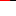

= Export tour

A local figure must survive the trip out of the application:

An https://example.com/reference?q=1#part[external destination], a
<<details,heading destination>>, and link:feature-tour.md[a local document].

A formula: latexmath:[x^2 + y^2 = z^2].

[[details]]
== Details

The diagram and the image must resolve in an ordinary browser.
