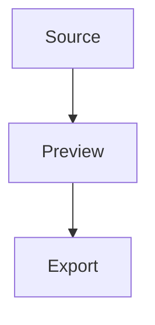

# Export tour

A local figure must survive the trip out of the application:

An [external destination](https://example.com/reference?q=1#part), a
[heading destination](#details), and a [local document](feature-tour.md).

Inline math: $x^2 + y^2 = z^2$.

## Details

The diagram above must print on a light background even when the editor is
dark.

> [!WARNING]
> An alert must keep its coloured rule and tint after export.
