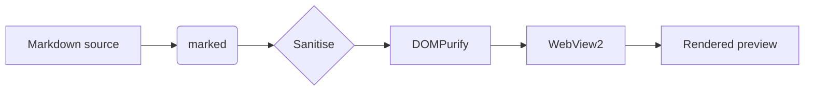
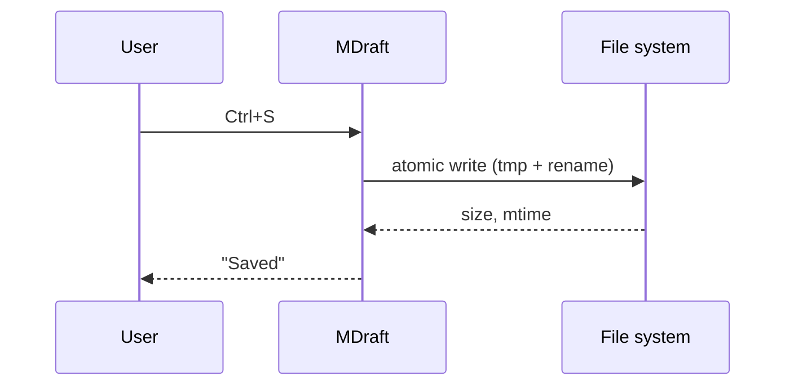

# MDraft — feature tour

Open this file in the app (`Ctrl+O`) to exercise every part of the rendering
pipeline at once. It is also what `scripts/dom-smoke.mjs` asserts against.

[TOC]

## Text

Regular text, **strong**, *emphasis*, ***both***, ~~strikethrough~~, `inline code`,
and a [link to the Tauri project](https://tauri.app). Relative links such as
[the readme](../README.md) open inside the app.

## Lists

- Bullet item
- Second item
  - Nested item
    - Deeper item

1. Ordered
2. Ordered
3. Ordered

- [x] A finished task
- [ ] A pending task

## Table

| Feature | Status | Notes |
| --- | :---: | --- |
| Live preview | yes | 200 ms debounce |
| Math | yes | KaTeX 0.19 |
| Diagrams | yes | Mermaid 12 |
| Syntax highlighting | yes | highlight.js 11 |

## Quote and rule

> Markdown is a plain-text format for writing structured documents.
> It is readable in source form and renders richly.

---

## Alerts

> [!NOTE]
> Useful information that users should know, even when skimming.

> [!TIP]
> A helpful tip for doing things better or more easily.

> [!WARNING]
> Urgent information that needs immediate attention.

---

## Math

Inline math flows with the text: $e^{i\pi} + 1 = 0$, and the quadratic formula
$x = \frac{-b \pm \sqrt{b^2 - 4ac}}{2a}$.

Display math gets its own centred block:

$$
\int_{-\infty}^{\infty} e^{-x^{2}}\,dx = \sqrt{\pi}
$$

Alternative delimiters also work: \(a^2 + b^2 = c^2\) and

\[
\sum_{n=1}^{\infty} \frac{1}{n^2} = \frac{\pi^2}{6}
\]

Math inside a code span is left alone: `$HOME` and `$$not math$$`.

## Diagrams





## Code

```rust
fn main() {
    let greeting = "highlighted by highlight.js";
    println!("{greeting}");
}
```

```javascript
const render = async (markdown) => {
  const html = marked.parse(markdown);
  return DOMPurify.sanitize(html);
};
```

```python
def word_count(text: str) -> int:
    return len(text.split())
```

An indented code block:

    plain indented code
    keeps its formatting

## Line endings

Save this file and compare: the original `CRLF` (or `LF`) ending and any
byte-order mark are preserved, because the editor keeps them out of band and the
Rust side restores them on write.
