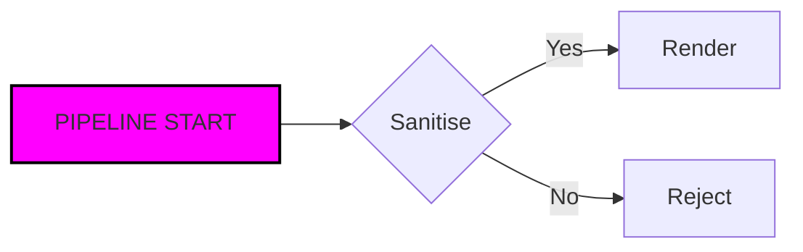

# PDF Quality Fixture

This document exists so a generated PDF can be measured rather than guessed at.
It carries every graphical element the print pipeline is responsible for:
selectable prose, an image with known colours, a ruled table, a code block, a
block quote, KaTeX fractions and radicals, and a Mermaid diagram. The words
`Selectable prose` and `Second page marker` are deliberately unique.


## Quarterly Matrix

| Region | Revenue | Growth | Owner |
| --- | ---: | ---: | --- |
| North | 1,240 | 12% | Ana |
| South | 980 | 8% | Bruno |
| East | 1,510 | 17% | Carla |
| West | 1,105 | 11% | Diego |

## Fraction and radical

Inline mathematics such as $a^2 + b^2 = c^2$ must stay on the baseline. A
display fraction and radical follow:

$$\frac{\sqrt{x^2 + y^2}}{\pi} = \frac{1}{2}$$

A second display formula checks the summation and superscript:

$$\sum_{n=1}^{\infty} \frac{1}{n^2} = \frac{\pi^2}{6}$$

## Code

```rust
fn main() {
    let greeting = "printed with syntax highlighting";
    println!("{greeting}");
}
```

## Diagram



## Quote

> A block quote keeps its left rule and indentation when the same HTML is
> printed, not only when it is previewed.

## Selectable prose

The PDF must contain real text, not a screenshot. A reader should be able to
select this sentence, search for `Second page marker`, and copy the table cell
`Epsilon`. The paragraphs below are intentionally long enough to force a second
page, because multi-page pagination is part of the graphical contract.

The first page exercises the image, the table and the display formulas. The
second page exercises ordinary prose, a second heading and the closing lines.
If a page break cuts a table row in half, strands a heading at the foot of a
page, or leaves a blank final page, the visual harness reports it.

A printed article is judged at reading distance: quiet margins, a comfortable
measure, and every diagram inside the printable area instead of running off the
edge. Those properties are measured on the rasterized pages, not inferred from
the HTML.

The editor may be dark, but the PDF should be light, with diagrams drawn for
paper rather than for a screen. A dark Mermaid diagram on a white page is a
defect even when the SVG is technically present.

The fixture also checks that code keeps a monospaced face and that inline code
does not collapse into the surrounding prose. A missing font is visible as a
fallback with the wrong width, and the embedded-font check catches it even when
the page looks plausible at a glance.

## Second page marker

This paragraph belongs to the second page. It is ordinary prose with **bold**,
*italic*, `inline code`, and a [link](https://example.com). Its purpose is to
prove that text remains selectable after pagination and that the page contains
real ink rather than an empty sheet with a header.
